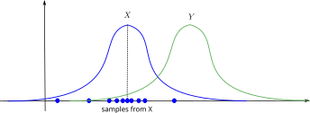
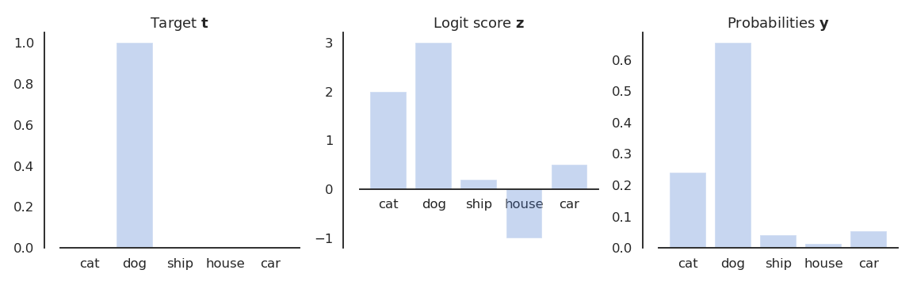
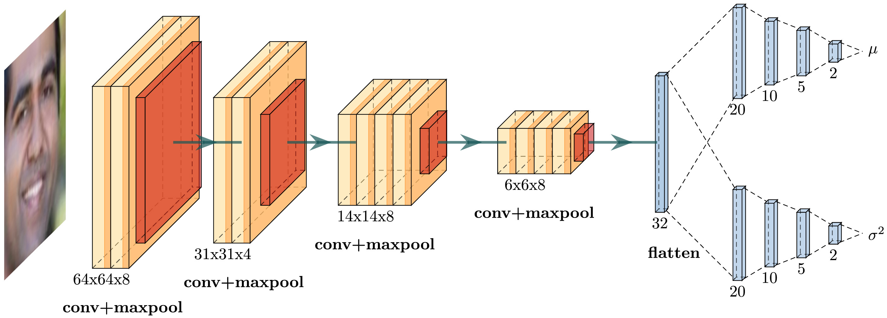
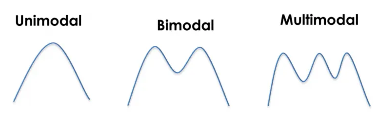
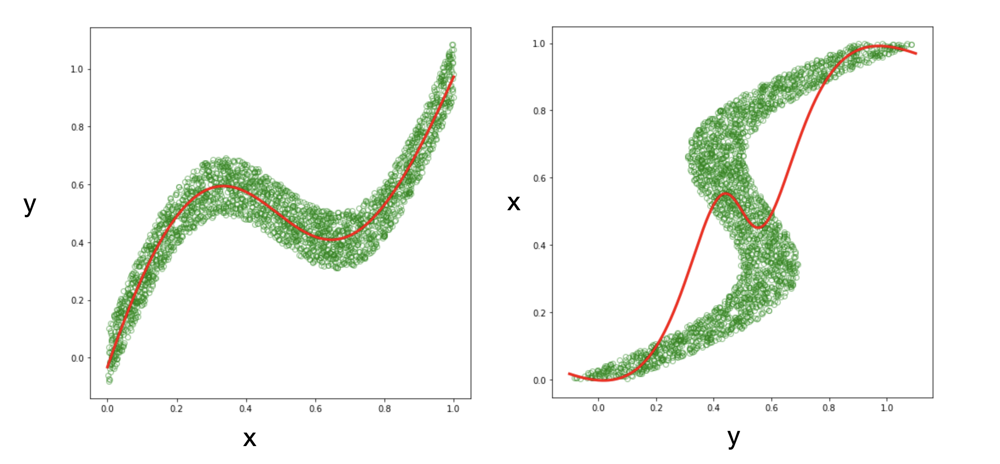
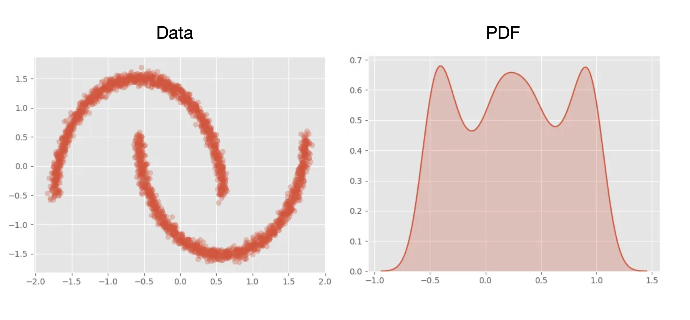
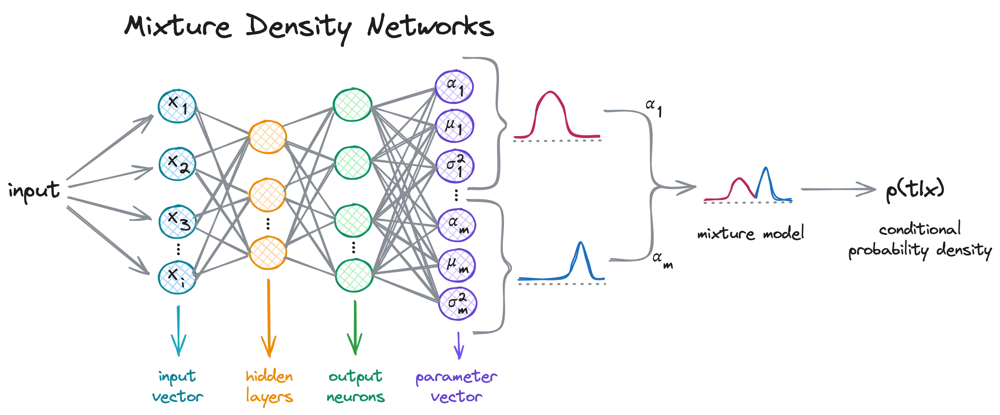
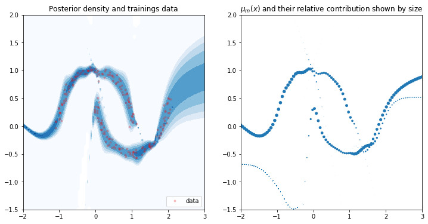
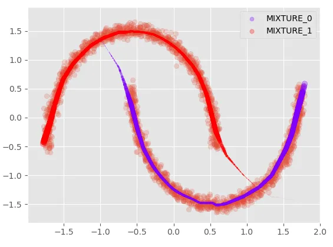

# Statistical machine learning {#sec-statisticalml}

## Three paradigms

We can think of three main paradigms in machine learning.

### Discriminative learning (supervised learning, classification, regression)

In discriminative learning, we try to model a **conditional probability** mapping a probability distribution $X$ into a probability distribution $Y$:

$$
    x \sim X, y\sim Y: p(y | x)
$$

We create a neural network $p_\theta(y | x)$ whose goal is to approximate the data distribution by taking an input $x$ and returning a parameterization of the distribution of $y$.

```{mermaid}
flowchart LR
    x --> f --> y
    x(("<i>x</i>"))
    f["<i>f</i><sub>θ</sub>"]
    y(("<i>p</i><sub>θ</sub>(<i>y</i> | <i>x</i>)"))
```

If $Y$ is a **discrete** (categorical) distribution, we are doing a **classification**. We just need to model $Y$ using a Gibbs / Boltzmann distribution (i.e. a softmax layer) and we are good.

If $Y$ is **continuous** and Gaussian, but we only care about its expectation ($\mathbb{E}[Y|X]$), we are performing **regression**. If we also want its variance, it is Bayesian regression.

If $Y$ is **continuous** and we want its distribution (of an unknown family) for uncertainty estimation, we need to use mixtures of Gaussians like in **Mixture Density Networks** (MDN, see @sec-mdn).

### Generative modeling (unsupervised learning)

In unsupervised learning, we only get samples $x$ of an unknown distribution $X$:

$$
    x \sim X: p(x)
$$

In **density estimation**, we want to train a neural network to predict the **likelihood** of a sample $x$.

```{mermaid}
flowchart LR
    x --> f --> y
    x(("<i>x</i>"))
    f["<i>f</i><sub>θ</sub>"]
    y(("<i>p</i><sub>θ</sub>(<i>x</i>)"))
```

This is vanilla **maximum likelihood estimation** (MLE, @sec-mle). This can be useful for **anomaly detection**: if the predicted likelihood of a new sample is below a threshold, it might be an anomaly.

**Generative modeling** is quite different. We want to generate a **new sample** from the data distribution (e.g. generate new images of cats). In most methods we want to learn a mapping between a simple known distribution (typically the standard normal distribution) and the data distribution. A sample $z$ from the "latent" prior distribution should be transformed into a sample $x$ of the (approximated) data distribution.

```{mermaid}
flowchart LR
    x --> f --> y
    x(("<i>z</i> ~ 𝒩(0, 1)"))
    f["<i>f</i><sub>θ</sub>"]
    y(("<i>x</i> ~ <i>p</i><sub>θ</sub>(<i>x</i>)"))
```

This is what the decoder of a VAE (variational inference, @sec-variationalinference), the generator of a GAN, or a diffusion model does.

### Autoregressive modeling (self-supervised learning)

Finally, autoregressive models predict part of the sample based on the rest. For temporal sequences, it is often **next item prediction**:

$$
    p(x_{t+1} | x_t, x_{t-1}, \ldots, x_0)
$$

Transformers for language modeling learn the **categorical probability distribution** of the next token (classification over thousands of vocabulary tokens) given the history (aka prompt).

```{mermaid}
flowchart LR
    x --> f --> y
    x(("<i>x</i><sub>0</sub>, …, <i>x</i><sub>t-1</sub>, <i>x</i><sub>t</sub>"))
    f["LLM"]
    y(("<i>x</i><sub>t+1</sub>"))
```

There also exist autoregressive vision models, where the next pixel is predicted depending on the others (PixelCNN).

Masked learning (predict part of the sample given the rest) somehow fits in this category.

### Summary

In virtually all machine learning paradigms, we learn a parameterized probability distribution $p_\theta(x)$ (whatever the meaning of $x$) and want to make it close to the data distribution $p(x)$.

The only way to do that is to minimize the KL divergence between the two distributions:

$$
    \theta^* = \text{argmin}_\theta \; \text{KL}(p(x) || p_\theta(x))
$$

However, we generally do not know the explicit form of $p(x)$: we only have access to samples $x_i$ from which we need to approximate the KL.

## Kullback-Leibler divergence in machine learning

Let us now look at maximum likelihood estimation / KL minimization from the information theory point of view.

The definition of the KL divergence (@sec-kl) relies on the mathematical expectation of the negative log-likelihood of the outcomes of $X$:

$$
    \text{KL}(X ||Y) = \mathbb{E}_{x \sim X}[- \log \dfrac{P(Y=x)}{P(X=x)}]
$$

There are basically two ways to compute the KL, one relying on closed analytical forms, the other on sampling.

### Closed form of the KL divergence for normal distributions {#sec-klnormal}

The first method is possible when both distributions are normal distributions. Let us suppose that $X$ and $Y$ are both univariate normal distributions:

$$
    X = \mathcal{N}(\mu_x, \sigma_x) \qquad\qquad\qquad Y = \mathcal{N}(\mu_y, \sigma_y)
$$

:::{.callout-tip icon="false"}
## KL for multivariate normal distributions

For multivariate normal distributions, see <https://mr-easy.github.io/2020-04-16-kl-divergence-between-2-gaussian-distributions/>. The formula looks the same, but with vectors and matrices.
:::

We can use the known pdf of normal distributions to get the KL:

$$
\begin{aligned}
\text{KL}(X ||Y) &= \mathbb{E}_{x \sim X}[- \log \dfrac{P(Y=x)}{P(X=x)}] \\
&= \mathbb{E}_{x \sim X}[- \log \dfrac{p(x; \mu_y, \sigma_y)}{p(x; \mu_x, \sigma_x)}] \\
&= \mathbb{E}_{x \sim X}[ \log p(x; \mu_x, \sigma_x) - \log p(x; \mu_y, \sigma_y)] \\
\end{aligned}
$$

As:

$$
    p(x ; \mu, \sigma) = \frac{1}{\sqrt{2 \pi \sigma^2}} \, \exp{- \dfrac{(x - \mu)^2}{2 \, \sigma^2}}
$$

the log-likelihood of a normal distribution is:

$$
\begin{aligned}
\log p(x ; \mu, \sigma) &= \log [\frac{1}{\sqrt{2 \pi \sigma^2}} \, \exp{- \dfrac{(x - \mu)^2}{2 \, \sigma^2}}] \\
&= -\dfrac{1}{2} \log 2 \pi \sigma^2 - \dfrac{(x - \mu)^2}{2 \, \sigma^2}\\
&= - \dfrac{1}{2} [ \log 2 \pi + 2 \, \log \sigma + \dfrac{(x - \mu)^2}{\sigma^2} ]\\
\end{aligned}
$$

This gives for the KL:

$$
\begin{aligned}
\text{KL}(X ||Y) &= \mathbb{E}_{x \sim X}[ \log p(x; \mu_x, \sigma_x) - \log p(x; \mu_y, \sigma_y)] \\
&= \mathbb{E}_{x \sim X}[\dfrac{1}{2} \, [2 \, \log \sigma_y + \dfrac{(x - \mu_y)^2}{\sigma_y^2} - 2 \, \log \sigma_x - \dfrac{(x - \mu_x)^2}{\sigma_x^2}]]\\
&= \mathbb{E}_{x \sim X} [\log \dfrac{\sigma_y}{\sigma_x} + \dfrac{(x - \mu_y)^2}{2 \sigma_y^2} - \dfrac{(x - \mu_x)^2}{2 \sigma_x^2}]\\
&= \log \dfrac{\sigma_y}{\sigma_x} + \dfrac{1}{2 \sigma_y^2} \, \mathbb{E}_{x \sim X} [(x - \mu_y)^2] - \dfrac{1}{2 \sigma_x^2} \, \mathbb{E}_{x \sim X} [(x - \mu_x)^2]\\
\end{aligned}
$$

By definition of the variance, we have:

$$
    \sigma_x^2 = \mathbb{E}_{x \sim X} [(x - \mu_x)^2]
$$

Moreover, as $\mathbb{E}_{x \sim X} [x - \mu_x] = 0$:

$$
\begin{aligned}
\mathbb{E}_{x \sim X} [(x - \mu_y)^2] &= \mathbb{E}_{x \sim X} [(x - \mu_x + \mu_x - \mu_y)^2]\\
&= \mathbb{E}_{x \sim X} [(x - \mu_x)^2] + 2 \, \mathbb{E}_{x \sim X} [(x - \mu_x) \, (\mu_x - \mu_y)] + \mathbb{E}_{x \sim X} [(\mu_x - \mu_y)^2] \\
&= \sigma_x^2 + (\mu_x - \mu_y)^2 \\
\end{aligned}
$$

which gives:

$$
\begin{aligned}
\text{KL}(X ||Y) &= \log \dfrac{\sigma_y}{\sigma_x} + \dfrac{1}{2 \sigma_y^2} \, \mathbb{E}_{x \sim X} [(x - \mu_y)^2] - \dfrac{1}{2 \sigma_x^2} \, \mathbb{E}_{x \sim X} [(x - \mu_x)^2]\\
&= \log \dfrac{\sigma_y}{\sigma_x} + \dfrac{\sigma_x^2 + (\mu_x - \mu_y)^2}{2 \sigma_y^2} - \dfrac{\sigma_x^2}{2 \sigma_x^2} \\
\end{aligned}
$$

:::{.callout-note icon="false"}
## Closed form of the KL divergence between two Gaussians

The closed form of the KL divergence between $X = \mathcal{N}(\mu_x, \sigma_x)$ and $Y=\mathcal{N}(\mu_y, \sigma_y)$ is simply a function of their parameters:

$$
    \text{KL}(X ||Y) = \log \dfrac{\sigma_y}{\sigma_x} + \dfrac{\sigma_x^2 + (\mu_x - \mu_y)^2}{2 \sigma_y^2} - \dfrac{1}{2}
$$
:::

We can check that when $\mu_x = \mu_y$ and $\sigma_x = \sigma_y$, the KL is zero.

When $Y$ is the standard normal distribution $\mathcal{N}(0, 1)$, we have:

$$
    \text{KL}(X || \mathcal{N}(0, 1)) = \dfrac{1}{2} [\sigma_x^2 + \mu_x^2 - 1 - \log \sigma_x^2]
$$

### Monte Carlo sampling

When we do not have access to the analytical form of the pdf of the distribution (or when the math becomes too complex), the only way to estimate the KL divergence between two distributions is through **Monte Carlo sampling**. To estimate the expectation of a quantity using a random variable, one can take **enough** samples (according to the central limit theorem) from the random variable and compute the **sampling average** of that quantity over the samples.

$$
    \mathbb{E}_{x \sim X} [f(X)] \approx \dfrac{1}{N} \, \sum_{i=1}^N f(x_i)
$$

Applied to the KL divergence, this gives us:

$$
    \text{KL}(X ||Y) = \mathbb{E}_{x \sim X}[- \log \dfrac{P(Y=x)}{P(X=x)}] \approx \dfrac{1}{N} \, \sum_{i=1}^N - \log \dfrac{P(Y=x_i)}{P(X=x_i)}
$$

If you want to estimate the KL between two distributions $X$ and $Y$, take enough samples from $X$ and average the logarithm of the ratio of the likelihoods.

{#fig-klsampling width=60%}

### Equivalence between KL and cross-entropy

Let's now consider that the samples $X = \{x_i\}_{i=1}^N$ come from some unknown distribution $p$ (the data), while $Y$ comes from a parameterized family of probability distributions $p_\theta(x)$ with parameters $\theta$ (the model). The KL divergence is expressed as:

$$
\begin{aligned}
\text{KL}(p || p_\theta) & = \mathbb{E}_{x \sim p(x)}[- \log \dfrac{p_\theta(x)}{p(x)}] \\
& = \mathbb{E}_{x \sim p(x)}[- \log p_\theta(x)] - \mathbb{E}_{x \sim p(x)}[- \log p(x)] \\
& = H(p(x), p_\theta(x)) - H(p(x)) \\
\end{aligned}
$$

The KL between the data and the model is the difference between their cross-entropy and the entropy of the data.

If we want the model $p_\theta$ to explain the data $\{x_i\}_{i=1}^N$ sampled from $p$, we want the KL divergence between $p_\theta$ and $p$ to be zero, as both distributions would then be the same. In other terms, we search for a value of $\theta$ where the KL divergence between the model and the data is **minimal**: the KL is always positive, so its minimum is 0.

$$
    \theta^* = \text{argmin}_\theta \, \text{KL}(p(x) || p_\theta(x))
$$

Minimizing the KL with respect to $\theta$ requires access to its **gradient**, i.e. the partial derivatives of the KL divergence with respect to each parameter. Gradient descent can for example be used to iteratively update the parameters in the opposite direction to this gradient:

$$
    \Delta \theta = - \eta \, \nabla_\theta \, \text{KL}(p(x) || p_\theta(x))
$$

Let us have a look at this gradient:

$$
    \nabla_\theta \, \text{KL}(p(x) || p_\theta(x)) = \nabla_\theta \, H(p(x), p_\theta(x)) - \nabla_\theta \, H(p(x))
$$

The gradient of the KL is the gradient of the cross-entropy minus the gradient of the entropy of the data. However, the data distribution $p(x)$ does not depend on the parameters $\theta$ of the model, so the gradient of the entropy of the data is zero:

$$
    \nabla_\theta \, H(p(x)) = 0
$$

This means that the gradient of the KL is the same as the gradient of the cross-entropy:

$$
    \nabla_\theta \, \text{KL}(p(x) || p_\theta(x)) = \nabla_\theta \, H(p(x), p_\theta(x))
$$

**Minimizing the KL divergence between a model and the data is the same as minimizing their cross-entropy!**

The KL divergence and the cross-entropy only differ by a constant term, the entropy of the data, which does not depend on the model. The value of $\theta$ that minimizes one also minimizes the other.

Let us now estimate the cross-entropy:

$$
    H(p(x), p_\theta(x)) = \mathbb{E}_{x \sim p(x)}[- \log p_\theta(x)]
$$

Using $N$ samples $\{x_i\}_{i=1}^N$ from the data, we can approximate it with:

$$
    H(p(x), p_\theta(x)) \approx \dfrac{1}{N} \, \sum_{i=1}^N - \log p_\theta(x_i) = - \dfrac{1}{N} \, l(\theta)
$$

where $l(\theta) = \sum_{i=1}^N \log p_\theta(x_i)$ is the log-likelihood of the model on the data that we introduced in **maximum likelihood estimation** (@sec-mle). Maximizing the log-likelihood minimizes the cross-entropy and therefore the KL divergence.

This means that MLE is strictly equivalent to minimizing the KL divergence (or cross-entropy) between the model $p_\theta$ and the distribution of the data $p$!

$$
    \theta_\text{MLE} = \text{argmax}_\theta \, l(\theta) = \text{argmin}_\theta \, H(p(x), p_\theta(x)) = \text{argmin}_\theta \, \text{KL}(p(x) || p_\theta(x))
$$

Any machine learning model with a probabilistic interpretation that tries to fit a parameterized model to some data is implicitly minimizing the KL divergence between the two distributions.

Depending on the assumption about the underlying distribution, we can use the following neural network architectures:

* Discrete / categorical / multinoulli distribution: softmax classifier.
* Continuous distribution: mixture density network [MDN, @Bishop1994] or Gaussian Process regression (GPR, but it is a nonparametric kernel-based probabilistic model, not a neural network).

## Softmax classifier for discrete distributions {#sec-softmax}

In machine learning, classification consists in learning a mapping between input vectors $\mathbf{x}$ and a finite number of classes $\mathbf{t}$ for some unknown conditional data distribution $p(\mathbf{t} | \mathbf{x})$. The training data is a set of tuples $\{\mathbf{x}_i, t_i\}_{i=1}^N$ sampled from $p$, where the values $t_i$ are called labels, targets or ground truth, and represent the class of each sample.

In object recognition, the input vectors are the pixels of particular images, and the targets are the name of the object represented in each image (or their index).

In multi-class classification, the target is usually represented by a **one-hot encoded vector** $\mathbf{t}$ consisting of mostly zeros, except a one at a location corresponding to the class.

For example, if you have five classes (cat, dog, ship, house, car), an image $\mathbf{x}$ of a dog would be associated with the following ground truth vector:

$$
    \mathbf{t} = [\text{cat}, \text{dog}, \text{ship}, \text{house}, \text{car}] = [0, 1, 0, 0, 0]
$$

The target vectors of the training set can be seen as being samples of a **conditional probability distribution** $p(\mathbf{t} | \mathbf{x})$, in this case a discrete **multinomial** (or multinoulli) distribution (a die with one side per class). For a given image $\mathbf{x}$, the conditional probabilities are defined by the one-hot encoded vector $\mathbf{t}$:

$$
    p(\mathbf{t} | \mathbf{x}) = [p(\text{cat}| \mathbf{x}), p(\text{dog}| \mathbf{x}), p(\text{ship}| \mathbf{x}), p(\text{house}| \mathbf{x}), p(\text{car}| \mathbf{x})] = [0, 1, 0, 0, 0]
$$

Each image $\mathbf{x}$ has different probabilities of belonging to one class or another. Note that the use of one-hot encoded targets is a special case: the ground truth could have non-binary conditional probabilities.

A **softmax classifier** is a parametric function approximator $p_\theta(\mathbf{y} | \mathbf{x})$ that outputs a conditional probability distribution through the vector $\mathbf{y}$, in the form of a multinomial distribution:

$$
    p_\theta(\mathbf{y} | \mathbf{x}) = [p_\theta(\text{cat}| \mathbf{x}), p_\theta(\text{dog}| \mathbf{x}), p_\theta(\text{ship}| \mathbf{x}), p_\theta(\text{house}| \mathbf{x}), p_\theta(\text{car}| \mathbf{x})]
$$

To make sure that the vector $\mathbf{y}$ indeed characterizes a probability distribution over the classes, its elements must be positive and sum to one. A classical choice is the softmax function, creating the vector $\mathbf{y}$ from the **logit score** $\mathbf{z}$. Their elements are related by:

$$
    \mathbf{y} = [y_i]_i = \mathcal{S}(\textbf{z}) = [\dfrac{e^{z_i}}{\sum_j e^{z_j}}]_i
$$

The use of the exponential makes sure that the elements are positive, and the denominator makes sure that they sum to one. The logit score vector can be anything, for example the output of a neural network with parameters $\theta$ taking $\mathbf{x}$ as an input:

$$
    \mathbf{z} = F_\theta(\mathbf{x})
$$

Using the softmax function makes sure that, for an input $\mathbf{x}$, the vectors $\mathbf{t}$ and $\mathbf{y}$ both represent a multinomial probability distribution, and that they can be compared with each other.

{#fig-softmax width=70%}

Now that we have two multinomial probability distributions, one $p(\mathbf{t} | \mathbf{x})$ representing the data, the other $p_\theta(\mathbf{y} | \mathbf{x})$ representing the parameterized model, we can try to find the value of $\theta$ that minimizes the statistical distance between the two distributions. As before, minimizing the KL divergence between the two is the same as minimizing their cross-entropy.

The cross-entropy loss function to minimize is expressed as:

$$
    \mathcal{L}(\theta) = \mathbb{E}_{\mathbf{x}, \mathbf{t} \sim p(\mathbf{t} | \mathbf{x})} [- \log p_\theta(\mathbf{t} | \mathbf{x})]
$$

What does $- \log p_\theta(\mathbf{t} | \mathbf{x})$ mean for a single sample? It denotes the negative log-likelihood that the model with parameters $\theta$ explains the target vector $\mathbf{t}$ for an input $\mathbf{x}$.

Let's suppose that the input image $\mathbf{x}$ is a dog ($\mathbf{t} = [0, 1, 0, 0, 0]$). This negative log-likelihood is defined by the predicted probability $p_\theta(\text{dog}| \mathbf{x})$, i.e. the second element of the vector $\mathbf{y}$. As $\mathbf{t} = [0, 1, 0, 0, 0]$ is a one-hot encoded vector, the log-likelihood could also be written as the dot product between $\mathbf{t}$ and $\log \, \mathbf{y}$:

$$
    - \log \, p_\theta(\mathbf{t} | \mathbf{x}) = - \log \, p_\theta(\text{dog}| \mathbf{x})
    = - \begin{bmatrix} 0 & 1 & 0 & 0 & 0 \\ \end{bmatrix} \times \begin{bmatrix} \log \, p_\theta(\text{cat}| \mathbf{x}) \\ \log \, p_\theta(\text{dog}| \mathbf{x}) \\ \log \, p_\theta(\text{ship}| \mathbf{x}) \\ \log \, p_\theta(\text{house}| \mathbf{x})\\ \log \, p_\theta(\text{car}| \mathbf{x}) \\ \end{bmatrix}
    = - \mathbf{t} \cdot \log \, \mathbf{y}
$$

The cross-entropy loss function can therefore be expressed as:

$$
    \mathcal{L}(\theta) = \mathbb{E}_{\mathbf{x}, \mathbf{t} \sim p(\mathbf{t} | \mathbf{x})} [- \mathbf{t} \cdot \log \, \mathbf{y}]
$$

To estimate this loss function, we only have to sample $N$ tuples $(\mathbf{x}_i, \mathbf{t}_i)$ from the data distribution and approximate it with a sampling average:

$$
    \mathcal{L}(\theta) \approx \dfrac{1}{N} \sum_{i=1}^N - \mathbf{t}_i \cdot \log \, \mathbf{y}_i
$$

When the model is a softmax over parameterized logit scores:

$$
    \mathbf{y} = \mathcal{S}(\mathbf{z}) = \mathcal{S}( F_\theta(\mathbf{x}) )
$$

the gradient of the individual loss function $l(\theta) = - \mathbf{t} \cdot \log \, \mathbf{y}$ with respect to the logit scores is extremely simple:

$$
    \dfrac{\partial l(\theta)}{\partial \mathbf{z}} = - (\mathbf{t} - \mathbf{y})
$$

:::{.callout-note icon="false" collapse="true"}
## Proof

When differentiating a softmax probability $y_j = \dfrac{\exp(z_j)}{\sum_k \exp(z_k)}$ w.r.t a logit score $z_i$, i.e. $\dfrac{\partial y_j}{\partial z_i}$, we need to consider two cases:

* If $i=j$, $\exp(z_i)$ appears both at the numerator and denominator of $\dfrac{\exp(z_i)}{\sum_k \exp(z_k)}$. The product rule $(f\times g)' = f'\, g + f \, g'$ gives us:

$$
\begin{aligned}
\dfrac{\partial y_i}{\partial z_i} &= \dfrac{\exp(z_i)}{\sum_k \exp(z_k)} + \exp(z_i) \, \dfrac{- \exp(z_i)}{(\sum_k \exp(z_k))^2} \\
&= \dfrac{\exp(z_i) \, \sum_k \exp(z_k) - \exp(z_i)^2}{(\sum_k \exp(z_k))^2} \\
&= \dfrac{\exp(z_i)}{\sum_k \exp(z_k)} \, (1- \dfrac{\exp(z_i)}{\sum_k \exp(z_k)})\\
&= y_i \, (1 - y_i)\\
\end{aligned}
$$

This is similar to the derivative of the logistic function.

* If $i \neq j$, $z_i$ only appears at the denominator, so we only need the chain rule:

$$
\begin{aligned}
\dfrac{\partial y_j}{\partial z_i} &= - \exp(z_j) \, \dfrac{\exp(z_i)}{(\sum_k \exp(z_k))^2} \\
&= - \dfrac{\exp(z_i)}{\sum_k \exp(z_k)} \, \dfrac{\exp(z_j)}{\sum_k \exp(z_k)} \\
&= - y_i \, y_j \\
\end{aligned}
$$

This allows us to differentiate the cross-entropy:

$$
\begin{aligned}
\frac{\partial {l}(\theta)}{\partial z_i} & = - \sum_j \frac{\partial}{\partial z_i} t_j \log(y_j)=
- \sum_j t_j \frac{\partial \log(y_j)}{\partial z_i} = - \sum_j t_j \frac{1}{y_j} \frac{\partial y_j}{\partial z_i} \\
& = - \frac{t_i}{y_i} \frac{\partial y_i}{\partial z_i} - \sum_{j \neq i} \frac{t_j}{y_j} \frac{\partial y_j}{\partial z_i}
= - \frac{t_i}{y_i} y_i (1-y_i) - \sum_{j \neq i} \frac{t_j}{y_j} (-y_j \, y_i) \\
& = - t_i + t_i \, y_i + \sum_{j \neq i} t_j \, y_i = - t_i + \sum_{j} t_j y_i
= -t_i + y_i \sum_{j} t_j \\
& = - (t_i - y_i)
\end{aligned}
$$

as the targets sum to one.
:::

Put together, the gradient of the cross-entropy loss function is:

$$
    \nabla_\theta \, \mathcal{L}(\theta) = \mathbb{E}_{\mathbf{x}, \mathbf{t} \sim p(\mathbf{t} | \mathbf{x})} [ - (\mathbf{t} - \mathbf{y} ) \times \nabla_\theta \, F_\theta(\mathbf{x})]
$$

The function approximator $\mathbf{z} = F_\theta(\mathbf{x})$ can be anything (neural network, etc.): we know how to apply gradient descent / backpropagation to minimize the KL divergence / cross-entropy between the data and the model!

## Mixture density networks for continuous distributions {#sec-mdn}

See <https://medium.com/towards-data-science/predicting-the-unpredictable-905f634acc20> for an explanation with code.

### Mean-variance estimation (MVE)

The easiest case is when we can assume that the data comes from a normal distribution. All we need to predict is then the mean and the variance of the distribution. This is logically called **mean-variance estimation** [MVE, @Nix1994].

As for the softmax classifier, the training data is a set of tuples $\{\mathbf{x}_i, \mathbf{t}_i\}_{i=1}^N$ sampled from the conditional probability distribution $p(\mathbf{t} | \mathbf{x})$, but the outputs $\mathbf{t}_i$ are regular vectors of size $d_o$, not classes.

Let's make the assumption that the underlying distribution is a **multivariate normal distribution**, with a mean vector $\mu(\mathbf{x})$ and standard deviation vector $\sigma(\mathbf{x})$ that depend on the input $\mathbf{x}$:

$$
    p(\mathbf{t} | \mathbf{x}) = \mathcal{N}(\mu(\mathbf{x}), \sigma(\mathbf{x}) \cdot I)
$$

It is easy to generalize to anisotropic normal distributions with a full covariance matrix $\Sigma(\mathbf{x})$, but let's keep the math simple here.

Our model will be a parameterized distribution $p_\theta(\mathbf{t} | \mathbf{x})$, which we can safely consider as a normal distribution too:

$$
    p_\theta (\mathbf{t} | \mathbf{x}) = \mathcal{N}(\mu_\theta(\mathbf{x}), \sigma_\theta(\mathbf{x}) \cdot I)
$$

The model is fully parameterized by the two vectors $\mu_\theta(\mathbf{x})$ and $\sigma_\theta(\mathbf{x})$. All we need is a function approximator (aka neural network) taking $\mathbf{x}$ as an input and returning the two vectors.

$$
    \mu_\theta, \sigma_\theta = F_\theta (\mathbf{x})
$$

{#fig-mve width=70%}

If we knew the original parameters $\mu(\mathbf{x})$ and $\sigma(\mathbf{x})$ of the data distribution, we would only need to minimize the KL (@sec-klnormal):

$$
    \text{KL}(p ||p_\theta) = \log \dfrac{\sigma_\theta}{\sigma} + \dfrac{\sigma^2 + (\mu - \mu_\theta)^2}{2 \sigma_\theta^2} - \dfrac{1}{2}
$$

As a side note, if we only care about the mean of the data (i.e. consider $\sigma_\theta$ constant), the KL becomes proportional to:

$$
    \text{KL}(p ||p_\theta) \sim (\mu - \mu_\theta)^2
$$

i.e. the squared difference between the mean prediction $\mu_\theta$ and the mean of the data. Pretty close to the mse... Standard regression is just a sub-case of MVE where we do not care about the variance.

Anyway, we do not have access to the parameters of the data. All we can do is maximize the likelihood of our model on samples taken from the data distribution. It is the same as minimizing the negative log-likelihood:

$$
    \mathcal{L}(\theta) = \mathbb{E}_{\mathbf{x}, \mathbf{t} \sim p(\mathbf{t} | \mathbf{x})} [- \log p_\theta(\mathbf{t} | \mathbf{x})] \approx \dfrac{1}{N} \, \sum_{i=1}^N - \log p_\theta(\mathbf{t}_i | \mathbf{x}_i)
$$

The NLL of a sample $(\mathbf{x}_i, \mathbf{t}_i)$ is by definition of the normal distribution:

$$
    - \log p_\theta(\mathbf{t}_i | \mathbf{x}_i) = \dfrac{1}{2} [ \log 2 \pi + 2 \, \log \sigma_\theta(\mathbf{x}_i) + \dfrac{(\mathbf{t}_i - \mu_\theta(\mathbf{x}_i))^2}{\sigma_\theta(\mathbf{x}_i)^2}]
$$

The loss function is a fully differentiable function of the parameters $\theta$: we can apply **gradient descent** (aka backpropagation) without any problem! Even if $\mu_\theta(\mathbf{x})$ and $\sigma_\theta(\mathbf{x})$ were the output of two different neural networks, we could train them in parallel by providing them the same loss function.

### Mixture density networks

MVE is nice and all, as it allows to learn both the mean and variance of the data during regression, but it assumes that the data is normal, i.e. unimodal. In real life, interesting probability distributions are multimodal, which means that the pdf has more than one local maximum.

{#fig-multimodal width=70%}

In <https://github.com/dusenberrymw/mixture-density-networks/blob/master/mixture_density_networks.ipynb>, they take a nice example to understand why it is important. As seen on the left of @fig-mdninverse, it is very easy to do a non-linear regression $y = f_\theta(x)$ on this data.

{#fig-mdninverse}

However, learning the inverse model $x = f_\theta(y)$ is not possible for a regular regression algorithm, as the mean of $x$ is not a function of $y$ (one value of $y$ can correspond to two values of $x$). The classical dataset for such a problem is the half-moon data, where the probability density of the y-axis is clearly multimodal:

{#fig-halfmoons}

For multimodal distributions, a **mixture of Gaussians** (as in the Gaussian Mixture Models - GMM - used in clustering) is able to approximate virtually any complex distribution. We just need a basis of $K$ multivariate normal distributions $\mathcal{N}(\mu_k(\mathbf{x}), \sigma_k(\mathbf{x}) \cdot I)$ and weigh them with a **mixing weight** $\alpha_k(\mathbf{x})$:

$$
    p_\theta(\mathbf{t} | \mathbf{x}) = \sum_{k=1}^K \alpha_k(\mathbf{x}) \cdot \mathcal{N}(\mu_k(\mathbf{x}), \sigma_k(\mathbf{x}) \cdot I)
$$

The neural network should output for each component $k$:

* the mean $\mu_k(\mathbf{x})$ of the component,
* the std $\sigma_k(\mathbf{x})$ of the component,
* the weight $\alpha_k(\mathbf{x})$.

A necessary condition is that the weights $\alpha_k(\mathbf{x})$ are positive and sum to 1: $\sum_{k=1}^K \alpha_k(\mathbf{x}) = 1$. A simple method to ensure this is to use a softmax over the corresponding output neurons $z_k$:

$$
    \alpha_k(\mathbf{x}) = \dfrac{e^{z_k}}{\displaystyle\sum_{j=1}^K e^{z_j}}
$$

Similarly, the std must be positive, so we take the exponential of the corresponding output neuron $z^\sigma_k$:

$$
    \sigma_k(\mathbf{x}) = e^{z^\sigma_k}
$$

{#fig-mdn width=70%}

A **mixture density network** is a regular neural network outputting those three vectors for each component $k$. Training is done by maximizing the log-likelihood of the model on data samples, or equivalently by minimizing the loss function:

$$
    \mathcal{L}(\theta) = \dfrac{1}{N} \, \sum_{i=1}^N - \log p_\theta(\mathbf{t}_i | \mathbf{x}_i)  = \dfrac{1}{N} \, \sum_{i=1}^N - \log \sum_{k=1}^K \alpha_k(\mathbf{x}_i) \cdot \mathcal{N}(\mathbf{t}_i; \mu_k(\mathbf{x}_i), \sigma_k(\mathbf{x}_i) \cdot I)
$$

Because of the log of a sum, the loss does not simplify nicely, but it does not matter for pytorch or tensorflow: they can minimize it without a problem. It is straightforward to get the gradient of the loss with respect to $\mu_k(\mathbf{x})$, $\sigma_k(\mathbf{x})$ (as in MVE) and $\alpha_k(\mathbf{x})$, and continue with backpropagation for the weights of the neural network.

After training, how do we use this network? For a given input $\mathbf{x}$, you would only get the value of the probability density function $p_\theta$ of the mixture, which is not very informative unless you can visualize it.

{#fig-mdnposterior}

Getting a sample out of the mixture requires two steps:

1. sample a component $k$ using the softmax mixing weights $\alpha_k(\mathbf{x})$.
2. sample the corresponding normal distribution $\mathcal{N}(\mu_k(\mathbf{x}), \sigma_k(\mathbf{x}) \cdot I)$.

@fig-mdnsampling shows an example with sampling from two components on the half-moons.

{#fig-mdnsampling width=60%}
