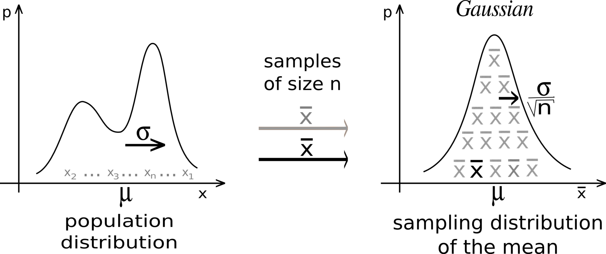

# Bayesian estimation {#sec-bayesian}

## Central limit theorem: frequentist estimation

Suppose we have an unknown distribution $X$ (it does not have to be normal) with expected value $\mu = \mathbb{E}[X]$ and variance $\sigma^2$. We can take randomly $N$ samples from $X$ to compute the sample average:

$$
    S_N = \frac{1}{N} \, \sum_{i=1}^N x_i
$$

The **Central Limit Theorem** (CLT) states that:

> The distribution of sample averages is normally distributed with mean $\mu$ and variance $\frac{\sigma^2}{N}$.

$$
    S_N \sim \mathcal{N}(\mu, \frac{\sigma}{\sqrt{N}})
$$

If we perform the sampling multiple times, even with a few samples, the average of the sampling averages will be very close to the expected value. The more samples we get, the smaller the variance of the estimates. Although the distribution $X$ can be anything, the sampling averages are normally distributed.

{#fig-clt width=70%}

MLE (@sec-mle) is a frequentist estimation method as it only relies on the obtained samples, not on additional knowledge one might have about the underlying distribution. In Bayesian statistics [@Bayes1763], this additional knowledge takes the form of a prior distribution $P(\theta)$ over the parameters $\theta$ of the model.

## Maximum a posteriori (MAP)

*To be written.*
