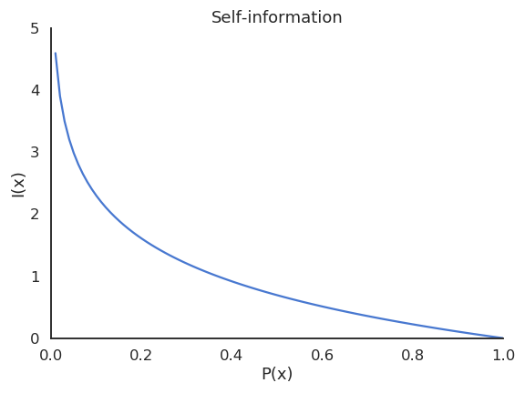
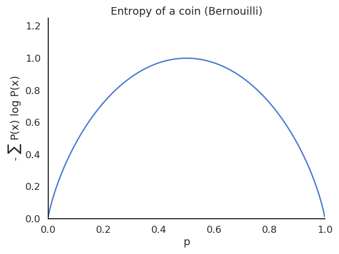
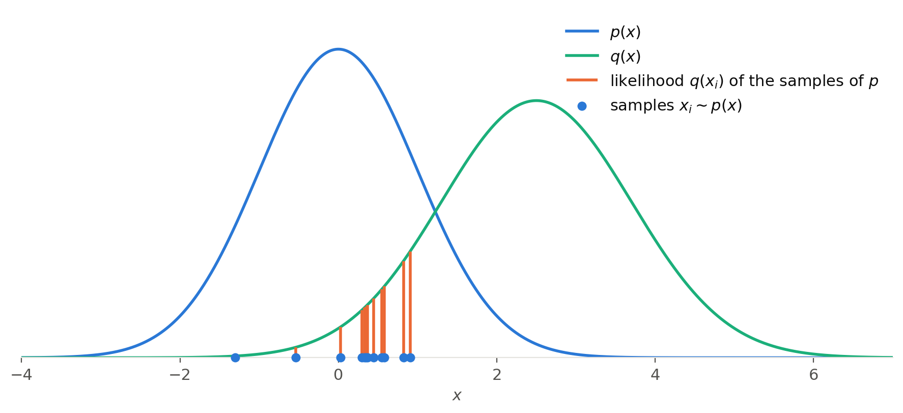

# Information theory {#sec-informationtheory}

## Entropy

Information theory was born from a very practical question. In the 1920s, engineers at Bell Labs wanted to know how fast messages could be sent over telegraph and telephone lines [@Nyquist1924; @Hartley1928]. In 1948, Claude Shannon gave a complete answer, in a paper that founded the field [@Shannon1948]: information can be **measured**, in bits, and this measure tells exactly how much a message can be compressed and how fast it can be transmitted through a noisy channel.

Shannon's key idea is that the information carried by a message has nothing to do with its meaning, only with how **surprising** it is. A message that you could have predicted tells you nothing new. Think of the morning news:

* "The sun rose this morning" is almost certain: it happens every day, and announcing it carries almost no information. It is not newsworthy.
* "The sun did not rise this morning" would be extremely surprising, as it is almost impossible: it would carry a lot of information, and definitely make the news.

This is also why messages can be compressed. In an English text, the letter following a "q" is almost always a "u": transmitting it is a waste, as the receiver could have guessed it. Only the unpredictable parts of a message really need to be transmitted, and the more predictable a source is, the more its messages can be compressed.

Why should machine learning care about telephone lines? Because **predicting and compressing are two sides of the same coin**. A model that predicts the data well assigns them a high probability: it is not surprised by them, and could therefore encode them with few bits. The cross-entropy loss used to train classifiers and language models (@sec-crossentropy) is exactly the average number of bits (or nats) that the model needs to encode the data: training a language model to predict the next word is training it to compress text. The quantities introduced in this chapter, entropy, cross-entropy and the Kullback-Leibler divergence, will be used throughout this book to measure how well a model fits the data.

Formally, the key concept of information theory is the **entropy** of a random variable $X$, whose outcomes $x$ follow the probability distribution $p(x) = P(X = x)$: a probability mass function (pmf) for discrete variables, a probability density function (pdf) for continuous ones. The entropy measures how much information is contained, on average, in the outcomes of $X$. It is built on the information carried by each single outcome.

{#fig-selfinformation width=60%}

A useful measurement of how surprising an outcome $x$ of a random variable $X$ with pdf/pmf $p(x)$ is, is the **self-information**:

$$
    I(x) = - \log P(X = x) = - \log p(x)
$$

When $P(X = x)$ is 1, the self-information is 0, as the result is certain and deterministic: it brings no information. When $P(X = x)$ is close to 0, the self-information is very high, as it is very surprising that $x$ happens.

Depending on which log is used, the self-information has different units, but it is just a rescaling: the base never matters as we are going to compare it to other values.

* $\log_2$: bits or shannons.
* $\log_e = \ln$: nats.

The **entropy** (or Shannon entropy) of a random variable $X$ is the expected value of the self-information of its outcomes:

$$
    H(X) = \mathbb{E}_{x \sim p(x)} [I(x)] = \mathbb{E}_{x \sim p(x)} [- \log p(x)]
$$

The entropy only depends on the distribution $p(x)$ of the random variable, not on the values of its outcomes, so it is also written $H(p)$, the notation we use when comparing two distributions (@sec-crossentropy).

It measures the **uncertainty**, **randomness** or **information content** of the random variable.

In the discrete case, the expectation is defined as a sum over the outcomes, weighted by the probability that they happen:

$$
    H(X) = - \sum_x P(X=x) \, \log P(X=x)
$$

In the continuous case, we need to use an integral to get the **differential entropy** (or continuous entropy):

$$
    H(X) = - \int_x p(x) \, \log p(x) \, dx
$$

:::{.callout-note icon="false" collapse="true"}
## Differential entropy is not quite an entropy

The differential entropy is not an exact equivalent of the discrete entropy:

* It can be **negative**: a density can be larger than 1, so $- \log p(x)$ can be negative. For example, the differential entropy of a normal distribution $\mathcal{N}(\mu, \sigma)$ is $\frac{1}{2} \log (2 \pi e \sigma^2)$, which is negative for small values of $\sigma$.
* It depends on the **units** of $x$: measuring $x$ in millimeters instead of meters multiplies the density by $10^{-3}$, and adds $\log 1000$ to the differential entropy.
* It is not the limit of the discrete entropy when the continuous variable is discretized more and more finely: with bins of width $\Delta$, the discrete entropy is approximately $H(X) - \log \Delta$, which diverges when $\Delta \rightarrow 0$, as describing a real number exactly would require an infinite number of bits.

These problems disappear in the KL divergence (@sec-kl), which compares two distributions: as a difference between a cross-entropy and an entropy, the problematic terms cancel out. The KL divergence between two continuous distributions is always positive or zero, and does not depend on the units, which is one reason why machine learning relies on it. See <https://en.wikipedia.org/wiki/Differential_entropy> for more details.
:::

The entropy of a Bernoulli variable is maximal when both outcomes are **equiprobable**. If a variable is **deterministic** (probability is either 0 or 1), its entropy is minimal and equal to zero.

{#fig-entropybernoulli width=60%}

The entropy has equivalent properties to probabilities, where products are replaced by additions and divisions are replaced by subtractions:

* The **joint entropy** of two random variables $X$ and $Y$ is defined by the joint probability:

$$
    H(X, Y) = \mathbb{E}_{x \sim X, y \sim Y} [- \log P(X=x, Y=y)]
$$

* The **conditional entropy** of two random variables $X$ and $Y$ is defined by:

$$
    H(X | Y) = \mathbb{E}_{x \sim X, y \sim Y} [- \log p(x | y)]  = \mathbb{E}_{x \sim X, y \sim Y} [- \log \frac{p(x , y)}{p(y)}]
$$

which gives, as $\log$ turns divisions into subtractions:

$$
    H(X | Y) = H(X, Y) - H(Y)
$$

* If the variables are **independent**, we have:

$$
    H(X, Y) = H(X) + H(Y)
$$

$$
    H(X | Y) = H(X)
$$

* The equivalent of Bayes' rule is:

$$
    H(Y |X) = H(X |Y) + H(Y) - H(X)
$$

## Mutual information

The most important information measurement between two variables is the **mutual information** MI (or information gain):

$$
    I(X, Y) = H(X) - H(X | Y) = H(Y) - H(Y | X)
$$

It measures how much information the variable $Y$ holds on $X$ (and reciprocally):

* If the two variables are **independent**, the MI is 0: $X$ is as uncertain, whether you know $Y$ or not.

$$
    I (X, Y) = 0
$$

* If the two variables are **dependent**, knowing $Y$ gives you information on $X$, which becomes less random, i.e. less uncertain / surprising or more predictable.

$$
    I (X, Y) > 0
$$

If you can fully predict $X$ when you know $Y$, it becomes deterministic ($H(X|Y)=0$) so the mutual information is maximal ($I(X, Y) = H(X)$).

## Cross-entropy {#sec-crossentropy}

The entropy, joint entropy and mutual information are properties of random variables. The cross-entropy and the KL divergence compare two **probability distributions** $p$ and $q$ defined over the same outcomes $x$. The **cross-entropy** between $p$ and $q$ is defined as:

$$
    H(p, q) = \mathbb{E}_{x \sim p(x)}[- \log q(x)]
$$

It measures the entropy of the outcomes of $p$ for the distribution $q$, i.e. how surprising samples of $p$ are for $q$. If $p$ and $q$ are the same, the cross-entropy is the same as the entropy of $p$. If they are different, the samples of $p$ become surprising for $q$, i.e. they have a low likelihood $q(x)$.

{#fig-crossentropy width=80%}

The cross-entropy is the mathematical expectation of the **negative log-likelihood** that a sample $x$ taken from the distribution $p$ could also come from the distribution $q$. It measures how many bits of information one would need to distinguish the two distributions $p$ and $q$.

* If the two distributions are the same *almost everywhere*, one cannot distinguish samples from the two distributions. The cross-entropy is the same as the entropy of $p$.
* If the two distributions are different, one can tell whether a sample $x$ comes from $p$ or $q$, as it will be unlikely under one of them. The cross-entropy would then be higher than the entropy of $p$.

In layman's terms, the cross-entropy measures the overlap (or distance) between the two distributions: when the distributions are the same, the cross-entropy is minimal; when they are different, it is high.

## Kullback-Leibler divergence {#sec-kl}

In practice, the **Kullback-Leibler (KL) divergence** $\text{KL}(p || q)$ is a better measurement of the similarity (statistical distance) between two probability distributions:

$$
    \text{KL}(p || q) = \mathbb{E}_{x \sim p(x)}[- \log \dfrac{q(x)}{p(x)}]
$$

The KL divergence is linked to the cross-entropy by:

$$
    \text{KL}(p || q) = H(p, q) - H(p)
$$

as:

$$
    \mathbb{E}_{x \sim p(x)}[- \log \dfrac{q(x)}{p(x)}] = \mathbb{E}_{x \sim p(x)}[- \log q(x)] - \mathbb{E}_{x \sim p(x)}[- \log p(x)]
$$

If the two distributions are the same *almost everywhere*, the KL divergence is zero. If the two distributions are different, the KL divergence is positive. Minimizing the KL between two distributions is therefore the same as making the two distributions "equal" or similar.

However, the KL is not a metric (a distance), as it is not symmetric:

$$
    \text{KL}(p || q) \neq \text{KL}(q || p)
$$

The two directions behave very differently when they are minimized, as we will see in @sec-forwardreverse. Other divergences to measure the similarity between two distributions are symmetric, such as the [Jensen-Shannon divergence](https://en.wikipedia.org/wiki/Jensen%E2%80%93Shannon_divergence).

Refer to <https://towardsdatascience.com/entropy-cross-entropy-and-kl-divergence-explained-b09cdae917a> for nice visual explanations of the cross-entropy and KL divergence.
