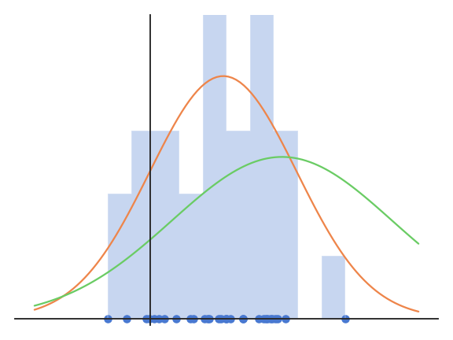

# Maximum likelihood estimation {#sec-mle}

## Principle

Maximum likelihood estimation (MLE) is a statistical method to **estimate** the parameters $\theta$ of a parametric family of probability distributions $p(x; \theta) = p_\theta(x)$ that **best explains** some observed data samples $X = \{x_i\}_{i=1}^N$ coming from an unknown distribution $p(x)$.

The $N$ samples $x_i$ come from some unknown probability distribution $\mathcal{D}$. An important assumption is that the samples are **i.i.d** (independent and identically distributed), i.e. that they all come from the same distribution and are not correlated with each other (the value of one sample does not influence the value taken by the next one).

We then assume a particular parametric family of probability distributions, with a probability density function (pdf) $p_\theta(x)$. For example, the pdf of the family of normal distributions is:

$$
    p(x ; \mu, \sigma) = \frac{1}{\sqrt{2 \pi \sigma^2}} \, \exp{- \frac{(x - \mu)^2}{2 \, \sigma^2}}
$$

where $\mu$ is the mean of the distribution and $\sigma$ its standard deviation. The family of normal distributions is parameterized by $\mu$ and $\sigma$.

{#fig-mlenormalfits width=60%}

The problem is to find the values of $\mu$ and $\sigma$ which best explain the observations $\{x_i\}_{i=1}^N$. Said otherwise: among all possible normal distributions with different values for $\mu$ and $\sigma$, which one is the most likely origin of the samples $\{x_i\}_{i=1}^N$? In @fig-mlenormalfits, the orange normal distribution fits the data better than the green one. But how do we find its parameters?

The idea of MLE is to maximize the joint density function for all observations $p_\theta(X)$, i.e. the joint probability of observing the $N$ samples $x_i$ given the current value of the parameters $\theta$. This function is also called the **likelihood function** $L(\theta; X)$ (or simply $L(\theta)$), i.e. the likelihood that the parameters $\theta$ explain the data $X$:

$$
    L(\theta)  = p_\theta( X) = p_\theta( x_1, x_2, \ldots, x_N)
$$

Note that $p_\theta( X )$ is a joint probability, but $L(\theta)$ is a likelihood: the first is asking about the data, while the second is asking about the parameters.

When the samples are **i.i.d**, the joint probability of observing the $N$ samples $x_i$ is equal to the product of their individual probabilities, as $p(x, y) = p(x) \, p(y)$ when $x$ and $y$ are independent:

$$
    L(\theta) = p_\theta( X ) = \prod_{i=1}^{N} p_\theta(x_i )
$$

Intuitively, this means that when the pdf of the distribution $p_\theta(x_i)$ is high for **all** samples, the samples likely come from that distribution as the likelihood will be high.

This means that if we know the pdf of the family of distributions, we can compute the likelihood function and find its **mode**, i.e. the value of $\theta$ for which the likelihood is maximal:

$$
    \theta_\text{MLE} = \text{argmax}_\theta \, L(\theta)
$$

For mathematical convenience, we can also maximize the **log-likelihood function**:

$$
    l(\theta) = \log L(\theta) = \sum_{i=1}^N \log p_\theta(x_i )
$$

as the log function is monotonically increasing on $\Re^+$ and the likelihood function is positive (product of probabilities).

$$
    \theta_\text{MLE} = \text{argmax}_\theta \, l(\theta) = \text{argmax}_\theta \, \sum_{i=1}^N \log p_\theta(x_i )
$$

In machine learning, it is customary to **minimize** the **negative log-likelihood** (NLL), which is exactly the same thing:

$$
    \theta_\text{MLE} = \text{argmin}_\theta \, \text{NLL}(\theta) = \text{argmin}_\theta \, \sum_{i=1}^N - \log p_\theta(x_i )
$$

Any optimization method can be used, either analytic optimization if we have the analytical form of the pdf, or approximate optimization methods such as gradient descent.

Note that the probability distribution $p(x; \theta_\text{MLE})$ with the best parameters is not equal to the true distribution of the data $\mathcal{D}$: it is only the best approximation we can get using 1) that particular family of distributions (the pdf of $\mathcal{D}$ might not have the Gaussian shape of the normal distribution) and 2) those samples (the more samples, the better).

## MLE for the univariate normal distribution

For the normal distribution, the likelihood function is:

$$
\begin{aligned}
L(\mu, \sigma) & = \prod_{i=1}^{N} p(x_i ; \mu, \sigma ) \\
& = \prod_{i=1}^{N} \frac{1}{\sqrt{2\pi \sigma^2}} \, \exp{- \frac{(x_i - \mu)^2}{2\sigma^2}}\\
& = (\frac{1}{\sqrt{2\pi \sigma^2}})^N \, \prod_{i=1}^{N} \exp{- \frac{(x_i - \mu)^2}{2\sigma^2}}\\
& = (\frac{1}{\sqrt{2\pi \sigma^2}})^N \, \exp{- \frac{\sum_{i=1}^{N}(x_i - \mu)^2}{2\sigma^2}}\\
\end{aligned}
$$

To find the mode of $L(\mu, \sigma)$, we would need to search where its gradient is equal to zero:

$$
\begin{cases}
\dfrac{\partial L(\mu, \sigma)}{\partial \mu} = 0 \\
\dfrac{\partial L(\mu, \sigma)}{\partial \sigma} = 0 \\
\end{cases}
$$

The likelihood function is complex to differentiate because of all the products involved, so we consider instead the log-likelihood function:

$$
\begin{aligned}
l(\mu, \sigma) & = \log L(\mu, \sigma) \\
& = \log \left((\frac{1}{\sqrt{2\pi \sigma^2}})^N \, \exp{- \frac{\sum_{i=1}^{N}(x_i - \mu)^2}{2\sigma^2}} \right)\\
& = - \frac{N}{2} \log (2\pi \sigma^2) - \frac{\sum_{i=1}^{N}(x_i - \mu)^2}{2\sigma^2}\\
\end{aligned}
$$

The advantage of using the log function is that it turns products into sums, and exponentials into linear terms, which is much more differentiation-friendly.

The maximum of the log-likelihood function respects:

$$
\begin{aligned}
\frac{\partial l(\mu, \sigma)}{\partial \mu} & = \frac{\sum_{i=1}^{N}(x_i - \mu)}{\sigma^2} = 0 \\
\frac{\partial l(\mu, \sigma)}{\partial \sigma} & = - \frac{N}{2} \frac{4 \pi \sigma}{2 \pi \sigma^2} + \frac{\sum_{i=1}^{N}(x_i - \mu)^2}{\sigma^3} \\
& = - \frac{N}{\sigma} + \frac{\sum_{i=1}^{N}(x_i - \mu)^2}{\sigma^3} = 0\\
\end{aligned}
$$

By solving these two equations, we obtain:

$$
    \mu = \frac{1}{N} \sum_{i=1}^{N} x_i \qquad\qquad \sigma^2 = \frac{1}{N} \sum_{i=1}^{N}(x_i - \mu)^2
$$

Unsurprisingly, the mean and variance of the normal distribution which best explains the data are the empirical mean and variance of the data... When we summarize data points by their mean and variance only, we implicitly treat them as normally distributed: these two numbers fully describe a normal distribution, but they can be misleading for skewed or multimodal data.

The same principle can be applied to estimate the parameters of any distribution based on samples. The following table gives the MLE estimates for the most common distributions, where $\bar{x} = \frac{1}{N} \sum_{i=1}^N x_i$ denotes the empirical mean of the samples:

| Distribution | pmf / pdf | MLE estimates |
|:---|:---|:---|
| Bernoulli $\mathcal{B}(\rho)$, $x \in \{0, 1\}$ | $\rho^x \, (1 - \rho)^{1-x}$ | $\hat{\rho} = \bar{x}$ (fraction of ones) |
| Categorical, $x \in \{1, \ldots, K\}$ | $\pi_x$ | $\hat{\pi}_k = \frac{N_k}{N}$ (fraction of samples in class $k$) |
| Binomial, $n$ trials, $x \in \{0, \ldots, n\}$ | $\binom{n}{x} \, \rho^x \, (1 - \rho)^{n-x}$ | $\hat{\rho} = \frac{\bar{x}}{n}$ |
| Poisson, $x \in \mathbb{N}$ | $\frac{\lambda^x \, e^{-\lambda}}{x!}$ | $\hat{\lambda} = \bar{x}$ |
| Geometric, $x \in \{1, 2, \ldots\}$ | $(1 - \rho)^{x-1} \, \rho$ | $\hat{\rho} = \frac{1}{\bar{x}}$ |
| Uniform $\mathcal{U}(a, b)$ | $\frac{1}{b - a}$ on $[a, b]$ | $\hat{a} = \min_i x_i$, $\hat{b} = \max_i x_i$ |
| Exponential, $x \geq 0$ | $\lambda \, e^{-\lambda x}$ | $\hat{\lambda} = \frac{1}{\bar{x}}$ |
| Normal $\mathcal{N}(\mu, \sigma)$ | $\frac{1}{\sqrt{2\pi\sigma^2}} \, e^{- \frac{(x - \mu)^2}{2\sigma^2}}$ | $\hat{\mu} = \bar{x}$, $\hat{\sigma}^2 = \frac{1}{N} \sum_i (x_i - \bar{x})^2$ |
| Laplace | $\frac{1}{2b} \, e^{- \frac{\lvert x - \mu \rvert}{b}}$ | $\hat{\mu} = \text{median}(x_i)$, $\hat{b} = \frac{1}{N} \sum_i \lvert x_i - \hat{\mu} \rvert$ |
| Multivariate normal $\mathcal{N}(\mu, \Sigma)$ | $\frac{1}{\sqrt{(2\pi)^d \det \Sigma}} \, e^{- \frac{1}{2} (x - \mu)^T \Sigma^{-1} (x - \mu)}$ | $\hat{\mu} = \bar{x}$, $\hat{\Sigma} = \frac{1}{N} \sum_i (x_i - \bar{x}) (x_i - \bar{x})^T$ |

The empirical mean appears in many of these estimates, not only for the normal distribution. Other distributions, such as the gamma or beta distributions, have no closed-form MLE: the log-likelihood has to be maximized numerically, for example with gradient ascent.

Maximum likelihood estimation is a good method when 1) the number of samples is big enough (central limit theorem, see @sec-bayesian) and 2) we do not care about the uncertainty of our estimator.
