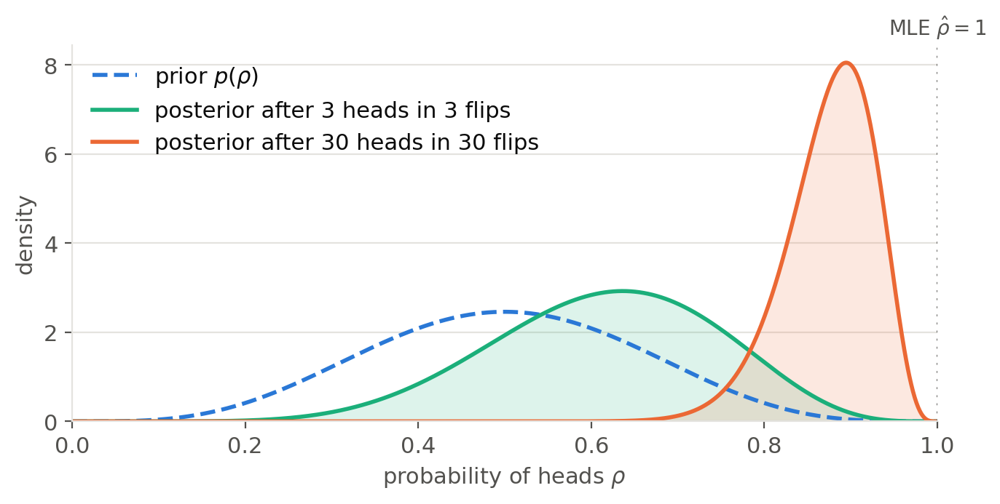

# Bayesian estimation {#sec-bayesian}

Maximum likelihood estimation trusts the data, and only the data. Suppose you flip a coin three times and get three heads. The maximum likelihood estimate of the probability of heads is the fraction of heads (@sec-mle), here $\hat{\rho} = 1$: according to MLE, this coin can never land on tails. Nobody would believe that. We know from experience that most coins are close to fair, and three flips are far too few to conclude otherwise.

Two things are missing from MLE. First, it returns a single value, without telling us how much we should trust it: three heads out of three flips and three thousand heads out of three thousand flips give the same estimate. Second, it cannot use what we already know about the problem before seeing the data. **Bayesian estimation** addresses both: it combines prior knowledge with the data, and returns a whole distribution over the plausible values of the parameters instead of a single one.

## How uncertain is an estimate? {#sec-clt}

Before turning to the Bayesian approach, let's look at how classical (**frequentist**) statistics measures the uncertainty of an estimate. The key observation is that an estimate is itself random: it is computed from a finite set of samples, and another set of samples from the same distribution would give a slightly different value.

Take the simplest estimate, the average of $N$ samples $x_i$ of a distribution $p(x)$ with mean $\mu$ and standard deviation $\sigma$:

$$
    \bar{x} = \frac{1}{N} \, \sum_{i=1}^N x_i
$$

The **central limit theorem** (CLT) states that, when $N$ is large enough, the average is approximately normally distributed around the true mean, whatever the shape of $p(x)$:

$$
    \bar{x} \sim \mathcal{N}(\mu, \frac{\sigma}{\sqrt{N}})
$$

@fig-clt illustrates it with a very skewed distribution, the exponential distribution. The average of a single sample has the same skewed shape, but averages of a few dozen samples are already very close to a normal distribution.

{#fig-clt}

The central limit theorem tells us two things about the estimate:

* It is centered on the true value: on average over many datasets, it neither over- nor under-estimates the mean.
* Its uncertainty, the standard deviation $\sigma / \sqrt{N}$, decreases with the number of samples. This is the origin of the error bars reported in experimental sciences, and it explains why the precision of an estimate improves slowly: four times more samples are needed to halve the error.

The same reasoning applies to the maximum likelihood estimates of @sec-mle, which become approximately normal around the true parameters when the number of samples is large. This frequentist view of uncertainty has two limitations, however. It only holds for **large** $N$, and says little about our three coin flips. And it treats the true parameter as a fixed unknown value, so it gives no room for prior knowledge about it. The **Bayesian** view [@Bayes1763] takes the opposite stance: the parameters themselves are uncertain, and this uncertainty is described by a probability distribution.

## Bayes' rule on the parameters {#sec-bayesrule}

In the Bayesian view, our knowledge about the parameters $\theta$ before seeing any data is described by a **prior** distribution $p(\theta)$. For the coin, the prior over the probability of heads $\rho$ would be concentrated around $\frac{1}{2}$, as most coins are roughly fair, but would not completely exclude biased coins.

After observing the data $X = \{x_i\}_{i=1}^N$, this belief is updated into the **posterior** distribution $p(\theta | X)$, using Bayes' rule:

$$
    p(\theta | X) = \dfrac{p(X | \theta) \, p(\theta)}{p(X)}
$$

The posterior depends on:

* the **likelihood** $p(X | \theta)$: how well the parameters $\theta$ explain the data. It is the same likelihood $p_\theta(X)$ as in MLE, written as a conditional probability now that $\theta$ has a distribution.
* the **prior** $p(\theta)$: which values of the parameters are plausible before seeing the data.
* the **evidence** $p(X)$: the probability of the data, averaged over all possible values of the parameters.

The evidence is obtained by marginalizing over the parameters:

$$
    p(X) = \int_\theta p(X | \theta) \, p(\theta) \, d\theta
$$

It does not depend on $\theta$: it is only a normalization constant ensuring that the posterior integrates to one. The posterior is therefore proportional to the product of the likelihood and the prior: the values of the parameters that remain plausible are those that were plausible before **and** explain the data well.

@fig-coinposterior shows this update for the coin. After three heads, the posterior moves towards biased coins, but a fair coin is still quite plausible. After thirty heads in a row, the data has overwhelmed the prior: the coin is almost certainly biased. In both cases, the posterior is a whole distribution, whose width tells us how uncertain we still are, unlike the MLE estimate $\hat{\rho} = 1$, which is the same in both cases.

{#fig-coinposterior width=70%}

Bayesian updating is naturally **sequential**: the posterior obtained after a first batch of data can serve as the prior for the next batch, and the result is the same as if all the data had been observed at once.

## Maximum a posteriori (MAP) {#sec-map}

The posterior contains everything we know about the parameters, but we often need a single value, for example to make predictions. The simplest choice is the most probable value of the parameters *after* having observed the data, i.e. the **mode** of the posterior. This is **maximum a posteriori** (MAP) estimation:

$$
    \theta_\text{MAP} = \text{argmax}_\theta \, p(\theta | X) = \text{argmax}_\theta \, \dfrac{p(X | \theta) \, p(\theta)}{p(X)}
$$

As the evidence does not depend on $\theta$, we do not need to compute it to find the mode of the posterior. This is lucky, as the integral over all possible parameters is generally intractable:

$$
    \theta_\text{MAP} = \text{argmax}_\theta \, p(X | \theta) \, p(\theta)
$$

For the same reasons as in MLE, we rather minimize the negative logarithm of this quantity. When the samples are i.i.d., the likelihood is a product over the samples, so the objective is a sum:

$$
    \theta_\text{MAP} = \text{argmin}_\theta \, \sum_{i=1}^N - \log p(x_i | \theta) - \log p(\theta)
$$

The MAP objective is the MLE objective plus an additional term, the negative log-prior, which pulls the estimate towards the values of the parameters that we believe are plausible. If the prior is **uniform** (all values of $\theta$ are equally plausible), this term is a constant and MAP reduces to MLE: MLE is the special case of MAP where we have no prior knowledge about the parameters.

For the coin, the MAP estimate after three heads is the mode of the green posterior of @fig-coinposterior, a probability of heads of about $0.64$: the data suggests that the coin may be biased towards heads, but not that tails is impossible. The prior used in the figure acts as if we had already observed four heads and four tails before the experiment, which tempers the conclusions drawn from a few flips. After thirty heads, the MAP estimate is close to $0.9$, and it tends towards the MLE estimate as heads keep coming.

:::{.callout-note icon="false" collapse="true"}
## MAP for the coin

The prior of @fig-coinposterior is a **beta distribution** $\text{Beta}(a, b)$, the standard distribution over probabilities $\rho \in [0, 1]$:

$$
    p(\rho) \propto \rho^{a-1} \, (1 - \rho)^{b-1}
$$

With $a = b$, it is symmetric around $\frac{1}{2}$, and the larger $a$ and $b$, the more concentrated it is. The likelihood of observing $k$ heads in $N$ flips is $\rho^k \, (1 - \rho)^{N - k}$ (Bernoulli trials), so the posterior is:

$$
    p(\rho | X) \propto \rho^{k + a - 1} \, (1 - \rho)^{N - k + b - 1}
$$

i.e. another beta distribution $\text{Beta}(a + k, b + N - k)$: the beta prior is **conjugate** to the Bernoulli likelihood. Its mode is the MAP estimate:

$$
    \rho_\text{MAP} = \dfrac{k + a - 1}{N + a + b - 2}
$$

Compared to the MLE estimate $\frac{k}{N}$, the prior adds $a - 1$ "virtual" heads and $b - 1$ "virtual" tails to the observations. With $a = b = 5$ and $k = N = 3$, $\rho_\text{MAP} = \frac{7}{11} \approx 0.64$. With a uniform prior ($a = b = 1$), MAP is the same as MLE.
:::

### MAP for the mean of a normal distribution

Let's go back to the example of the univariate normal distribution from @sec-mle. To keep the math simple, we suppose that the standard deviation $\sigma$ of the data is known and only estimate its mean $\mu$. Before seeing the data, we believe that the mean should be around a value $\mu_0$, with an uncertainty $\sigma_0$. This translates into a normal prior $p(\mu) = \mathcal{N}(\mu_0, \sigma_0)$ on the parameter $\mu$. Setting the derivative of the log-posterior to zero gives:

$$
    \mu_\text{MAP} = \dfrac{N \, \sigma_0^2}{N \, \sigma_0^2 + \sigma^2} \, \bar{x} + \dfrac{\sigma^2}{N \, \sigma_0^2 + \sigma^2} \, \mu_0
$$

where $\bar{x} = \frac{1}{N} \sum_{i=1}^{N} x_i$ is the empirical mean of the data, i.e. the MLE estimate.

:::{.callout-note icon="false" collapse="true"}
## Derivation

The likelihood of the $N$ samples is:

$$
    p(X | \mu) = \prod_{i=1}^{N} \frac{1}{\sqrt{2\pi \sigma^2}} \, \exp{- \frac{(x_i - \mu)^2}{2\sigma^2}}
$$

and the prior is:

$$
    p(\mu) = \frac{1}{\sqrt{2\pi \sigma_0^2}} \, \exp{- \frac{(\mu - \mu_0)^2}{2\sigma_0^2}}
$$

The log-posterior is, up to constant terms that do not depend on $\mu$:

$$
    \log p(\mu | X) = - \frac{\sum_{i=1}^{N}(x_i - \mu)^2}{2\sigma^2} - \frac{(\mu - \mu_0)^2}{2\sigma_0^2} + \text{cst}
$$

Its maximum is reached when its derivative w.r.t $\mu$ is zero:

$$
    \frac{\partial \log p(\mu | X)}{\partial \mu} = \frac{\sum_{i=1}^{N}(x_i - \mu)}{\sigma^2} - \frac{\mu - \mu_0}{\sigma_0^2} = 0
$$

which gives:

$$
    \mu \, (\frac{N}{\sigma^2} + \frac{1}{\sigma_0^2}) = \frac{N \, \bar{x}}{\sigma^2} + \frac{\mu_0}{\sigma_0^2}
$$

Multiplying both sides by $\sigma^2 \, \sigma_0^2$ and dividing by $N \, \sigma_0^2 + \sigma^2$ gives the result.
:::

The MAP estimate is a **weighted average** between the MLE estimate $\bar{x}$ and the prior mean $\mu_0$. The two weights sum to one, and their relative importance depends on the number of samples and on how confident we are in the prior:

* When there are **few samples**, the estimate stays close to the prior $\mu_0$: we do not have enough evidence to change our mind.
* When there are **many samples** ($N \rightarrow \infty$), the weight of the prior vanishes and the MAP estimate tends to the MLE estimate $\bar{x}$: the data overrides the prior.
* When the prior is **very uncertain** ($\sigma_0 \rightarrow \infty$), the prior becomes uniform and we also recover MLE.
* When the prior is **very certain** ($\sigma_0 \rightarrow 0$), the estimate sticks to $\mu_0$, whatever the data says.

@fig-mapposterior illustrates this with a prior $\mathcal{N}(0, 1)$ and data sampled from $\mathcal{N}(3, 2)$. With a single sample, the posterior stays close to the prior. As more samples are observed, the likelihood becomes sharper and pulls the posterior towards the empirical mean $\bar{x}$, while the prior loses its influence.

{#fig-mapposterior}

As for the coin, the posterior has the same form as the prior: here it is itself a normal distribution (the normal prior is **conjugate** to the normal likelihood), whose mean is $\mu_\text{MAP}$ and whose variance $\sigma_N^2$ is given by:

$$
    \frac{1}{\sigma_N^2} = \frac{N}{\sigma^2} + \frac{1}{\sigma_0^2}
$$

The more samples we observe, the smaller the variance of the posterior: our uncertainty about the parameter decreases with the amount of data, as for the sampling averages of the central limit theorem (@sec-clt).

### MAP and regularization

MAP estimation has a direct interpretation in machine learning. Let's consider a neural network with parameters $\theta$ trained by minimizing the negative log-likelihood of the data, for example the cross-entropy loss of a classifier (@sec-softmax). If we put a normal prior with zero mean on each parameter $\theta_j$:

$$
    p(\theta) = \prod_j \frac{1}{\sqrt{2\pi \sigma_0^2}} \, \exp{- \frac{\theta_j^2}{2\sigma_0^2}}
$$

the negative log-prior becomes:

$$
    - \log p(\theta) = \frac{1}{2 \sigma_0^2} \, \sum_j \theta_j^2 + \text{cst} = \frac{1}{2 \sigma_0^2} \, ||\theta||^2 + \text{cst}
$$

The MAP objective is then the usual loss function plus a penalty on the squared norm of the parameters:

$$
    \mathcal{L}(\theta) = \sum_{i=1}^N - \log p_\theta(x_i) + \lambda \, ||\theta||^2 \qquad \text{with} \qquad \lambda = \frac{1}{2 \sigma_0^2}
$$

This is exactly **L2 regularization** (or weight decay)! Adding weight decay to the loss function is the same as assuming that the parameters are normally distributed around zero, and the regularization coefficient $\lambda$ controls the width of this prior: a strong regularization means a narrow prior, i.e. a strong belief that the parameters should stay small.

Similarly, a Laplace prior $p(\theta_j) \propto \exp{- \frac{|\theta_j|}{b}}$ leads to **L1 regularization** (the lasso), which favors sparse parameters. Most neural networks are therefore trained with MAP rather than MLE, often without saying so.

## Beyond point estimates {#sec-posteriorpredictive}

MAP is still a **point estimate**: it returns a single value of the parameters, the mode of the posterior, and discards the rest of the distribution. The two posteriors of @fig-coinposterior have very different widths, but MAP only reports their peaks, without telling us how much we should trust them. The mode can also be a poor summary of the posterior, for example when the posterior is very skewed or has several modes.

**Full Bayesian inference** keeps the whole posterior distribution $p(\theta | X)$, and makes predictions by averaging over all possible values of the parameters, weighted by their posterior probability. This gives the **posterior predictive** distribution of a new sample $x$:

$$
    p(x | X) = \int_\theta p(x | \theta) \, p(\theta | X) \, d\theta = \mathbb{E}_{\theta \sim p(\theta | X)} [p(x | \theta)]
$$

For the coin, the probability that the next flip lands on heads is the average of $\rho$ over the posterior. After three heads, it is around $0.6$: tails is less likely than heads, but far from impossible, as MLE would claim. The prediction accounts both for the randomness of the coin and for our uncertainty about its bias, which makes them much more sensible when data is scarce.

The price to pay is that the posterior must now be known completely, including its normalization by the evidence $p(X)$, and that predictions require an integral over all parameters. In conjugate cases such as the coin or the mean of a normal distribution, these integrals have closed forms. In general, and in particular for neural networks with millions of parameters, they are intractable: the parameter space is far too large to be covered by a grid (@sec-curse).

These intractable integrals are the central difficulty of this book, and they will come back with the latent variables of generative models (@sec-latentvariables). Two strategies exist to handle them:

* **Sampling** (Part III): instead of computing the posterior, draw samples from it, and replace the integrals with averages over these samples (@sec-montecarlo). Markov chain Monte Carlo methods only need the posterior up to the evidence, i.e. the product $p(X | \theta) \, p(\theta)$ (@sec-mcmcposterior).
* **Optimization** (Part IV): approximate the posterior with a simpler parameterized distribution, fitted by minimizing a divergence to the true posterior. This is **variational inference** (@sec-variationalinference).
