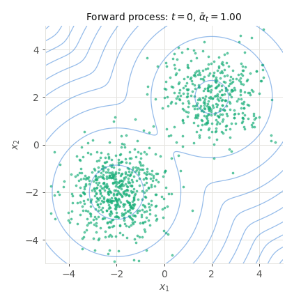
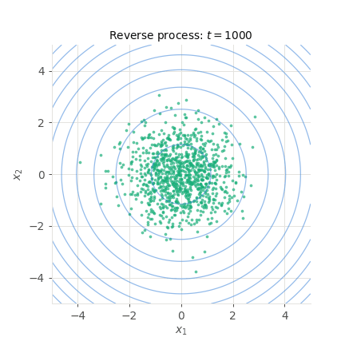

# Denoising diffusion models {#sec-diffusion}

Diffusion models are the generative models behind most of the image, video and audio generators of recent years. They bring together the two halves of this book. They are latent variable models trained by maximizing an evidence lower bound, like the variational autoencoders of @sec-vae; and the network they train learns the score of the data distribution, which is then used to generate samples with a noisy, Langevin-like dynamics, as in @sec-hmc.

## From VAEs to diffusion models

Variational autoencoders have a well-known weakness: a single decoder has to transform a simple distribution, the prior over the latent space, into the whole distribution of the data, in a single step. For complex data such as natural images, this transformation is extremely hard to learn, and the generated images are often blurry (@sec-vae).

Diffusion models [@Sohl-Dickstein2015; @Ho2020] split this difficult transformation into many easy ones. The idea is to start from the other end: it is very easy to **destroy** an image, by adding a little bit of noise to it again and again, until nothing is left but pure noise. Each of these noising steps changes the image only slightly, so each of them should also be easy to **undo**: a slightly noisy image only has a few plausible, slightly less noisy versions. If a neural network learns to undo a single noising step, applying it repeatedly can transform pure noise into a realistic image (@fig-diffusionsteps).

{#fig-diffusionsteps}

In the language of @sec-latentvariables, a diffusion model is a latent variable model with many layers of latent variables: the noisy images $x_1, x_2, \ldots, x_T$ are the latent variables of the data sample $x_0$, all with the same dimension as the data. It differs from a VAE in two important ways:

* The **encoder** is not learned: it is the fixed noising process, which has no parameters. There is therefore no approximate posterior to learn, and no posterior collapse to fear (@sec-betavae).
* The **decoder** is not a single network mapping the prior onto the data in one step, but a chain of $T$ small denoising steps, all performed by the same network. As each step only has to remove a little noise, it is much easier to learn than the full transformation.

The price to pay is the number of steps: generating a sample requires running the network hundreds or thousands of times, instead of once for a VAE. The rest of the chapter presents the noising process (the forward process), the denoising process (the reverse process), how the network is trained, how samples are generated, and why the network actually learns the score of the data.

## The forward process

### Adding noise step by step

The **forward process** transforms a data sample $x_0 \sim p(x_0)$ into noise in $T$ steps, typically $T = 1000$. At each step $t$, the previous sample is slightly shrunk, and a small amount of Gaussian noise is added independently to each of its dimensions (each pixel of an image):

$$
    x_t = \sqrt{1 - \beta_t} \, x_{t-1} + \sqrt{\beta_t} \, \epsilon \qquad \text{with} \qquad \epsilon \sim \mathcal{N}(0, I)
$$

i.e. $q(x_t | x_{t-1}) = \mathcal{N}(\sqrt{1 - \beta_t} \, x_{t-1}, \sqrt{\beta_t})$. The **variance schedule** $\beta_1, \ldots, \beta_T$ is a fixed sequence of small numbers, chosen in advance: in the original paper, it increases linearly from $10^{-4}$ to $0.02$ [@Ho2020]. The forward process is a Markov chain (@sec-markovchains): each noisy sample only depends on the previous one. As announced, it plays the role of the encoder of a VAE, but it has no parameter to learn.

The factor $\sqrt{1 - \beta_t}$ in front of $x_{t-1}$ may seem surprising. It prevents the samples from growing indefinitely: if $x_{t-1}$ has a unit variance, then $x_t$ also has a unit variance, as $(1 - \beta_t) + \beta_t = 1$. The noise progressively **replaces** the signal instead of being piled on top of it.

### Jumping to any step

The forward process has a very convenient property: the noisy sample at any step $t$ can be obtained **directly** from the data sample, in a single step. Combining two consecutive steps gives a sum of independent Gaussian noises, which is again Gaussian, and repeating the argument leads to:

$$
    x_t = \sqrt{\bar{\alpha}_t} \, x_0 + \sqrt{1 - \bar{\alpha}_t} \, \epsilon \qquad \text{with} \qquad \epsilon \sim \mathcal{N}(0, I)
$$

where $\alpha_t = 1 - \beta_t$ and $\bar{\alpha}_t = \prod_{s=1}^t \alpha_s$ only depend on the schedule. In other terms, $q(x_t | x_0) = \mathcal{N}(\sqrt{\bar{\alpha}_t} \, x_0, \sqrt{1 - \bar{\alpha}_t})$: the noisy sample at step $t$ is a weighted mixture of the data and of a single Gaussian noise.

:::{.callout-note icon="false" collapse="true"}
## Proof for two steps

Let's apply the forward step twice, with two independent noises $\epsilon_1$ and $\epsilon_2$:

$$
\begin{aligned}
    x_t &= \sqrt{\alpha_t} \, x_{t-1} + \sqrt{1 - \alpha_t} \, \epsilon_2 \\
    &= \sqrt{\alpha_t} \, (\sqrt{\alpha_{t-1}} \, x_{t-2} + \sqrt{1 - \alpha_{t-1}} \, \epsilon_1) + \sqrt{1 - \alpha_t} \, \epsilon_2 \\
    &= \sqrt{\alpha_t \, \alpha_{t-1}} \, x_{t-2} + \sqrt{\alpha_t (1 - \alpha_{t-1})} \, \epsilon_1 + \sqrt{1 - \alpha_t} \, \epsilon_2 \\
\end{aligned}
$$

The last two terms are independent Gaussian noises with zero mean; their sum is a Gaussian noise whose variance is the sum of their variances, $\alpha_t (1 - \alpha_{t-1}) + 1 - \alpha_t = 1 - \alpha_t \, \alpha_{t-1}$. It can therefore be written $\sqrt{1 - \alpha_t \, \alpha_{t-1}} \, \epsilon$ with a single $\epsilon \sim \mathcal{N}(0, I)$:

$$
    x_t = \sqrt{\alpha_t \, \alpha_{t-1}} \, x_{t-2} + \sqrt{1 - \alpha_t \, \alpha_{t-1}} \, \epsilon
$$

Repeating the argument down to $x_0$ gives the result with $\bar{\alpha}_t = \prod_{s=1}^t \alpha_s$.
:::

This formula is the reparameterization trick of @sec-reparameterization applied to the whole forward process. It has two important consequences:

* During training, we will never have to simulate the forward process step by step: the noisy version of a data sample at any step $t$ is obtained in one operation.
* As $\bar{\alpha}_t$ is a product of numbers smaller than one, it decreases towards zero. At the end of the forward process, $\bar{\alpha}_T \approx 0$ and $x_T \approx \epsilon$: whatever the data sample, it has become a sample of the standard normal distribution, and all information about $x_0$ is lost.

@fig-diffusionforward shows the forward process on the two-dimensional mixture of @fig-score (the second tab shows it as an animation). As $t$ increases, each mode is shrunk towards the origin and blurred, the two modes merge, and the distribution $q(x_t)$ of the noisy samples ends up as a standard normal distribution. The speed at which the information is destroyed depends on the schedule: the linear schedule destroys most of it in the first few hundred steps, and other schedules, such as a cosine schedule, spread the destruction more evenly over the steps [@Nichol2021].

:::{.panel-tabset}
#### Snapshots

{#fig-diffusionforward}

#### Animation

{width=60%}
:::

## The reverse process

### Inverting a noising step

To generate data, we have to run the forward process backwards: start from pure noise $x_T \sim \mathcal{N}(0, I)$, and repeatedly sample a slightly less noisy $x_{t-1}$ given $x_t$. This requires the **reverse** transition $q(x_{t-1} | x_t)$, which Bayes' rule expresses as:

$$
    q(x_{t-1} | x_t) = \dfrac{q(x_t | x_{t-1}) \, q(x_{t-1})}{q(x_t)}
$$

The forward transition $q(x_t | x_{t-1})$ is known, but the marginals $q(x_{t-1})$ and $q(x_t)$ are not: they are the distribution of the data blurred by noise, $q(x_t) = \int q(x_t | x_0) \, p(x_0) \, dx_0$, which depends on the whole unknown data distribution. Inverting a noising step is an inverse problem (@sec-inverseproblems): a noisy image is compatible with many slightly less noisy images, and knowing which ones are plausible requires knowing what images look like.

Two facts make the problem manageable:

* When the step is small ($\beta_t \ll 1$), the reverse transition $q(x_{t-1} | x_t)$ is **approximately normal**: a tiny amount of noise only allows a small, Gaussian-shaped region of possible previous samples. A learned normal distribution per step is therefore a good model of each reverse step, even if the data distribution itself is highly multimodal. This is the reason for using many small steps.
* When the original data sample $x_0$ is known, the reverse transition is **exactly normal**, with a closed-form mean and variance.

### The reverse step knowing the data

Conditioned on $x_0$, all distributions in Bayes' rule are normal: $q(x_t | x_{t-1})$ is the forward step, and $q(x_{t-1} | x_0)$, $q(x_t | x_0)$ are given by the one-shot formula of the forward process. Their combination is a normal distribution:

$$
    q(x_{t-1} | x_t, x_0) = \mathcal{N}(\tilde{\mu}_t(x_t, x_0), \tilde{\sigma}_t)
$$

with:

$$
    \tilde{\mu}_t(x_t, x_0) = \dfrac{\sqrt{\alpha_t} \, (1 - \bar{\alpha}_{t-1})}{1 - \bar{\alpha}_t} \, x_t + \dfrac{\sqrt{\bar{\alpha}_{t-1}} \, \beta_t}{1 - \bar{\alpha}_t} \, x_0 \qquad \tilde{\sigma}_t^2 = \dfrac{1 - \bar{\alpha}_{t-1}}{1 - \bar{\alpha}_t} \, \beta_t
$$

The mean is a weighted average of the noisy sample $x_t$ and of the clean sample $x_0$: one step of the reverse process moves the noisy sample a little bit towards the data, and adds a little noise.

:::{.callout-note icon="false" collapse="true"}
## Derivation

Using Bayes' rule conditioned on $x_0$, and the Markov property $q(x_t | x_{t-1}, x_0) = q(x_t | x_{t-1})$:

$$
    q(x_{t-1} | x_t, x_0) = \dfrac{q(x_t | x_{t-1}) \, q(x_{t-1} | x_0)}{q(x_t | x_0)} \propto \exp \left( - \dfrac{(x_t - \sqrt{\alpha_t} \, x_{t-1})^2}{2 \, \beta_t} - \dfrac{(x_{t-1} - \sqrt{\bar{\alpha}_{t-1}} \, x_0)^2}{2 \, (1 - \bar{\alpha}_{t-1})} \right)
$$

where the denominator does not depend on $x_{t-1}$. The exponent is a quadratic function of $x_{t-1}$, so the distribution is normal; its parameters are obtained by completing the square. The coefficient of $x_{t-1}^2$ gives the inverse of the variance:

$$
    \dfrac{1}{\tilde{\sigma}_t^2} = \dfrac{\alpha_t}{\beta_t} + \dfrac{1}{1 - \bar{\alpha}_{t-1}} = \dfrac{\alpha_t \, (1 - \bar{\alpha}_{t-1}) + \beta_t}{\beta_t \, (1 - \bar{\alpha}_{t-1})} = \dfrac{1 - \bar{\alpha}_t}{\beta_t \, (1 - \bar{\alpha}_{t-1})}
$$

as $\alpha_t (1 - \bar{\alpha}_{t-1}) + \beta_t = \alpha_t - \bar{\alpha}_t + 1 - \alpha_t = 1 - \bar{\alpha}_t$. The mean is the coefficient of the linear term multiplied by the variance:

$$
    \tilde{\mu}_t(x_t, x_0) = \tilde{\sigma}_t^2 \, \left( \dfrac{\sqrt{\alpha_t}}{\beta_t} \, x_t + \dfrac{\sqrt{\bar{\alpha}_{t-1}}}{1 - \bar{\alpha}_{t-1}} \, x_0 \right) = \dfrac{\sqrt{\alpha_t} \, (1 - \bar{\alpha}_{t-1})}{1 - \bar{\alpha}_t} \, x_t + \dfrac{\sqrt{\bar{\alpha}_{t-1}} \, \beta_t}{1 - \bar{\alpha}_t} \, x_0
$$
:::

During generation, however, $x_0$ is precisely what we do not know. But the one-shot formula of the forward process links the three quantities: $x_t = \sqrt{\bar{\alpha}_t} \, x_0 + \sqrt{1 - \bar{\alpha}_t} \, \epsilon$, where $\epsilon$ is the noise that was added to $x_0$ to obtain $x_t$. Replacing $x_0$ by $(x_t - \sqrt{1 - \bar{\alpha}_t} \, \epsilon) / \sqrt{\bar{\alpha}_t}$ in the mean gives, after simplification:

$$
    \tilde{\mu}_t(x_t, x_0) = \dfrac{1}{\sqrt{\alpha_t}} \, \left( x_t - \dfrac{\beta_t}{\sqrt{1 - \bar{\alpha}_t}} \, \epsilon \right)
$$

Knowing the clean sample is the same as knowing the **noise** it contains: the reverse step simply removes a fraction of this noise from $x_t$, and rescales the result.

### The learned reverse process

The learned reverse process mimics this form. Each reverse step is a normal distribution:

$$
    p_\theta(x_{t-1} | x_t) = \mathcal{N}(\mu_\theta(x_t, t), \sigma_t)
$$

whose variance $\sigma_t^2$ is fixed, for example to $\tilde{\sigma}_t^2$ or $\beta_t$, and whose mean has the same form as $\tilde{\mu}_t$, where the unknown noise is replaced by the prediction of a neural network:

$$
    \mu_\theta(x_t, t) = \dfrac{1}{\sqrt{\alpha_t}} \, \left( x_t - \dfrac{\beta_t}{\sqrt{1 - \bar{\alpha}_t}} \, \epsilon_\theta(x_t, t) \right)
$$

The network $\epsilon_\theta(x_t, t)$ receives a noisy sample and the step $t$, and **predicts the noise** it contains. This is the only learned part of the whole model: the forward process, the variances and the prior $p(x_T) = \mathcal{N}(0, I)$ are all fixed. The network does not need to know $x_0$: it has to guess, from the noisy sample alone, which noise was most likely added, and for that it has to learn what the data look like.

For images, the network takes a noisy image as input, and outputs an image-sized prediction of the noise. The usual architecture is a **U-Net** [@Ronneberger2015], originally designed for image segmentation, which processes the image at several resolutions and combines them through skip connections (@fig-unet). The step $t$ is given to the network as an additional input, through an embedding added to its feature maps, as the amount of noise to remove depends strongly on $t$. The same network is used for all the steps.

{#fig-unet width=70%}

## Training: the ELBO of a hierarchical VAE

### The evidence lower bound

As for any latent variable model, we would like to maximize the log-likelihood $\log p_\theta(x_0)$ of the data under the model, but it requires integrating over all the latent variables $x_1, \ldots, x_T$, which is intractable. And as for the VAE, we can maximize instead the evidence lower bound of @sec-variationalinference, using the forward process as the encoder:

$$
    \log p_\theta(x_0) \geq \mathbb{E}_{x_{1:T} \sim q(x_{1:T} | x_0)} [\log \dfrac{p_\theta(x_{0:T})}{q(x_{1:T} | x_0)}] = \text{ELBO}(\theta)
$$

where $p_\theta(x_{0:T}) = p(x_T) \, \prod_{t=1}^T p_\theta(x_{t-1} | x_t)$ is the joint distribution of the reverse process, and $q(x_{1:T} | x_0) = \prod_{t=1}^T q(x_t | x_{t-1})$ the one of the forward process. As the encoder has no parameters, the ELBO only depends on the parameters $\theta$ of the network. Thanks to the Markov structure of both processes, the ELBO decomposes into a sum of simple terms [@Ho2020; @Luo2022a]:

$$
    \text{ELBO}(\theta) = \mathbb{E}_{q} [\log p_\theta(x_0 | x_1)] - \text{KL}(q(x_T | x_0) || p(x_T)) - \sum_{t=2}^T \mathbb{E}_{q} [\text{KL}(q(x_{t-1} | x_t, x_0) || p_\theta(x_{t-1} | x_t))]
$$

:::{.callout-note icon="false" collapse="true"}
## Derivation

The ratio inside the ELBO is:

$$
    \dfrac{p_\theta(x_{0:T})}{q(x_{1:T} | x_0)} = \dfrac{p(x_T) \, \prod_{t=1}^T p_\theta(x_{t-1} | x_t)}{\prod_{t=1}^T q(x_t | x_{t-1})}
$$

For $t \geq 2$, the forward steps can be reversed with Bayes' rule conditioned on $x_0$ (the Markov property gives $q(x_t | x_{t-1}) = q(x_t | x_{t-1}, x_0)$):

$$
    q(x_t | x_{t-1}) = \dfrac{q(x_{t-1} | x_t, x_0) \, q(x_t | x_0)}{q(x_{t-1} | x_0)}
$$

In the product over $t = 2, \ldots, T$, the fractions $q(x_t | x_0) / q(x_{t-1} | x_0)$ cancel each other except the first and the last ones (a telescoping product), leaving $q(x_T | x_0) / q(x_1 | x_0)$. The ratio becomes:

$$
    \dfrac{p_\theta(x_{0:T})}{q(x_{1:T} | x_0)} = \dfrac{p(x_T)}{q(x_T | x_0)} \, p_\theta(x_0 | x_1) \, \prod_{t=2}^T \dfrac{p_\theta(x_{t-1} | x_t)}{q(x_{t-1} | x_t, x_0)}
$$

Taking the logarithm and the expectation over the forward process, each ratio of the product gives minus a KL divergence, which leads to the decomposition.
:::

The three kinds of terms have simple interpretations:

* $\text{KL}(q(x_T | x_0) || p(x_T))$ compares the end of the forward process with the prior $\mathcal{N}(0, I)$. It does not depend on $\theta$, and it is close to zero when $\bar{\alpha}_T \approx 0$: it can be ignored.
* $\log p_\theta(x_0 | x_1)$ is a reconstruction term for the very last denoising step, as in a VAE.
* Each $\text{KL}(q(x_{t-1} | x_t, x_0) || p_\theta(x_{t-1} | x_t))$ compares one learned reverse step with the reverse step **knowing the data** of the previous section. These are the terms that train the network: each reverse step should do what we would do if we knew the original sample.

### From KL divergences to a simple regression

All the KL terms are divergences between two normal distributions with the same fixed variance $\sigma_t^2$, so they have a closed form (@sec-klnormal), which only depends on the distance between their means:

$$
    \text{KL}(q(x_{t-1} | x_t, x_0) || p_\theta(x_{t-1} | x_t)) = \dfrac{1}{2 \sigma_t^2} \, || \tilde{\mu}_t(x_t, x_0) - \mu_\theta(x_t, t) ||^2 + \text{cst}
$$

Both means were written in the same form in the previous section, with the true noise $\epsilon$ for $\tilde{\mu}_t$ and its prediction $\epsilon_\theta(x_t, t)$ for $\mu_\theta$. Their difference is therefore proportional to the error of the network:

$$
    \text{KL}(q(x_{t-1} | x_t, x_0) || p_\theta(x_{t-1} | x_t)) = \lambda_t \, || \epsilon - \epsilon_\theta(x_t, t) ||^2 + \text{cst} \qquad \text{with} \qquad \lambda_t = \dfrac{\beta_t^2}{2 \, \sigma_t^2 \, \alpha_t \, (1 - \bar{\alpha}_t)}
$$

Maximizing the ELBO is therefore a weighted sum of $T$ regression problems: at each step, predict the noise contained in the noisy sample. @Ho2020 found that ignoring the weights $\lambda_t$ gives better samples in practice, which leads to the remarkably simple loss:

$$
    \mathcal{L}(\theta) = \mathbb{E}_{x_0 \sim p(x_0), \, t \sim \mathcal{U}(1, T), \, \epsilon \sim \mathcal{N}(0, I)} [|| \epsilon - \epsilon_\theta(\sqrt{\bar{\alpha}_t} \, x_0 + \sqrt{1 - \bar{\alpha}_t} \, \epsilon, t) ||^2]
$$

The sum over the $T$ steps has been replaced by an expectation over a random step $t$, estimated with Monte Carlo as everything else. Thanks to the one-shot formula of the forward process, training never simulates the forward process step by step. Each training iteration consists in:

1. sampling a data sample $x_0$ from the training set, a step $t$ uniformly between 1 and $T$, and a noise $\epsilon \sim \mathcal{N}(0, I)$;
2. computing the noisy sample $x_t = \sqrt{\bar{\alpha}_t} \, x_0 + \sqrt{1 - \bar{\alpha}_t} \, \epsilon$;
3. updating the network to reduce the squared error $|| \epsilon - \epsilon_\theta(x_t, t) ||^2$ between the true and the predicted noise.

A diffusion model is therefore trained as a **denoiser**: a single network learns to remove noise from data at all noise levels at once. The simplicity and stability of this training, a plain regression without adversarial game or approximate posterior, is one of the main reasons for the success of diffusion models.

### Mass-covering, but not blurry

The training objective is a lower bound of the log-likelihood of the data, and each KL term has the distribution derived from the data as its first argument: like the VAE, a diffusion model is trained in the direction of maximum likelihood, i.e. by minimizing the **forward** KL divergence between the data and the model (@sec-forwardreverse). A more general rule of thumb is that objectives defined as expectations over the **data** are mass-covering (maximum likelihood, VAEs, diffusion models), while objectives defined as expectations over the **model's own samples** are mode-seeking (variational inference). With a suitable weighting of the noise levels, the training objective of diffusion models is indeed a bound on the KL divergence between the data and the model [@Song2021].

@sec-forwardreverse showed that the forward KL produces "averaged" fits between the modes of the data when the model is not flexible enough, which explains the blurriness of VAEs. Diffusion models escape this fate because their family of distributions is very flexible. Each reverse step only has to be approximately normal, which is accurate for small steps, and the composition of many such steps can represent arbitrarily complex, multimodal distributions. The forward KL only averages between modes when the model cannot represent them; a chain of many small Gaussian steps can.

## Sampling

### Running the reverse process

Once the network is trained, generating a new sample is a direct application of ancestral sampling (@sec-simplesampling): sample the last latent variable from the prior, then each latent variable given the next one, down to $x_0$:

1. sample pure noise $x_T \sim \mathcal{N}(0, I)$;
2. for $t = T, T-1, \ldots, 1$: predict the noise $\epsilon_\theta(x_t, t)$ contained in the current sample, and sample the previous step:
$$
    x_{t-1} = \dfrac{1}{\sqrt{\alpha_t}} \, \left( x_t - \dfrac{\beta_t}{\sqrt{1 - \bar{\alpha}_t}} \, \epsilon_\theta(x_t, t) \right) + \sigma_t \, z \qquad \text{with} \qquad z \sim \mathcal{N}(0, I)
$$
3. return $x_0$ (no noise is added in the very last step).

Each step removes part of the predicted noise from the current sample, and adds back a smaller amount of fresh noise. The resulting dynamics look very much like Langevin dynamics (@sec-langevin): a deterministic move in a direction given by the network, plus some noise. The next section shows that this is not a coincidence.

@fig-diffusionreverse shows this reverse process on the two-dimensional mixture of @fig-score. For this simple data distribution, the noise predictor that a perfect network would learn can be computed exactly, so the figure shows what an ideal diffusion model does, without any training. The samples start as a standard normal distribution, progressively split into two groups, and end up as samples of the data distribution. At each step, their distribution matches the distribution $q(x_t)$ of the forward process (contours): the reverse process exactly undoes the forward process, one step at a time. The proportions of the two modes are also correct: about 60% of the final samples end up in the lower-left mode, as in the data, whereas the Langevin chains of @fig-langevin initially split equally between the modes.

:::{.panel-tabset}
#### Snapshots

{#fig-diffusionreverse}

#### Animation

{width=60%}
:::

### Faster sampling

The main drawback of diffusion models is their sampling speed: generating a single sample requires $T$ evaluations of the network, typically $T = 1000$, where a VAE needs a single evaluation of its decoder. Much research has been devoted to reducing this number.

A first improvement is to **learn** the variances $\sigma_t$ of the reverse steps instead of fixing them: the reverse process can then skip steps, and keeps a good sample quality with only about 50 steps, while also improving the log-likelihood of the model [@Nichol2021].

**Denoising diffusion implicit models** (DDIM) [@Song2022] go further, without any change to the training: they use the same trained network, but a different sampling procedure. At each step, the predicted noise gives an estimate of the clean sample, $\hat{x}_0 = (x_t - \sqrt{1 - \bar{\alpha}_t} \, \epsilon_\theta(x_t, t)) / \sqrt{\bar{\alpha}_t}$, and the next sample is obtained by noising this estimate again to the level of the next step, reusing the predicted noise instead of drawing a new one:

$$
    x_{t'} = \sqrt{\bar{\alpha}_{t'}} \, \hat{x}_0 + \sqrt{1 - \bar{\alpha}_{t'}} \, \epsilon_\theta(x_t, t) \qquad \text{with} \qquad t' < t
$$

Two things change compared to the reverse process above:

* The sampling is **deterministic**: no new noise is added, so a given initial noise $x_T$ always leads to the same sample $x_0$. The initial noise acts as a latent representation of the generated sample, which can for example be interpolated.
* The next step $t'$ does not have to be $t - 1$: the sampler can **skip** steps, and only visit a few tens of the $T$ noise levels. With the exact noise predictor of @fig-diffusionreverse, 50 DDIM steps already produce samples with the correct modes, proportions and spreads.

Since then, better numerical integration schemes have reduced the number of steps further, and distillation techniques train networks that generate a sample in a few steps, or even a single one.

## Diffusion models learn the score

### The noise predictor is a score

The network is trained to predict the noise contained in a noisy sample, with a squared error. The best possible prediction for a squared error is the expected value: a perfect network outputs the **average** noise that could have produced the noisy sample, $\epsilon^*(x_t, t) = \mathbb{E}[\epsilon | x_t]$. This average turns out to be proportional to the score of the noisy distribution $q(x_t)$ (@sec-score):

$$
    \nabla_{x_t} \log q(x_t) = - \dfrac{\mathbb{E}[\epsilon | x_t]}{\sqrt{1 - \bar{\alpha}_t}}
$$

:::{.callout-note icon="false" collapse="true"}
## Derivation

The noisy distribution is a mixture of the normal distributions $q(x_t | x_0) = \mathcal{N}(\sqrt{\bar{\alpha}_t} \, x_0, \sqrt{1 - \bar{\alpha}_t})$ over the data: $q(x_t) = \int q(x_t | x_0) \, p(x_0) \, dx_0$. Its gradient is therefore:

$$
    \nabla_{x_t} q(x_t) = \int \nabla_{x_t} q(x_t | x_0) \, p(x_0) \, dx_0 = \int q(x_t | x_0) \, \nabla_{x_t} \log q(x_t | x_0) \, p(x_0) \, dx_0
$$

Dividing by $q(x_t)$, and using Bayes' rule $q(x_0 | x_t) = q(x_t | x_0) \, p(x_0) / q(x_t)$, the score of the mixture is the average of the scores of the components, weighted by their posterior probability:

$$
    \nabla_{x_t} \log q(x_t) = \mathbb{E}_{x_0 \sim q(x_0 | x_t)} [\nabla_{x_t} \log q(x_t | x_0)]
$$

The score of the normal distribution $q(x_t | x_0)$ is $- (x_t - \sqrt{\bar{\alpha}_t} \, x_0) / (1 - \bar{\alpha}_t) = - \epsilon / \sqrt{1 - \bar{\alpha}_t}$ (@sec-score), where $\epsilon$ is the noise that leads from $x_0$ to $x_t$. Averaging over the possible $x_0$ gives the result. This is known as **Tweedie's formula** [@Luo2022a].
:::

A diffusion model therefore learns the score of the data at all noise levels: the network defines a learned score:

$$
    s_\theta(x_t, t) = - \dfrac{\epsilon_\theta(x_t, t)}{\sqrt{1 - \bar{\alpha}_t}}
$$

Training it with the simple loss is a form of **denoising score matching**: learning the score of a distribution from its samples only, by learning to denoise them. This answers the question left open at the end of @sec-hmclimits: the score of an unknown data distribution can be learned from data.

Equivalently, the network predicts the average **clean** sample compatible with the noisy one, $\mathbb{E}[x_0 | x_t] = (x_t - \sqrt{1 - \bar{\alpha}_t} \, \mathbb{E}[\epsilon | x_t]) / \sqrt{\bar{\alpha}_t}$. At high noise levels, many very different clean samples are compatible with $x_t$, and their average is a blurry mixture of all of them. This averaging is not a flaw: it is exactly what is needed to compute the score at this noise level, and the modes of the data are only separated progressively, as the noise decreases.

### Sampling is a Langevin dynamics with decreasing noise

Replacing the noise prediction by the learned score in the reverse step gives:

$$
    x_{t-1} = \dfrac{1}{\sqrt{\alpha_t}} \, \left( x_t + \beta_t \, s_\theta(x_t, t) \right) + \sigma_t \, z
$$

Up to the rescaling factor $1 / \sqrt{\alpha_t}$, which is close to one, this is very close to a step of Langevin dynamics (@sec-langevin) with step size $\eta = \beta_t$: a move along the score, plus some noise. The difference is that the score changes at each step: it is the score of the data **blurred by a decreasing amount of noise**. Sampling a diffusion model is therefore an annealed Langevin dynamics, which starts on a very blurred version of the data distribution and progressively sharpens it. This is exactly the idea of the score-based generative models of @Song2020a, which learn the score at several noise levels and run Langevin dynamics while decreasing the noise: diffusion models and score-based models are two views of the same family of models.

@fig-diffusionscore shows the score of the noisy distributions on the two-dimensional mixture. This view explains how diffusion models solve the two problems of Langevin dynamics with a learned score raised in @sec-hmclimits:

* **The score is learned everywhere.** At high noise levels, the noisy data cover the whole space, so the score is learned in the regions where samples start, and it is a simple field pointing towards the bulk of the data.
* **The modes are correctly weighted.** At high noise levels, the noisy distribution has a single mode, which the samples reach easily. The modes of the data appear progressively as the noise decreases, and each sample commits to one of them while they are still close and connected: the samples are distributed between the modes in proportion to their mass, as in @fig-diffusionreverse, instead of being trapped in the nearest mode as the Langevin chains of @fig-langevin.

{#fig-diffusionscore}

### Continuous time

The forward process adds a small amount of noise at each of $T$ steps. When the number of steps goes to infinity and each step becomes infinitely small, the sequence of noisy samples becomes a continuous trajectory $x(t)$, with $t$ now a continuous time between 0 and 1. Its evolution is described by a **stochastic differential equation** (SDE) [@Song2021a]:

$$
    dx = - \dfrac{1}{2} \, \beta(t) \, x \, dt + \sqrt{\beta(t)} \, dW
$$

An SDE describes how a random trajectory changes during an infinitesimal time $dt$. The first term, the **drift**, is a deterministic move: here a slow shrinking towards the origin. The second term is a random kick: $dW$ is a Gaussian increment with zero mean and variance $dt$ (a Brownian motion), scaled by $\sqrt{\beta(t)}$. Discretizing this equation with a time step $dt = 1$ gives back the forward step of DDPM: $x_t = (1 - \frac{1}{2} \beta_t) \, x_{t-1} + \sqrt{\beta_t} \, \epsilon \approx \sqrt{1 - \beta_t} \, x_{t-1} + \sqrt{\beta_t} \, \epsilon$. This SDE progressively transforms any data distribution into a standard normal distribution, by spreading the probability mass like heat in a solid: hence the name **diffusion**.

A classical result of stochastic calculus states that such a process can be run **backwards in time**, with another SDE whose drift involves the score of the distribution $q_t(x)$ of the noisy samples at time $t$:

$$
    dx = \left[ - \dfrac{1}{2} \, \beta(t) \, x - \beta(t) \, \nabla_x \log q_t(x) \right] dt + \sqrt{\beta(t)} \, d\bar{W}
$$

where time now runs from $t = 1$ to $t = 0$ ($dt < 0$) and $d\bar{W}$ is a Brownian motion running backwards. Starting from samples of the standard normal distribution at $t = 1$ and solving this equation backwards produces samples of the data at $t = 0$. The only unknown quantity is the score, which is exactly what the network learns: replacing it by $s_\theta(x, t)$ and discretizing the reverse SDE with a time step of $-1$ gives back the reverse step of DDPM of the previous section. The structure of this equation is the one of Langevin dynamics (@sec-langevin): a move along the score, plus noise.

The same distributions $q_t(x)$ can also be obtained **without any noise**, by following an ordinary differential equation, the **probability flow**:

$$
    \dfrac{dx}{dt} = - \dfrac{1}{2} \, \beta(t) \, \left[ x + \nabla_x \log q_t(x) \right]
$$

Each trajectory is now deterministic: a given initial noise always leads to the same sample, but the distribution of the samples at each time is the same as with the reverse SDE. Compared to the reverse SDE, the score term is halved and the noise is removed: the noise of the SDE spreads the samples, which half of the score term compensates on average. DDIM is a discretization of this deterministic flow, which explains why it is deterministic and can take large steps: ordinary differential equations can be solved with efficient numerical methods.

This continuous view unifies the different diffusion models: they differ by the SDE they use (the choice of $\beta(t)$) and by the numerical method used to solve the reverse SDE or ODE, not by what the network learns. It also connects diffusion models to another family of generative models, which learn a deterministic flow from noise to data directly, without going through a noising process: **flow matching** [@Lipman2023], presented in a later chapter.
