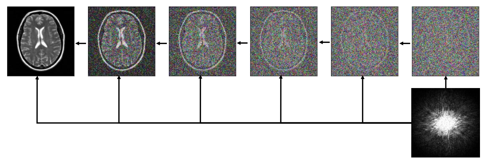
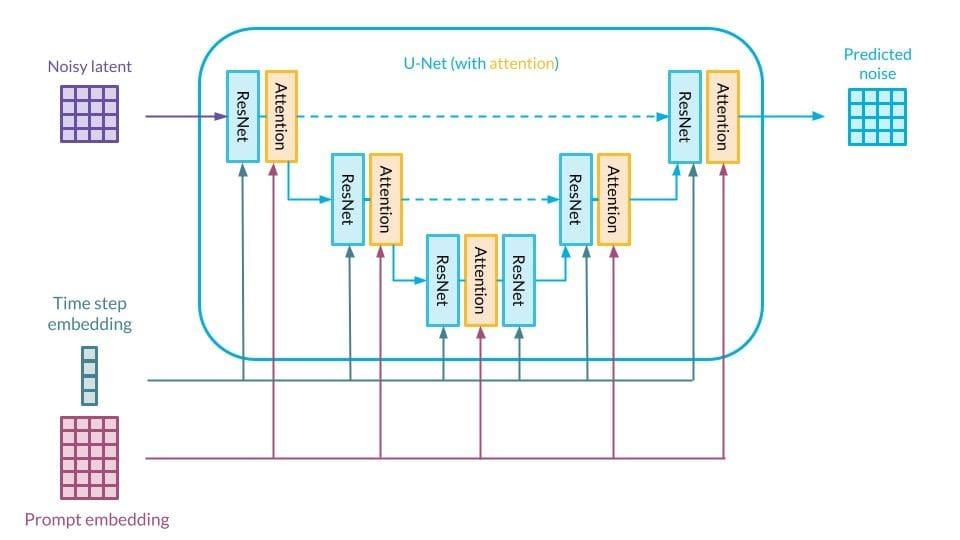
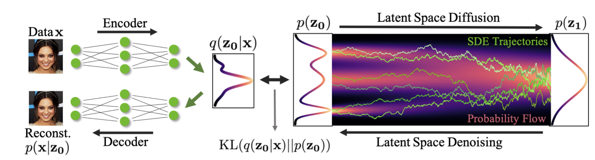
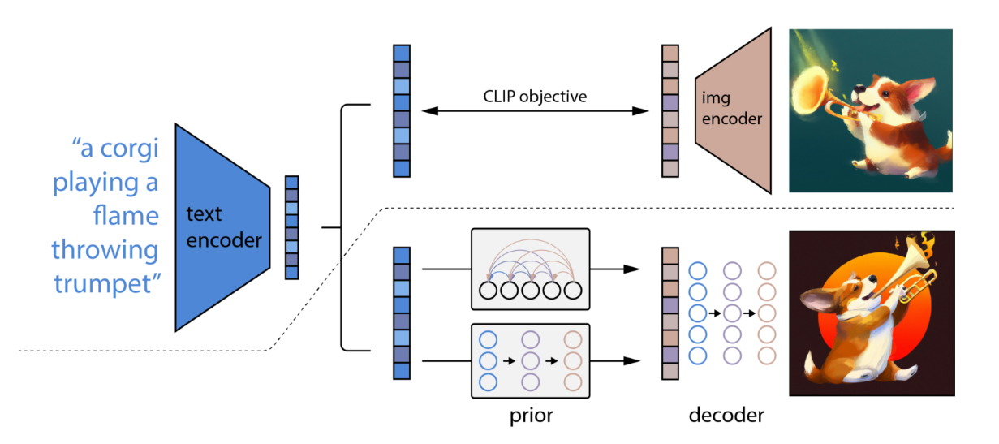
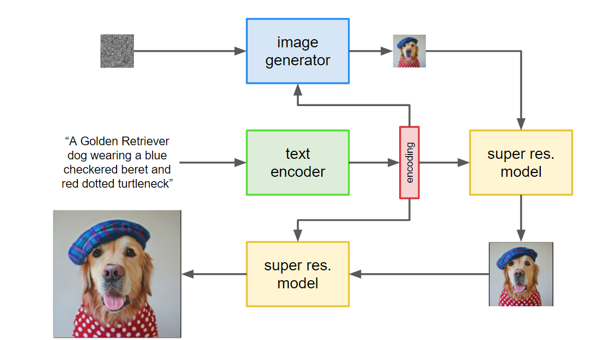

# Conditional and latent diffusion {#sec-conditionaldiffusion}

The diffusion models of @sec-diffusion learn to sample the distribution of their training data. This is not enough for most applications: we do not want *an* image, but an image of a cat, an image matching a text description, or the most plausible image given some incomplete measurements. In terms of distributions, the data distribution has many modes, for example one for the images of cats and one for the images of dogs, and an unconditional diffusion model sends each initial noise towards one of them, without any control over which one. A **conditional** model should send all the samples towards the mode we ask for (@fig-conditionalgeneration).

, CC-BY 4.0.](../img/conditional-generation.png){#fig-conditionalgeneration}

This chapter presents how diffusion models are **conditioned** on such information, and how they are made efficient enough to generate high-resolution images, by working in the latent space of an autoencoder.

## Conditional generation {#sec-guidance}

### Conditioning the network

A conditional diffusion model learns the distribution $p(x_0 | c)$ of the data given a condition $c$: a class label, a text description, a low-resolution version of the image... The simplest way is to give the condition as an additional input to the network, $\epsilon_\theta(x_t, c, t)$, and to train it on pairs $(x_0, c)$ with the same loss as before. Everything else is unchanged: the network now learns the score of the noisy conditional distribution, $\nabla_{x_t} \log q(x_t | c)$, and the reverse process generates samples of $p(x_0 | c)$.

In practice, conditioning alone often produces samples that do not match the condition strongly enough: the model also has to represent the variability of the data, and generates plausible but ambiguous samples. **Guidance** methods modify the sampling process to make the samples more characteristic of their condition.

### Classifier guidance

Bayes' rule relates the conditional and the unconditional noisy distributions through a classifier $q(c | x_t)$, which predicts the condition from a noisy sample:

$$
    q(x_t | c) = \dfrac{q(c | x_t) \, q(x_t)}{q(c)}
$$

Taking the gradient of the logarithm with respect to $x_t$, the normalization $q(c)$ disappears, and the conditional score is the sum of the unconditional score and of the gradient of the classifier:

$$
    \nabla_{x_t} \log q(x_t | c) = \nabla_{x_t} \log q(x_t) + \nabla_{x_t} \log q(c | x_t)
$$

**Classifier guidance** [@Dhariwal2021] uses this decomposition with an unconditional diffusion model and a separately trained classifier. The gradient of the classifier, computed by backpropagation through the classifier network, tells in which direction the noisy sample should move to look more like the condition. Multiplying this term by a **guidance scale** $\gamma > 1$ strengthens the condition:

$$
    \nabla_{x_t} \log \tilde{q}_\gamma(x_t | c) = \nabla_{x_t} \log q(x_t) + \gamma \, \nabla_{x_t} \log q(c | x_t)
$$

This is the score of the **guided distribution** $\tilde{q}_\gamma(x_t | c) \propto q(x_t) \, q(c | x_t)^\gamma$, which is the conditional distribution for $\gamma = 1$: the samples are pushed towards the regions where the classifier is the most confident. The classifier has to work on noisy samples at all noise levels, so it must be trained specifically for this purpose.

The same idea applies to the inverse problems of @sec-inverseproblems: the condition can be a set of measurements $y$, and the classifier is replaced by the likelihood $p(y | x)$ of the measurements, which is known when the measurement process is known. An unconditional diffusion model trained on images then becomes a prior for image restoration, without any retraining (@fig-diffusionmri).

{#fig-diffusionmri}

### Classifier-free guidance

**Classifier-free guidance** [@Ho2022] obtains the same effect without any classifier. Applying Bayes' rule the other way around, the gradient of the classifier is the difference between the conditional and the unconditional scores:

$$
    \nabla_{x_t} \log q(c | x_t) = \nabla_{x_t} \log q(x_t | c) - \nabla_{x_t} \log q(x_t)
$$

Replacing it in the guided score gives:

$$
    \nabla_{x_t} \log \tilde{q}_\gamma(x_t | c) = \gamma \, \nabla_{x_t} \log q(x_t | c) + (1 - \gamma) \, \nabla_{x_t} \log q(x_t)
$$

The guided score only involves the conditional and the unconditional scores, which can both be learned by the **same network**: during training, the condition is replaced by a "null" condition for a fraction of the examples (typically 10 to 20%), so that the network learns both $\epsilon_\theta(x_t, c, t)$ and $\epsilon_\theta(x_t, \varnothing, t)$. During sampling, the two predictions are combined at each step:

$$
    \tilde{\epsilon}_\theta(x_t, c, t) = \gamma \, \epsilon_\theta(x_t, c, t) + (1 - \gamma) \, \epsilon_\theta(x_t, \varnothing, t)
$$

With $\gamma = 0$, the model is unconditional; with $\gamma = 1$, it samples the conditional distribution; with $\gamma > 1$, it **extrapolates** beyond the conditional prediction, away from the unconditional one. Most text-to-image models use classifier-free guidance with a scale between 3 and 10.

@fig-cfg illustrates the effect of the guidance scale on a toy problem with two overlapping classes, where the conditional and unconditional scores can be computed exactly. Without guidance, the samples follow the mixture of the two classes; conditioned on the upper-right class, they follow its distribution, including the region where it overlaps with the other class; with guidance, they are pushed away from the other class, and concentrate on the samples that are the most characteristic of their own.

{#fig-cfg}

Guidance therefore trades **diversity** for **fidelity**: the guided samples match their condition better, and are often perceived as being of higher quality, but they are less varied, as they ignore the less typical members of their class. In the terms of @sec-forwardreverse, the model is trained in the mass-covering direction, and guidance makes its sampling **mode-seeking**.

### Text conditioning

The condition does not have to be a class: it can be any vector, in particular the embedding of a text description (the **prompt**) computed by a pretrained language model. The prompt embedding is given to every block of the denoising network, usually through attention layers, together with the embedding of the step $t$ (@fig-textconditioning), and classifier-free guidance strengthens the match between the image and the text.

{#fig-textconditioning width=80%}

The best results are obtained with text embeddings that were trained to be aligned with images, such as the ones of CLIP [@Radford2021]. CLIP learns a text encoder and an image encoder together, on pairs of images and their captions, by **contrastive learning** (@fig-clip): in a batch of pairs, the embeddings of each image and of its own caption are pulled together, while the embeddings of mismatched pairs are pushed apart. Text and images then live in a shared embedding space, where the embedding of a prompt describes what the corresponding images should look like.

{#fig-clip width=80%}

## Latent diffusion models {#sec-latentdiffusion}

### Diffusion in a latent space

The diffusion models of @sec-diffusion work directly on the pixels of the images. This is very expensive for high-resolution images: a $512 \times 512$ color image has almost 800 000 dimensions, and every step of the reverse process runs a large U-Net on all of them, hundreds of times per generated image. Most of this computation is spent on details that are hardly perceptible, such as the exact value of neighboring pixels, which are highly redundant.

**Latent diffusion models** [@Rombach2022] separate the two problems. An **autoencoder** is first trained to compress images into a much smaller latent space, for example $64 \times 64 \times 4$ values instead of $512 \times 512 \times 3$, and to reconstruct them from it. A diffusion model is then trained **in this latent space**: the forward process adds noise to the latent representations $z = \mathcal{E}(x)$ of the training images, and the network learns to denoise them (@fig-latentdiffusion). To generate an image, the reverse process produces a latent representation from noise, which the decoder $\mathcal{D}$ transforms into an image in a single pass.

{#fig-latentdiffusion}

This division of labor matches the strengths of both models. The autoencoder handles the **perceptual** compression: it removes the redundancy of the pixels and is responsible for the fine details of the reconstruction. The diffusion model handles the **semantic** content: it learns the distribution of the latent representations, i.e. what images look like, in a space that is much smaller and therefore much cheaper to process. In the terms of @sec-latentvariables, the autoencoder provides coordinates on the manifold of images, and the diffusion model learns the distribution of the data on this manifold.

The autoencoder is close to the VAEs of @sec-vae, with a small weight on the regularization term, so that the latent space is regular without losing information, and with additional losses that make the reconstructions sharp. This is the family of models behind Stable Diffusion, and most current text-to-image and video generators are latent diffusion models conditioned on text, as in @sec-guidance.

### Back to the VAE

Latent diffusion models solve, in a sense, the problem of VAEs raised in @sec-vae. A VAE assumes that the latent representations follow a simple prior, the standard normal distribution, and its decoder must cope with the mismatch between this prior and the actual distribution of the encoded data, which leads to blurry samples. In a latent diffusion model, the latent space is not required to follow a simple distribution: the diffusion model **learns** the distribution of the latent representations, whatever its shape. The diffusion model is a learned, very expressive prior for the latent space of the autoencoder.

The autoencoder and the diffusion model can even be trained together, the diffusion model playing the role of the prior in the ELBO of the VAE [@Vahdat2021] (@fig-lsgm): the regularization term $\text{KL}(q_\phi(z|x) || p(z))$ of @sec-variationalinference then compares the encoder with the distribution learned by the diffusion model, instead of a fixed normal distribution.

{#fig-lsgm}

## Modern text-to-image models {#sec-imagegenerators}

The text-to-image generators that appeared from 2022 onwards combine the ingredients of this chapter in different ways. Their details change with each new version, but their main architectural ideas illustrate well how the pieces fit together.

### Stable Diffusion

**Stable Diffusion** is the open-source implementation of latent diffusion [@Rombach2022]: an autoencoder compresses the images, a U-Net conditioned on a CLIP text embedding through cross-attention performs the diffusion in its latent space, and classifier-free guidance strengthens the match with the prompt (@fig-latentdiffusion). Its weights are publicly available, which made it the basis of a large ecosystem of fine-tuned models and extensions, conditioned not only on text but also on sketches, depth maps or poses.

GLIDE [@Nichol2022] had shown shortly before that diffusion models conditioned on text, with classifier-free guidance, produce photorealistic images, and that the same model can edit existing images by **inpainting**: generating new content in a masked region, consistent with the rest of the image, which is the inverse problem of @sec-inverseproblems with a text condition.

### DALL-E 2

**DALL-E 2** [@Ramesh2022] makes explicit use of the shared embedding space of CLIP. The generation is split into two steps (@fig-dalle2):

1. A **prior** transforms the CLIP embedding of the text into a plausible CLIP embedding of an image. This step is necessary because the embeddings of a caption and of its image are close but not identical: many images match the same caption. The prior is itself a diffusion model, working on embedding vectors instead of images.
2. A **decoder**, a diffusion model conditioned on the image embedding, generates the image itself, followed by diffusion models that increase its resolution.

As the decoder inverts the image encoder of CLIP, the approach is also called unCLIP. Sampling several images from the same image embedding produces variations of an image that share its content and style.

{#fig-dalle2}

### Imagen

**Imagen** [@Saharia2022] works directly in pixel space, with a **cascade** of diffusion models (@fig-imagen): a first model generates a small $64 \times 64$ image from the text, and two **super-resolution** diffusion models successively increase its resolution to $256 \times 256$ and $1024 \times 1024$, each conditioned on the text and on the lower-resolution image. Each model of the cascade only has to solve a simpler problem: the first one the global composition of the image, the next ones the details.

Its other main finding concerns the text encoder: instead of a CLIP encoder, Imagen uses a large language model trained on text only (T5), whose weights are frozen. Increasing the size of this text encoder improved the quality of the images and their match with the prompt much more than increasing the size of the diffusion models: understanding the prompt is as important as generating the image.

{#fig-imagen}

### Current trends

Two evolutions have marked the most recent generations of models. First, the U-Net is increasingly replaced by **transformers** operating on patches of the latent representation [@Peebles2023], which scale better with the size of the model and of the data, as they did for language. Second, many recent models, including recent versions of Stable Diffusion [@Esser2024], are no longer trained as diffusion models in the strict sense, but with **flow matching**, which learns a deterministic flow from noise to data: the subject of the next chapters.

## Summary

Diffusion models gather most of the ideas of this book in a single framework. The following table summarizes the role played by each of them:

| Ingredient | In diffusion models | Introduced in |
|:---|:---|:---|
| Latent variable model, ELBO | noisy samples as latent variables, fixed encoder, training by maximizing the ELBO | @sec-latentvariables, @sec-variationalinference |
| KL between normal distributions | each term of the ELBO is a squared error between noises | @sec-klnormal |
| Reparameterization | one-shot formula of the forward process | @sec-reparameterization |
| Markov chains, ancestral sampling | forward and reverse processes | @sec-markovchains, @sec-simplesampling |
| Score, Langevin dynamics | the network learns the score of the noisy data, sampling is an annealed Langevin dynamics | @sec-score, @sec-langevin |
| Forward vs. reverse KL | mass-covering training, mode-seeking guidance | @sec-forwardreverse |
| Inverse problems | measurements as a condition, the diffusion model as a prior | @sec-inverseproblems |
| VAEs | the autoencoder of latent diffusion, the diffusion model as a learned prior | @sec-vae |

In short, a diffusion model:

* destroys the data progressively with a fixed noising process, whose noisy samples at any step are obtained in one operation;
* learns a single network to undo one step of noise, trained with a simple regression on the noise, which is a lower bound of the log-likelihood of the data and a form of denoising score matching;
* generates new samples by running the learned reverse process from pure noise, a noisy Langevin dynamics with decreasing noise, or a deterministic flow for faster sampling;
* can be conditioned on classes, texts or measurements, and guided to trade diversity for fidelity;
* is usually trained in the latent space of an autoencoder, which makes it efficient enough for high-resolution images.

The continuous-time view of @sec-diffusion opens the way to another family of generative models, which learn a deterministic flow transporting the noise onto the data, without going through a noising process. Learning such a flow raises a new question: among all the ways of transporting one distribution onto another, which one is the best? This is the subject of optimal transport, presented in the next chapter, before flow matching.
