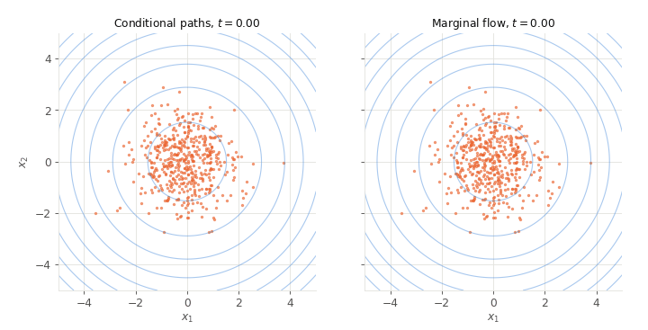
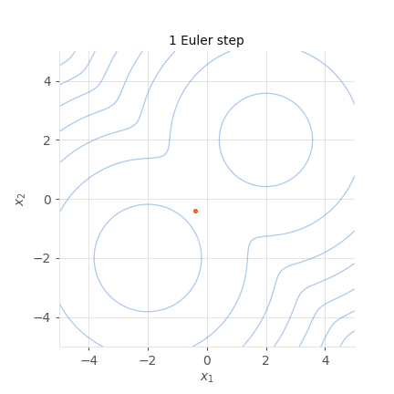

# Flow matching {#sec-flowmatching}

Diffusion models learn to generate data by learning to undo a noising process, one step at a time (@sec-diffusion). Their continuous-time version showed that they can also be sampled with a deterministic flow, an ordinary differential equation transporting noise onto data, and @sec-ot showed that some flows are better than others: the ones of optimal transport move the mass along straight lines. **Flow matching** [@Lipman2023; @Liu2022e; @Albergo2023] learns such a flow directly, with a regression as simple as the one of diffusion models, but without any noising process. It has become the training method of many recent large generative models.

:::{.callout-warning icon="false"}
## Time runs from noise to data

This chapter follows the convention of the flow matching literature: the time $t$ goes from $t = 0$, where the samples are **noise**, $x_0 \sim p_0 = \mathcal{N}(0, I)$, to $t = 1$, where they are **data**, $x_1 \sim p_1$. This is the opposite of the diffusion chapters, where $x_0$ was the data and $x_T$ the noise.
:::

## Flows

A **flow** is defined by a time-dependent **velocity field** $v_t(x)$, which gives, at each time $t \in [0, 1]$ and each position $x$, the velocity of a particle located there. Starting from a sample of the noise distribution, a particle follows the ordinary differential equation (ODE):

$$
    \dfrac{dx}{dt} = v_t(x) \qquad \text{with} \qquad x(0) = x_0 \sim p_0
$$

until it reaches its final position $x(1)$ at $t = 1$. Moving all the samples of $p_0$ in this way transforms their distribution: at each time $t$, the particles follow a distribution $p_t$, which goes from $p_0$ at $t = 0$ to some final distribution at $t = 1$. The goal of a generative model is to find a velocity field whose final distribution is the data distribution $p_1$. This is the dynamic view of transport of @sec-ot, and the probability flow of diffusion models (@sec-diffusion) is one such velocity field.

@fig-flow illustrates this in one dimension, with time on the horizontal axis. The velocity field is represented by arrows: at each time and position, it tells in which direction and how fast a particle moves. The particles start from the noise distribution on the left, follow the arrows, and progressively gather into the two modes of the data distribution on the right. In between, their distribution $p_t$ progressively deforms from one into the other.

{#fig-flow}

How the distribution $p_t$ evolves under the flow is described by the **continuity equation** of fluid mechanics, which expresses the conservation of mass: the probability mass is neither created nor destroyed, so the density at a point only changes because mass flows in or out of it. We will not need its exact form here, only the fact that a velocity field determines how the whole distribution moves.

Models that learn a velocity field $v_\theta(x, t)$ with a neural network are called **continuous normalizing flows** [@Chen2018]. They can in principle be trained by maximum likelihood, as the continuity equation allows computing how the log-density of each sample changes along its trajectory. But this requires simulating the ODE for every training sample, and computing derivatives of the network along the whole trajectory: training is very slow, and scales badly to high-dimensional data such as images. Flow matching avoids this simulation entirely: the velocity field is learned by regression on samples of the paths, without ever solving the ODE during training.

## Conditional paths and the marginal velocity

### Straight lines between noise and data

Which velocity field transports the noise onto the data? We do not know it, but we can easily build paths from noise to data. Let's pick a noise sample $x_0 \sim \mathcal{N}(0, I)$ and a data sample $x_1$ from the training set, independently of each other, and join them by a straight line travelled at constant speed:

$$
    x_t = (1 - t) \, x_0 + t \, x_1
$$

Along this **conditional path**, the velocity is constant and very simple:

$$
    u_t = \dfrac{d x_t}{dt} = x_1 - x_0
$$

Repeating this for all pairs of noise and data samples defines a distribution $p_t$ of the interpolated points at each time $t$. It goes from the noise distribution at $t = 0$ to the data distribution at $t = 1$, and blends both in between: for each $t$, $p_t$ is obtained by shrinking the data by a factor $t$ and blurring it with noise of standard deviation $1 - t$. We already have a way to generate samples of $p_t$ for any $t$, by interpolating random pairs. But generating data requires a **velocity field**: a rule that tells, for a point $x$ at time $t$, where to go, without knowing in advance which pair it belongs to.

### The marginal velocity

Many conditional paths pass through the same point $x$ at time $t$: lines between different noise and data samples cross each other (@fig-flowmatchingpaths, left). The velocity field that moves the whole distribution $p_t$ along, called the **marginal velocity**, is the **average** of the velocities of all the conditional paths passing through $x$ at time $t$:

$$
    v_t(x) = \mathbb{E}[x_1 - x_0 \, | \, x_t = x]
$$

:::{.callout-note icon="false" collapse="true"}
## Why the average?

Think of the probability mass flowing through a small region around $x$ at time $t$. Each conditional path passing through this region carries its own share of the mass with velocity $x_1 - x_0$. The total flux of mass through the region is the sum of the fluxes of all the paths, i.e. the density $p_t(x)$ multiplied by their average velocity. A single velocity field moving the same amount of mass in the same way must therefore have this average velocity at $x$. Formally, the continuity equation is linear in the product of the density and the velocity, so the marginal densities and fluxes of the conditional paths add up [@Lipman2023].

As the path is a straight line, the conditional velocity can also be written in terms of the end point: $x_1 - x_0 = (x_1 - x_t) / (1 - t)$, so that $v_t(x) = (\mathbb{E}[x_1 | x_t = x] - x) / (1 - t)$: the marginal velocity points towards the average data sample compatible with the current position, which is what the toy figures of this chapter compute exactly.
:::

The marginal velocity transports the noise distribution onto the data distribution, through exactly the same intermediate distributions $p_t$ as the conditional paths. But its trajectories are not the conditional paths. Each conditional path is a straight line, but the marginal velocity averages over many lines going in different directions, so its trajectories are **curved** (@fig-flowmatchingpaths, right). A particle does not end at a predetermined data sample: it follows the average direction, and commits progressively to one of the modes. Unlike the conditional paths, the trajectories of the marginal flow never meet, as the velocity field defines a single direction at each point and time.

:::{.panel-tabset}
#### Paths

{#fig-flowmatchingpaths}

#### Animation

{width=90%}
:::

## The flow matching loss

We would like to train a neural network $v_\theta(x, t)$ to approximate the marginal velocity, for example by minimizing the squared error between the two at all times and positions:

$$
    \mathcal{L}_\text{FM}(\theta) = \mathbb{E}_{t \sim \mathcal{U}(0, 1), \, x \sim p_t} [|| v_\theta(x, t) - v_t(x) ||^2]
$$

But the marginal velocity $v_t(x)$ is an average over all the data, which we cannot compute. The key result of flow matching is that we do not need it: regressing on the velocity of the **conditional** paths, which is known, works just as well. The **conditional flow matching** loss is:

$$
    \mathcal{L}_\text{CFM}(\theta) = \mathbb{E}_{t \sim \mathcal{U}(0, 1), \, x_0 \sim \mathcal{N}(0, I), \, x_1 \sim p_1} [|| v_\theta((1 - t) \, x_0 + t \, x_1, t) - (x_1 - x_0) ||^2]
$$

The two losses differ only by a constant that does not depend on $\theta$, so they have the same gradients and the same minimum [@Lipman2023]. The reason is the same as for the noise predictor of diffusion models (@sec-diffusion): the best prediction of a quantity in the sense of the squared error is its expected value. The network cannot know from which pair $(x_0, x_1)$ the point $x_t$ comes, so the best it can do is to predict the average of $x_1 - x_0$ over all the pairs compatible with $x_t$, which is precisely the marginal velocity.

:::{.callout-note icon="false" collapse="true"}
## Proof

Expanding the squares, both losses contain the term $\mathbb{E}[||v_\theta(x_t, t)||^2]$, which is the same as the points $x_t$ follow $p_t$ in both cases. The terms that do not involve $\theta$ (the squared norms of the targets) are constants. Only the cross terms remain to compare. For the conditional loss, conditioning on $x_t$:

$$
    \mathbb{E}_{t, x_0, x_1} [v_\theta(x_t, t) \cdot (x_1 - x_0)] = \mathbb{E}_{t, x_t} [v_\theta(x_t, t) \cdot \mathbb{E}[x_1 - x_0 | x_t]] = \mathbb{E}_{t, x_t} [v_\theta(x_t, t) \cdot v_t(x_t)]
$$

which is the cross term of the marginal loss. The two losses therefore differ by a constant.
:::

Training a flow matching model is therefore as simple as training a diffusion model. Each training iteration consists in:

1. sampling a data sample $x_1$ from the training set, a noise sample $x_0 \sim \mathcal{N}(0, I)$, and a time $t \in [0, 1]$;
2. computing the interpolated point $x_t = (1 - t) \, x_0 + t \, x_1$;
3. updating the network to reduce the squared error $|| v_\theta(x_t, t) - (x_1 - x_0) ||^2$.

The structure is the same as the training of diffusion models: sample data, noise and a time, mix them, and regress. Only the mixing and the target differ: a straight interpolation instead of the noise schedule $\sqrt{\bar{\alpha}_t}$, and the direction from the noise to the data instead of the noise itself. No ODE is ever solved during training, which is the main advantage over continuous normalizing flows. As for diffusion models, the distribution of the times $t$ used during training matters in practice: large models sample them more often in the middle of the interval, where the prediction is the most difficult [@Esser2024].

## Sampling

Once the velocity field is learned, generating a new sample consists in drawing a noise sample $x_0 \sim \mathcal{N}(0, I)$ and integrating the ODE $dx / dt = v_\theta(x, t)$ from $t = 0$ to $t = 1$. The simplest numerical method is the **Euler method**: the time interval is divided into $K$ steps of size $h = 1 / K$, and at each step the sample moves in a straight line along the current velocity:

$$
    x_{t + h} = x_t + h \, v_\theta(x_t, t)
$$

Each step requires one evaluation of the network, as one step of the reverse process of a diffusion model. The Euler method is exact when the trajectories are straight lines travelled at constant speed: a single step would then be enough. When the trajectories are curved, following the velocity in a straight line overshoots or undershoots the curve, and more steps are needed.

@fig-flowmatchingsampling shows the effect of the number of steps with the exact velocity field of @fig-flowmatchingpaths. With a single step, all the samples land on the same point, the mean of the data: at $t = 0$, the noise sample says nothing about which data sample it will become, so the marginal velocity points towards the average data sample, $\mathbb{E}[x_1] - x_0$, and a single step follows it all the way. With a few more steps, the samples have time to change direction and split between the two modes, but the modes are still too narrow and their proportions wrong. Around 50 steps, the samples follow the data distribution. The more curved the trajectories, the more steps are needed, which is why straightening the trajectories is an important goal (see below). In practice, higher-order integration methods, which evaluate the velocity at several points of each step, reduce the number of steps further.

:::{.panel-tabset}
#### Snapshots

{#fig-flowmatchingsampling}

#### Animation

{width=60%}
:::

## Diffusion models are flow matching models

### Gaussian paths

The straight line is not the only possible conditional path. More generally, flow matching can use any **Gaussian path** of the form:

$$
    x_t = \alpha_t \, x_1 + \sigma_t \, x_0 \qquad \text{with} \qquad x_0 \sim \mathcal{N}(0, I)
$$

where the coefficients $\alpha_t$ and $\sigma_t$ go from $\alpha_0 = 0$, $\sigma_0 = 1$ (pure noise) to $\alpha_1 = 1$, $\sigma_1 = 0$ (pure data). The straight line of the previous sections corresponds to $\alpha_t = t$ and $\sigma_t = 1 - t$. The conditional velocity is then $\dot{\alpha}_t \, x_1 + \dot{\sigma}_t \, x_0$, where the dots denote the derivatives with respect to time, and the flow matching loss is unchanged otherwise.

This form should look familiar: it is exactly the one-shot formula of the forward process of diffusion models (@sec-diffusion), $\sqrt{\bar{\alpha}} \, x_{\text{data}} + \sqrt{1 - \bar{\alpha}} \, \epsilon$, with time running in the opposite direction. Diffusion models use the coefficients $\alpha_t = \sqrt{\bar{\alpha}}$ and $\sigma_t = \sqrt{1 - \bar{\alpha}}$, which satisfy $\alpha_t^2 + \sigma_t^2 = 1$: the variance of the samples is preserved along the path. In the plane spanned by $x_0$ and $x_1$, this path is not a straight line but an arc of circle: the conditional paths of diffusion models are **curved**, even for a single pair of noise and data samples.

### Velocity, noise and score

For Gaussian paths, the three quantities that a network can be trained to predict, the velocity, the noise and the score, are linear functions of each other. The marginal velocity can be written as:

$$
    v_t(x) = \dfrac{\dot{\alpha}_t}{\alpha_t} \, x + \left( \dfrac{\dot{\alpha}_t \, \sigma_t^2}{\alpha_t} - \dot{\sigma}_t \, \sigma_t \right) \nabla_x \log p_t(x)
$$

:::{.callout-note icon="false" collapse="true"}
## Derivation

Along a conditional path, $x_1 = (x_t - \sigma_t \, x_0) / \alpha_t$, so that the conditional velocity can be written as a function of the current point and of the noise:

$$
    \dot{\alpha}_t \, x_1 + \dot{\sigma}_t \, x_0 = \dfrac{\dot{\alpha}_t}{\alpha_t} \, x_t + \left( \dot{\sigma}_t - \dfrac{\dot{\alpha}_t \, \sigma_t}{\alpha_t} \right) x_0
$$

The marginal velocity is its average given $x_t = x$, which only involves the average noise $\mathbb{E}[x_0 | x_t = x]$. By Tweedie's formula (@sec-diffusion), this average noise is proportional to the score of $p_t$: $\mathbb{E}[x_0 | x_t = x] = - \sigma_t \, \nabla_x \log p_t(x)$. Replacing it gives the result.
:::

The velocity is a combination of the current position and of the score of the noisy data distribution. A network trained to predict the noise, as in diffusion models, therefore also defines a velocity field, and conversely. In particular, the probability flow ODE of a diffusion model (@sec-diffusion) is exactly the marginal flow of flow matching with the variance-preserving path: both transport the noise onto the data through the same intermediate distributions.

Diffusion models and flow matching models are thus two members of the same family. They differ by three choices, rather than by their principle:

* the **path**: an arc of circle for diffusion models, a straight line for the simplest flow matching;
* the **target** of the regression: the noise, the score or the velocity, which are equivalent up to time-dependent factors, but weight the errors differently at different times;
* the **sampler**: a stochastic reverse process or a deterministic ODE, which can both be used with either model.

### Why straight paths?

If both families are equivalent, why prefer straight paths? With a straight path, the conditional velocity $x_1 - x_0$ is constant along the path, which gives the network a simple, well-scaled regression target at all times. More importantly, straight conditional paths tend to give straighter marginal trajectories than the curved paths of diffusion models, which can be integrated with fewer steps. In a large-scale comparison of paths and training targets for text-to-image models, straight paths with an appropriate distribution of training times gave the best results [@Esser2024], and they are now used by many large generative models.

But, as @fig-flowmatchingpaths showed, straight conditional paths do not make the marginal trajectories straight: with random pairs of noise and data, the marginal velocity averages over crossing paths, and its trajectories curve. Straightening the marginal trajectories requires changing how noise and data samples are **paired**, which brings optimal transport back.

## Straightening the flow

### Optimal transport couplings

The flow matching loss pairs noise and data samples at random, which is the independent coupling of @sec-ot. But the loss remains valid for any coupling: the conditional paths only have to start from noise and end on data. With the **optimal coupling**, the pairs are close to each other and their paths point in consistent directions, so that the marginal velocity averages over paths that agree, and its trajectories are close to the straight lines of optimal transport. The optimal coupling of the whole dataset cannot be computed, but it can be computed on each minibatch, with the assignment or the Sinkhorn algorithm, for a small additional cost [@Tong2024]: the learned trajectories are straighter, and fewer steps are needed to generate a sample.

@fig-flowmatching1d illustrates this in one dimension, where the optimal coupling of a minibatch is obtained by sorting both sets of samples. The conditional paths of random pairs cross, those of sorted pairs do not (top). With random pairs, the trajectories of the marginal flow are curved; with sorted pairs, all the paths passing through a point agree, and the trajectories are the straight lines of optimal transport (bottom). Interestingly, both flows end at the same points: in one dimension, a flow cannot make two particles cross, and the order-preserving map is the optimal transport map (@sec-ot). The marginal flow of random pairs finds the optimal destinations, but along curved paths, which require more integration steps.

![Flow matching with random and optimal pairs in one dimension, from the noise (left of each panel) to a bimodal data distribution (right). Top: the conditional paths of a minibatch of training pairs; random pairs cross (left), while optimal pairs, obtained by sorting both sets, do not (right). Bottom: the resulting flows, from the same noise samples. With random pairs, the trajectories of the marginal flow are curved (left); with optimal pairs, they are the straight lines of optimal transport (right). Both reach exactly the same end points.](../img/flow-matching-1d.png){#fig-flowmatching1d}

### Rectified flows

**Rectified flows** [@Liu2022e] straighten the trajectories without computing any optimal transport. After training a first flow with random pairs, each noise sample is paired with the data sample that this flow **generates** from it, by integrating the ODE. These new pairs are much more consistent than random pairs: the flow does not make its trajectories cross, so the straight lines between the start and end points of its trajectories cross much less. A second flow, trained on these pairs, has straighter trajectories, and the procedure, called **reflow**, can be repeated. After a few iterations, the trajectories are almost straight, and samples can be generated with very few steps, sometimes a single one. Rectified flows are at the heart of recent large-scale image generators, such as recent versions of Stable Diffusion [@Esser2024].

## Summary

Flow matching learns the velocity field of a flow transporting noise onto data, by a simple regression on the velocity of conditional paths between noise and data samples. Compared to the diffusion models of @sec-diffusion, it changes a few choices rather than the principle:

| | Diffusion models | Flow matching |
|:---|:---|:---|
| Conditional path | arc of circle (variance-preserving), via a noising process | straight line between a noise and a data sample |
| Coupling of noise and data | independent | independent, or optimal transport on minibatches |
| Regression target | the noise (equivalently, the score) | the velocity $x_1 - x_0$ |
| Training | regression at random times, no simulation | regression at random times, no simulation |
| Sampling | stochastic reverse process or deterministic ODE | deterministic ODE (Euler or higher-order steps) |
| Number of steps | tens to hundreds | fewer when the trajectories are straight; reflow towards a single step |

Both families learn the same kind of object, a time-dependent vector field (the score or the velocity) that transforms a simple distribution into the data distribution through a continuum of intermediate distributions, and both inherit the ideas of the previous chapters: the reparameterization of the noisy samples, denoising as a regression on conditional expectations, the dynamic view of optimal transport. The straight paths of flow matching make the regression target simpler and the sampling faster, which is why most recent large-scale image and video generators are trained with flow matching, often combined with transformers instead of U-Nets [@Esser2024]. The conditioning and guidance methods of @sec-conditionaldiffusion, and the use of a latent space, apply unchanged.

For a detailed, implementation-oriented presentation of flow matching and its many variants, see @Lipman2024.
