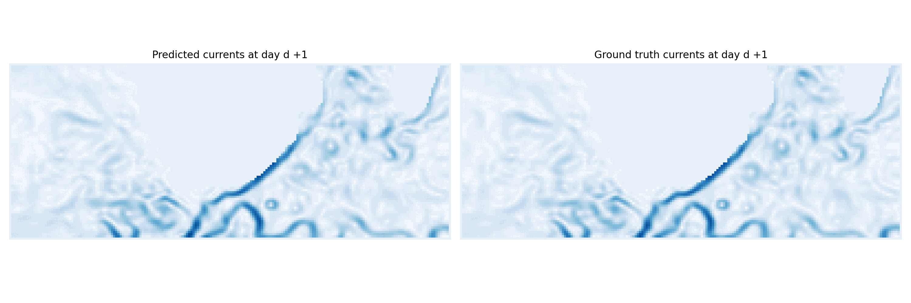
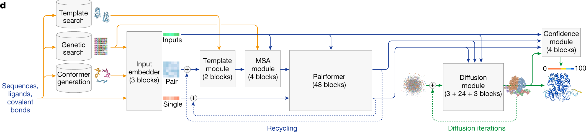

# Introduction {#sec-introduction}

## One answer, or many?

Most of deep learning is taught as the art of learning functions: a neural network takes an input $x$, such as an image, and produces an output $y$, such as the name of the object it contains, and it is trained to make its outputs as close as possible to the targets of a training set, typically by minimizing the mean square error between them. This view is very successful, but it hides an assumption: that for each input, there is **a single right answer**.

Many problems do not have a single answer. A blurry photograph is compatible with many sharp images; the weather in two weeks is compatible with many different situations; a sentence can be continued in many ways; a sketch can be turned into many paintings. What does a network trained with the mean square error do in such cases? It predicts the **average** of all the possible answers, as the average is the prediction that minimizes the squared error. When the possible answers are close to each other, the average is a good summary. When they are very different, the average is often not a possible answer at all: the average of a cat and a dog is not an animal, the average of two possible trajectories of a storm goes between them, and the average of two branches of a curve lies where there is no data (@fig-introaverage, left).

{#fig-introaverage}

A **probabilistic** model does not predict a single answer, but a **distribution** of answers $p(y | x)$, or, without inputs, the distribution $p(x)$ of the data itself (@fig-introaverage, right). This changes everything:

* the distribution can be **sampled**, to generate as many plausible answers as we want, all different and all realistic;
* it tells **how uncertain** the model is: a narrow distribution means a confident prediction, a broad or multimodal one means that several answers are possible;
* it can be **combined** with other sources of information, such as measurements or prior knowledge, through Bayes' rule.

This book is about the tools needed to build, train and use such probabilistic models with neural networks.

## Distributions everywhere

Probability distributions are at the heart of the most impressive applications of deep learning of the last years, often hidden behind the interface.

**Generating text and images.** A large language model is a probabilistic model of text: given the beginning of a sentence, it outputs a probability distribution over the next token, the output of a softmax classifier (@sec-softmax), and generates text by sampling one token at a time [@Brown2020]. Image generators sample high-dimensional distributions over images, conditioned on a text description: they are diffusion models and flow matching models (@sec-diffusion, @sec-flowmatching), often working in the latent space of an autoencoder [@Ramesh2022; @Esser2024]. In both cases, generating means sampling, and there is no single right output.

**Inverse problems.** Many measurement devices only give an incomplete or noisy view of what we want to observe: a medical scanner measures a few frequencies of an image, a camera takes a blurry or partially hidden picture. Reconstructing the image is an **inverse problem** with many solutions (@sec-inverseproblems). A generative model of plausible images acts as a prior, which selects the solutions consistent with both the measurements and what images usually look like, and quantifies how uncertain the reconstruction is [@Song2022a].

**Weather forecasting and data assimilation.** Deep networks now forecast the weather as well as the numerical models of national weather services, at a fraction of the computational cost [@Lam2023; @Bi2023]. Trained with the mean square error, deterministic forecasts become increasingly blurry at long lead times: they predict the average of all possible future weathers, in which storms are smeared out. Probabilistic models instead generate an **ensemble** of sharp, plausible forecasts, whose spread tells how predictable the weather is [@Price2025] (@fig-gencast). The same holds for the ocean: @fig-oceancurrents shows forecasts of ocean surface currents sampled from a conditional diffusion model. Before forecasting, the current state of the atmosphere or of the ocean must itself be estimated from sparse, noisy satellite and in-situ observations: this is **data assimilation**, an inverse problem over time whose answer is a posterior distribution over the possible states. Generative models are increasingly used to sample this posterior [@Rozet2023; @Huang2024b; @Andrae2025; @Martin2025].

{#fig-gencast}

{#fig-oceancurrents}

**Science.** Predicting the three-dimensional structure of a complex of proteins, DNA and small molecules from their sequences means predicting the positions of all their atoms. AlphaFold 3 does so with a **diffusion module**, which generates these positions from noise, conditioned on the sequences, and can be sampled several times to explore alternative structures [@Abramson2024] (@fig-alphafold3). More generally, the parameters of scientific models are rarely known exactly, and Bayesian inference gives their posterior distribution given the observations (@sec-bayesian).

{#fig-alphafold3}

**Decisions.** An agent learning by trial and error explores its environment with a stochastic **policy**, a distribution over its actions, which reinforcement learning shapes towards the actions with the best outcomes (@sec-reinforcementlearning). Language models are fine-tuned in the same way from human feedback, the generated texts being the actions [@Ouyang2022]. Robots can even generate their motor commands with a diffusion model conditioned on what they see [@Chi2023].

## The common thread

These applications look very different, but they rely on the same few ideas, which give this book its structure. The data, whether images, sentences or weather situations, are samples of an unknown distribution $p(x)$, of which we only know a training set. A model is a **parameterized distribution** $p_\theta(x)$, typically defined by a neural network with parameters $\theta$, and learning consists in making $p_\theta(x)$ as close as possible to $p(x)$ (@fig-commonthread). Closeness is measured by a **divergence** between the two distributions, most of the time the Kullback-Leibler divergence (@sec-kl): minimizing it is the same as maximizing the likelihood of the data under the model (@sec-mle), and this principle covers classification, regression, generative modeling and much more.

, CC-BY 4.0.](img/common-thread.png){#fig-commonthread}

The difficulty is that almost everything we want to compute with distributions involves **integrals**: expectations, normalization constants, marginals over latent variables, posteriors. In high dimensions, these integrals are intractable. Two families of methods make them tractable, and they form the two central parts of this book:

* **Sampling** replaces integrals by averages over samples: Monte Carlo methods, Markov chain Monte Carlo, Langevin dynamics.
* **Optimization** replaces an intractable distribution by the closest member of a tractable family: variational inference, and the variational autoencoders built on it.

The most recent generative models, diffusion models and flow matching, combine both: they are trained by optimizing a variational bound, they learn the gradient of the log-density that Langevin dynamics uses to sample, and they move samples along the paths of optimal transport.

## A map of the book

The book is organized in five parts:

* **Basics** introduces the probabilistic vocabulary used everywhere else: entropy, cross-entropy and the KL divergence, maximum likelihood estimation, and Bayesian estimation.
* **Statistical machine learning** shows that classical neural networks are probabilistic models in disguise: the softmax classifier, regression with uncertainty and mixture density networks, and the choice of divergence.
* **Sampling methods** presents the methods that compute expectations with samples: Monte Carlo and importance sampling, Markov chain Monte Carlo, and the gradient-based samplers, Langevin dynamics and Hamiltonian Monte Carlo.
* **Variational inference** presents the alternative, optimization: latent variable models, the evidence lower bound, variational autoencoders, and the estimation of gradients of expectations, with an application to reinforcement learning.
* **Deep generative models** brings everything together: diffusion models, their conditional and latent versions behind modern image generators, optimal transport, and flow matching.

```{mermaid}
flowchart LR
    A["<b>Basics</b><br>entropy, KL, likelihood"] --> B["<b>Statistical ML</b><br>softmax, MDN"]
    A --> C["<b>Sampling</b><br>Monte Carlo, MCMC, Langevin"]
    A --> D["<b>Variational inference</b><br>ELBO, VAE"]
    C --> E["<b>Deep generative models</b><br>diffusion, OT, flow matching"]
    D --> E
```

The parts are meant to be read in order, but readers mainly interested in generative models can take a shorter path: the KL divergence and maximum likelihood (@sec-informationtheory, @sec-mle), the score and Langevin dynamics (@sec-score, @sec-langevin), latent variable models, the ELBO and VAEs (@sec-latentvariables, @sec-variationalinference, @sec-vae), and then directly the diffusion models of @sec-diffusion.
