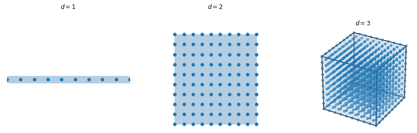
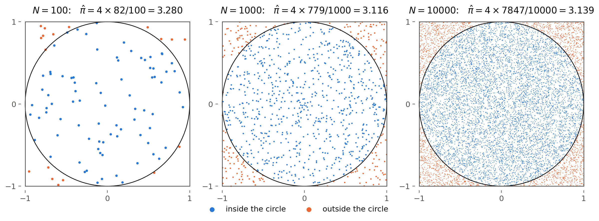
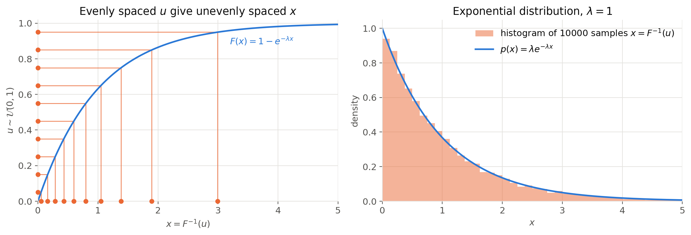

# Monte Carlo and importance sampling {#sec-montecarlo}

## Why sampling?

### Expectations everywhere

Nearly every quantity we manipulate in this book is a mathematical expectation over some probability distribution:

* The entropy, the cross-entropy and the KL divergence (@sec-informationtheory) are expectations of (log-)probabilities:

$$
    H(X) = \mathbb{E}_{x \sim p(x)} [- \log p(x)] \qquad \text{KL}(p || q) = \mathbb{E}_{x \sim p(x)}[- \log \dfrac{q(x)}{p(x)}]
$$

* The loss functions of machine learning are expectations over the data distribution, for example the negative log-likelihood (@sec-klml):

$$
    \mathcal{L}(\theta) = \mathbb{E}_{x \sim p(x)} [- \log p_\theta(x)]
$$

* The evidence of a latent variable model (see @sec-latentvariables later) is an expectation over the prior of the latent variables:

$$
    p_\theta(x) = \mathbb{E}_{z \sim p_\theta(z)} [p_\theta(x | z)]
$$

* The predictions of full Bayesian inference (@sec-map) are an expectation over the posterior of the parameters:

$$
    p(x | X) = \mathbb{E}_{\theta \sim p(\theta | X)} [p(x | \theta)]
$$

* The ELBO of variational inference (see @sec-variationalinference later) is an expectation over an approximate posterior $q_\phi(z|x)$.

All these quantities have the same generic form: the expectation of some function $f(x)$ when $x$ is distributed according to $p(x)$, which is by definition an integral over all possible values of $x$:

$$
    \mathbb{E}_{x \sim p(x)} [f(x)] = \int_x f(x) \, p(x) \, dx
$$

In the discrete case, the integral is replaced by a sum over all possible outcomes, but the problem is the same.

### Closed forms are the exception

In a few lucky cases, this integral can be computed analytically. We saw two of them:

* The KL divergence between two normal distributions only depends on their parameters (@sec-klnormal).
* The posterior of the mean of a normal distribution with a normal prior is itself a normal distribution (conjugate prior, @sec-map).

As soon as a neural network is involved (the likelihood $p_\theta(x)$ of a deep model, the decoder $p_\theta(x|z)$ of a VAE, etc.), there is no hope of computing the integral analytically. We need to approximate it numerically.

### Numerical integration does not scale {#sec-curse}

The classical way to approximate an integral numerically is **quadrature**: we cut the space of $x$ into a regular grid, evaluate $f(x) \, p(x)$ at each point of the grid, and sum the values weighted by the volume of each cell (Riemann sum). In one dimension, a grid of $M = 100$ points is usually enough to get a decent approximation.

The problem is that the number of points of the grid grows **exponentially** with the dimension $d$ of $x$. If we keep $M$ points per dimension, we need:

$$
    M^d
$$

evaluations of the function (@fig-cursedimensionality). With $M=100$ points per dimension:

* $d = 1$: 100 evaluations.
* $d = 10$: $10^{20}$ evaluations, already out of reach.
* $d = 784$ (a small $28 \times 28$ grayscale image): $10^{1568}$ evaluations, to be compared with the roughly $10^{80}$ atoms in the observable universe.

{#fig-cursedimensionality width=70%}

This is the **curse of dimensionality**. Worse, most of these evaluations are wasted: in high dimensions, the probability mass of $p(x)$ is concentrated in a tiny fraction of the space, so almost all grid points contribute nothing to the sum.

### The idea of sampling

**Monte Carlo methods** take a radically different approach: instead of visiting the whole space systematically, we let the distribution tell us where to look. If we can draw $N$ samples $x_i$ from $p(x)$, the expectation can be approximated by the average of $f$ over the samples:

$$
    \mathbb{E}_{x \sim p(x)} [f(x)] \approx \dfrac{1}{N} \, \sum_{i=1}^N f(x_i)
$$

The samples automatically fall where the probability mass is: regions where $p(x)$ is high are visited often, regions where it is negligible are almost never visited. No evaluation is wasted.

:::{.callout-tip icon="false"}
## Example: computing $\pi$

The classical example of a Monte Carlo method is the computation of $\pi$. Let's draw points $x = (x_1, x_2)$ **uniformly** in the square $[-1, 1]^2$, whose area is 4. The disk of radius 1 centered on the origin lies inside the square and has an area of $\pi$. The probability that a point falls inside the disk is therefore the ratio of the two areas:

$$
    P(||x|| \leq 1) = \dfrac{\pi}{4}
$$

This probability can be written as an expectation, using the **indicator function** $\mathbb{I}(||x|| \leq 1)$, which is equal to 1 when the point is inside the disk and 0 otherwise:

$$
    \pi = 4 \, P(||x|| \leq 1) = \mathbb{E}_{x \sim \mathcal{U}([-1, 1]^2)} [4 \, \mathbb{I}(||x|| \leq 1)]
$$

We are exactly in the setting above, with $p(x)$ the uniform distribution on the square and $f(x) = 4 \, \mathbb{I}(||x|| \leq 1)$. If $N_\text{in}$ of the $N$ samples fall inside the disk, the Monte Carlo approximation is:

$$
    \pi \approx \dfrac{1}{N} \, \sum_{i=1}^N 4 \, \mathbb{I}(||x_i|| \leq 1) = 4 \, \dfrac{N_\text{in}}{N}
$$

{#fig-montecarlopi}

As seen on @fig-montecarlopi, the estimate gets closer to $\pi = 3.14159\ldots$ when the number of samples increases, but rather slowly: with 10000 samples, the error is still around $0.003$. How fast the estimate converges is the topic of the next section.
:::

We already used this approximation several times without discussing it: to estimate the cross-entropy between the data and a model (@sec-klml), or to replace the expectations of a loss function by an average over a minibatch of training data. This chapter looks at it more closely. It requires two things:

1. being able to evaluate $f(x)$ for any $x$,
2. being able to draw samples from $p(x)$.

The first requirement is usually easy. The second one is the difficult part, and the rest of the chapter is organized around it:

* We first analyze the **Monte Carlo estimator** itself: why it works, and how fast it converges when we can sample from $p(x)$.
* We then see how to sample from **simple distributions**, for which dedicated methods exist.
* When $p(x)$ is too complex to be sampled directly, **rejection sampling** and **importance sampling** use a simpler proposal distribution $q(x)$ instead.
* Finally, we will see why these methods also break down in high dimensions, which motivates Markov chain Monte Carlo (MCMC) methods in the next chapter.

## The Monte Carlo estimator {#sec-mcestimator}

### Definition

Let's draw $N$ samples $x_1, x_2, \ldots, x_N$ **independently** from $p(x)$ (i.i.d., as in @sec-mle). The **Monte Carlo estimator** of $\mathbb{E}_{x \sim p(x)} [f(x)]$ is the sampling average of $f$:

$$
    \hat{f}_N = \dfrac{1}{N} \, \sum_{i=1}^N f(x_i)
$$

It is important to realize that $\hat{f}_N$ is itself a **random variable**: if we draw another set of $N$ samples, we obtain a different value. In the example of $\pi$, each panel of @fig-montecarlopi gave a different estimate, and repeating the experiment with other random points would give yet other values. The questions we need to answer are therefore statistical:

1. Is $\hat{f}_N$ correct **on average**, i.e. is its expectation equal to the quantity we want?
2. How far from the true value is a **single** estimate likely to be, i.e. what is its variance?

To simplify the notations, let's call $\mu_f$ and $\sigma_f^2$ the mean and variance of $f(x)$ when $x \sim p(x)$:

$$
    \mu_f = \mathbb{E}_{x \sim p(x)} [f(x)] \qquad\qquad \sigma_f^2 = \text{Var}_{x \sim p(x)} (f(x)) = \mathbb{E}_{x \sim p(x)} [(f(x) - \mu_f)^2]
$$

$\mu_f$ is the quantity we want to estimate. $\sigma_f^2$ measures how much the values of $f$ fluctuate from one sample to another.

### The estimator is unbiased

The expectation of the estimator (over all possible sets of $N$ samples) is, by linearity of the expectation:

$$
\begin{aligned}
    \mathbb{E}[\hat{f}_N] &= \mathbb{E}[\dfrac{1}{N} \, \sum_{i=1}^N f(x_i)] & \text{(Definition)} \\
    &= \dfrac{1}{N} \, \sum_{i=1}^N \mathbb{E}_{x_i \sim p(x)}[f(x_i)] & \text{(Linearity of the expectation)} \\
    &= \dfrac{1}{N} \, \sum_{i=1}^N \mu_f & \text{(All samples come from } p(x)) \\
    &= \mu_f & \\
\end{aligned}
$$

On average, the Monte Carlo estimator gives exactly the right value: it is an **unbiased** estimator of $\mu_f$. Note that this holds for **any** number of samples, even $N=1$: a single sample $f(x_1)$ is an unbiased (but very noisy) estimate of $\mu_f$.

This is what we do implicitly when we train a neural network with stochastic gradient descent: the gradient of the loss is estimated on a small minibatch of samples instead of the whole dataset. The estimate is noisy, but it is correct on average, which is enough for gradient descent to converge. Variational autoencoders (@sec-vae) even estimate the reconstruction loss with a single sample $z \sim q_\phi(z|x)$ per input.

### The variance decreases with $N$

The variance of the estimator tells us how much a single estimate deviates from $\mu_f$. Because the samples are **independent**, the variance of their sum is the sum of their variances. Moreover, multiplying a random variable by a constant $a$ multiplies its variance by $a^2$:

$$
\begin{aligned}
    \text{Var}(\hat{f}_N) &= \text{Var}(\dfrac{1}{N} \, \sum_{i=1}^N f(x_i)) & \text{(Definition)} \\
    &= \dfrac{1}{N^2} \, \text{Var}(\sum_{i=1}^N f(x_i)) & (\text{Var}(a X) = a^2 \, \text{Var}(X)) \\
    &= \dfrac{1}{N^2} \, \sum_{i=1}^N \text{Var}_{x_i \sim p(x)} (f(x_i)) & \text{(Independent samples)} \\
    &= \dfrac{1}{N^2} \, N \, \sigma_f^2 & \text{(All samples come from } p(x)) \\
    &= \dfrac{\sigma_f^2}{N} & \\
\end{aligned}
$$

The standard deviation of the estimator, also called its **standard error**, is therefore:

$$
    \sqrt{\text{Var}(\hat{f}_N)} = \dfrac{\sigma_f}{\sqrt{N}}
$$

Moreover, as $\hat{f}_N$ is a sampling average of i.i.d. variables, the **central limit theorem** (@sec-bayesian) tells us that it is approximately normally distributed for large $N$, whatever the distribution of $f(x)$:

$$
    \hat{f}_N \sim \mathcal{N}(\mu_f, \dfrac{\sigma_f}{\sqrt{N}})
$$

This allows to quantify the error of a single estimate: as for any normal distribution, $\hat{f}_N$ falls within two standard errors of the true value $\mu_f$ about 95% of the time.

### Consequences

The formula $\sigma_f / \sqrt{N}$ is the most important result of this chapter. Let's look at what it means:

* **The error decreases as $1/\sqrt{N}$.** More samples always help, but slowly: to divide the error by 2, we need 4 times more samples; to gain one decimal (divide the error by 10), we need 100 times more samples. Monte Carlo methods are good at giving a rough estimate quickly, not at reaching a high precision.

* **The error does not depend on the dimension $d$ of $x$.** The dimension does not appear anywhere in the formula: estimating an expectation over a 784-dimensional space converges at the same rate $1/\sqrt{N}$ as in one dimension. This is the fundamental reason why sampling escapes the curse of dimensionality (@sec-curse), while the grid needed $M^d$ points.

* **The constant $\sigma_f$ matters.** For a fixed budget of samples, the error is proportional to the standard deviation of $f(x)$ under $p(x)$. A function that fluctuates a lot between samples needs many more samples than a nearly constant one. This is where the dimension can come back in disguise: in high dimensions, $\sigma_f$ itself can become very large. Reducing $\sigma_f$ is the goal of **variance reduction** techniques, among which importance sampling (see below).

In practice, $\sigma_f$ is unknown, as it is an expectation itself. But it can be estimated from the same samples, using the empirical variance:

$$
    \sigma_f^2 \approx \dfrac{1}{N-1} \, \sum_{i=1}^N (f(x_i) - \hat{f}_N)^2
$$

so that every Monte Carlo estimate can come with an estimate of its own error bar.

:::{.callout-tip icon="false"}
## Example: convergence of the estimate of $\pi$

Let's come back to the computation of $\pi$, where $f(x) = 4 \, \mathbb{I}(||x|| \leq 1)$ takes the value 4 with probability $\pi / 4$ and 0 otherwise. Its mean is $\mu_f = 4 \times \frac{\pi}{4} = \pi$, as expected. As $f(x)^2$ takes the value 16 with probability $\pi / 4$, its variance is:

$$
    \sigma_f^2 = \mathbb{E}[f(x)^2] - \mu_f^2 = 16 \, \dfrac{\pi}{4} - \pi^2 = \pi \, (4 - \pi) \approx 2.70
$$

The standard error of the estimate is therefore:

$$
    \dfrac{\sigma_f}{\sqrt{N}} \approx \dfrac{1.64}{\sqrt{N}}
$$

With $N = 10000$ samples, the standard error is about $0.016$: the error of $0.003$ we obtained in @fig-montecarlopi was actually on the lucky side. To get 6 correct decimals, we would need an error around $10^{-6}$, i.e. $N \approx 2.7 \times 10^{12}$ samples...

{#fig-montecarloconvergence}

@fig-montecarloconvergence shows both aspects. On the left, each run fluctuates a lot for small $N$, then all runs converge towards $\pi$, staying most of the time within one or two standard errors. On the right, the measured error on a log-log scale is a straight line of slope $-1/2$, exactly following the theoretical $1.64 / \sqrt{N}$.
:::

:::{.callout-tip icon="false"}
## Example: Monte Carlo estimate of the KL divergence

When the two distributions are not normal, the KL divergence (@sec-kl) has no closed form. But it is an expectation over the first distribution:

$$
    \text{KL}(p || q) = \mathbb{E}_{x \sim p(x)}[- \log \dfrac{q(x)}{p(x)}]
$$

If we can sample from $p(x)$ and evaluate both densities $p(x)$ and $q(x)$, the Monte Carlo estimator applies with $f(x) = - \log \frac{q(x)}{p(x)}$:

$$
    \text{KL}(p || q) \approx \dfrac{1}{N} \, \sum_{i=1}^N - \log \dfrac{q(x_i)}{p(x_i)} \qquad \text{with} \qquad x_i \sim p(x)
$$

In words: take samples from $p$, and average the log-ratio of their likelihoods under $p$ and $q$ (@fig-crossentropy). Note that individual terms of the sum can be negative (for samples where $q(x_i) > p(x_i)$), even though the KL itself is always positive: only the average is guaranteed to be correct. With few samples, the estimate can even be negative.
:::

## Sampling from simple distributions {#sec-simplesampling}

The Monte Carlo estimator requires samples from $p(x)$. But how does a computer actually produce a sample of a distribution? This section presents the basic tools, which work for simple distributions and serve as building blocks for the more complex methods of the next sections.

### Everything starts from uniform numbers

Computers are deterministic machines: they cannot produce truly random numbers. Instead, they use **pseudo-random number generators** (PRNG), deterministic algorithms that produce a sequence of numbers that *look* random: they are uniformly distributed in $[0, 1]$ and pass all statistical tests of independence. Numpy uses for example the PCG64 algorithm by default.

The sequence is entirely determined by its starting point, the **seed**. Using the same seed produces exactly the same sequence of numbers, which makes experiments reproducible: all the figures of this chapter are generated with a fixed seed.

Samples $u \sim \mathcal{U}(0, 1)$ of the uniform distribution are therefore the only randomness we have access to. Sampling any other distribution means **transforming** uniform samples. The simplest transformation is an affine one: if $u \sim \mathcal{U}(0, 1)$, then:

$$
    x = a + (b - a) \, u \sim \mathcal{U}(a, b)
$$

This is how we sampled points in the square $[-1, 1]^2$ for the computation of $\pi$, one coordinate at a time.

### Inverse transform sampling

A general method to transform uniform samples into samples of a univariate distribution $p(x)$ uses its **cumulative distribution function** (CDF):

$$
    F(x) = P(X \leq x) = \int_{-\infty}^x p(x') \, dx'
$$

The CDF increases monotonically from 0 to 1. If we can compute its inverse $F^{-1}$, sampling is straightforward:

1. sample $u \sim \mathcal{U}(0, 1)$,
2. return $x = F^{-1}(u)$.

Intuitively, $u$ selects a "quantile" of the distribution uniformly: $x$ is the value below which a fraction $u$ of the probability mass lies. Regions where $p(x)$ is high are regions where the CDF is steep, so a large interval of values of $u$ is mapped onto a small interval of $x$: these values of $x$ are obtained often.

:::{.callout-note icon="false" collapse="true"}
## Proof

We need to show that the CDF of $x = F^{-1}(u)$ is $F$. For any value $x$, as $F$ is monotonically increasing:

$$
    P(F^{-1}(u) \leq x) = P(u \leq F(x)) = F(x)
$$

where the last equality comes from the CDF of the uniform distribution: $P(u \leq a) = a$ for any $a \in [0, 1]$.
:::

For example, the **exponential distribution** of rate $\lambda$, often used to model waiting times, has the pdf and CDF:

$$
    p(x) = \lambda \, e^{- \lambda x} \qquad\qquad F(x) = 1 - e^{- \lambda x} \qquad\qquad \text{for } x \geq 0
$$

Solving $u = F(x)$ for $x$ gives the inverse CDF, i.e. the sampling formula:

$$
    x = F^{-1}(u) = - \dfrac{1}{\lambda} \, \log(1 - u)
$$

@fig-inversetransform illustrates the method. On the left, ten evenly spaced values of $u$ are mapped through the inverse CDF: near $x = 0$, where the CDF is steep, they give closely packed values of $x$; in the tail of the distribution, where the CDF is flat, they give widely spread values. On the right, the histogram of 10000 samples obtained this way matches the pdf of the exponential distribution.

{#fig-inversetransform}

The method has two limitations:

* It requires the inverse CDF in closed form, or at least a cheap way to compute it. Even for the normal distribution, the CDF has no closed form (it involves the error function).
* It only works in **one dimension**: the CDF of a multivariate distribution cannot be inverted in general.

### Normal distributions

The normal distribution is so important that dedicated methods exist. The **Box-Muller transform** turns two independent uniform samples $u_1, u_2 \sim \mathcal{U}(0, 1)$ into two independent samples of the standard normal distribution:

$$
    z_1 = \sqrt{-2 \log u_1} \, \cos(2 \pi u_2) \qquad\qquad z_2 = \sqrt{-2 \log u_1} \, \sin(2 \pi u_2)
$$

We will not prove it here (it relies on a change of variables to polar coordinates). Libraries use faster variants, but the principle is the same.

Once we can sample from $\mathcal{N}(0, 1)$, any normal distribution is an affine transformation away. If $z \sim \mathcal{N}(0, 1)$, then:

$$
    x = \mu + \sigma \, z \sim \mathcal{N}(\mu, \sigma)
$$

In the multivariate case, if $\mathbf{z} \sim \mathcal{N}(\mathbf{0}, I)$ is a vector of independent standard normal samples and the covariance matrix is decomposed as $\Sigma = L \, L^T$ (Cholesky decomposition), then $\mathbf{x} = \mathbf{\mu} + L \, \mathbf{z} \sim \mathcal{N}(\mathbf{\mu}, \Sigma)$. For a diagonal covariance matrix, this simply means $\mathbf{x} = \mathbf{\mu} + \mathbf{\sigma} \odot \mathbf{z}$, element-wise.

This is exactly the **reparameterization trick** of variational autoencoders (@sec-vae): instead of sampling the latent representation directly from $q_\phi(\mathbf{z}|\mathbf{x}) = \mathcal{N}(\mathbf{\mu_x}, \mathbf{\sigma_x})$, we sample a noise vector from $\mathcal{N}(\mathbf{0}, I)$ and transform it with the outputs $\mathbf{\mu_x}$ and $\mathbf{\sigma_x}$ of the encoder.

### Categorical distributions

For a discrete distribution over $K$ classes with probabilities $p_1, p_2, \ldots, p_K$ (summing to one), inverse transform sampling takes a very simple form. We cut the interval $[0, 1]$ into $K$ consecutive segments of lengths $p_1, \ldots, p_K$, sample $u \sim \mathcal{U}(0, 1)$, and return the class whose segment contains $u$:

$$
    k = \min \{ j \; | \; u \leq \sum_{i=1}^j p_i \}
$$

Each class is selected with a probability equal to the length of its segment, i.e. $p_k$. This is how a class is sampled from the output of a softmax classifier (@sec-softmax), how the component of a mixture density network is selected (@sec-mdn), or how a language model samples the next token from its predicted distribution.

### Ancestral sampling

The previous methods sample from distributions with a known, simple form. Many models are more complex, but they are **built** from simple distributions. A latent variable model (@sec-latentvariables) defines the joint distribution of the latent variable $z$ and the observation $x$ as:

$$
    p(x, z) = p(z) \, p(x | z)
$$

where the prior $p(z)$ and the conditional $p(x | z)$ are simple (e.g. normal) distributions. To sample from the joint, we simply follow the generative process, "ancestors" first:

1. sample $z \sim p(z)$,
2. sample $x \sim p(x | z)$, with the value of $z$ obtained in the first step.

The pair $(z, x)$ is a sample of the joint distribution $p(x, z)$. If we simply **discard** $z$, the remaining $x$ is a sample of the marginal distribution:

$$
    p(x) = \int_z p(x | z) \, p(z) \, dz
$$

This is a remarkable property: we can sample from $p(x)$ without ever computing this integral, which is intractable in general. This is how we sampled from a mixture density network (@sec-mdn), where $z$ is the index of the component, and how a trained VAE generates new images: sample $\mathbf{z} \sim \mathcal{N}(\mathbf{0}, I)$, then pass it through the decoder $p_\theta(\mathbf{x}|\mathbf{z})$.

The same principle applies to any model defined as a chain of conditional distributions, as long as each variable is sampled after the variables it depends on. Autoregressive models (@sec-paradigms) are the extreme case: a language model samples the first token, then the second given the first, and so on:

$$
    p(x_0, x_1, \ldots, x_T) = p(x_0) \, \prod_{t=1}^T p(x_t | x_0, \ldots, x_{t-1})
$$

### When simple methods are not enough

Ancestral sampling illustrates an asymmetry that will follow us for the rest of the book:

* For latent variable models, **sampling** from $p(x)$ is easy, but **evaluating** $p(x)$ for a given $x$ is hard, as it requires the intractable integral over $z$.
* For many other distributions, it is the opposite: we can **evaluate** the density, at least up to a constant, but we have no simple way to **sample** from it.

The second case is very common. The posterior of the parameters (@sec-map) is known up to the evidence:

$$
    p(\theta | X) = \dfrac{p(X | \theta) \, p(\theta)}{p(X)} \propto p(X | \theta) \, p(\theta)
$$

We can evaluate the numerator for any $\theta$, but $p(X)$ is intractable, and the posterior has no reason to be a simple distribution with a known sampling method. In general, we will only have access to an **unnormalized density** $\tilde{p}(x)$:

$$
    p(x) = \dfrac{\tilde{p}(x)}{Z} \qquad\qquad \text{with} \qquad Z = \int_x \tilde{p}(x) \, dx
$$

where the normalization constant $Z$ is unknown. The rest of this chapter (rejection and importance sampling) and the next one (MCMC) are about sampling from, or computing expectations under, such distributions.

## Rejection sampling {#sec-rejection}

### Principle

Let's suppose that we want samples from a distribution $p(x) = \tilde{p}(x) / Z$, where we can evaluate the unnormalized density $\tilde{p}(x)$ for any $x$, but do not know $Z$ and have no direct way to sample from $p(x)$.

**Rejection sampling** uses a simpler **proposal distribution** $q(x)$ that we can sample from (for example a normal distribution), and a constant $M$ large enough so that the scaled proposal $M \, q(x)$ is above the target everywhere:

$$
    \tilde{p}(x) \leq M \, q(x) \qquad \text{for all } x
$$

$M \, q(x)$ is called the **envelope** of the target. The algorithm then repeats the following steps:

1. sample a candidate $x \sim q(x)$,
2. sample $u \sim \mathcal{U}(0, 1)$,
3. **accept** $x$ if $u \leq \dfrac{\tilde{p}(x)}{M \, q(x)}$, otherwise **reject** it and start again.

The accepted samples are samples of $p(x)$.

The method has a simple geometric interpretation (@fig-rejectionsampling, left). The pair $(x, u \, M \, q(x))$ is a point drawn uniformly **under the curve** of the envelope: $x$ is distributed according to $q(x)$, and its height is uniform between 0 and $M \, q(x)$. The point is accepted if it also lies under the curve of the target $\tilde{p}(x)$. The accepted points are therefore uniformly distributed under $\tilde{p}(x)$, and their $x$-coordinates follow $p(x)$: there are more accepted points where $\tilde{p}(x)$ is high.

{#fig-rejectionsampling}

:::{.callout-note icon="false" collapse="true"}
## Proof

The probability density of proposing $x$ **and** accepting it is the density of the proposal times the probability of acceptance:

$$
    q(x) \times \dfrac{\tilde{p}(x)}{M \, q(x)} = \dfrac{\tilde{p}(x)}{M}
$$

Integrating over all $x$ gives the overall probability of accepting a proposal:

$$
    P(\text{accept}) = \int_x \dfrac{\tilde{p}(x)}{M} \, dx = \dfrac{Z}{M}
$$

The distribution of the accepted samples is the conditional distribution of $x$ given acceptance, i.e. the ratio of the two:

$$
    p(x | \text{accept}) = \dfrac{\tilde{p}(x) / M}{Z / M} = \dfrac{\tilde{p}(x)}{Z} = p(x)
$$
:::

Note that the unknown normalization constant $Z$ is never needed: only $\tilde{p}(x)$ is evaluated. The same holds for the proposal, which could also be unnormalized as long as we can sample from it.

### Acceptance rate

The proof shows that a proposal is accepted with probability:

$$
    P(\text{accept}) = \dfrac{Z}{M}
$$

which is the ratio between the area under the target and the area under the envelope. All the rejected samples are wasted computations: on average, we need $M / Z$ proposals to obtain one accepted sample. In @fig-rejectionsampling, about 37% of the proposals are accepted, as predicted.

The efficiency of rejection sampling therefore depends entirely on how well the envelope fits the target:

* $M$ should be as small as possible, i.e. the smallest value such that $\tilde{p}(x) \leq M \, q(x)$ everywhere. Finding it requires knowing the maximum of $\tilde{p}(x) / q(x)$, which is not always possible. If $M$ is chosen too small, the condition is violated somewhere and the samples do not follow $p(x)$ anymore, without any warning.
* The proposal $q(x)$ should have the same shape as the target. In particular, its tails must be at least as heavy as the tails of the target: if $q(x)$ decreases faster than $\tilde{p}(x)$ when $x \rightarrow \infty$, no constant $M$ can satisfy the condition.

In @fig-rejectionsampling, most of the rejections happen between the two modes and in the tails, where the proposal puts mass that the target does not have.

### Failure in high dimensions

Rejection sampling works well in one or two dimensions, but the acceptance rate collapses when the dimension increases. Let's take a simple example, where both the target and the proposal are isotropic normal distributions centered on the origin in $d$ dimensions, the proposal being slightly broader than the target:

$$
    p(\mathbf{x}) = \mathcal{N}(\mathbf{0}, \sigma_p^2 \, I) \qquad\qquad q(\mathbf{x}) = \mathcal{N}(\mathbf{0}, \sigma_q^2 \, I) \qquad\qquad \text{with } \sigma_q > \sigma_p
$$

Both distributions are normalized ($Z = 1$). The ratio $p(\mathbf{x}) / q(\mathbf{x})$ is maximal at the origin, where it is equal to the ratio of the normalization constants of the two normal distributions:

$$
    M = \max_\mathbf{x} \dfrac{p(\mathbf{x})}{q(\mathbf{x})} = \dfrac{p(\mathbf{0})}{q(\mathbf{0})} = (\dfrac{\sigma_q}{\sigma_p})^d
$$

The acceptance rate is therefore:

$$
    P(\text{accept}) = \dfrac{1}{M} = (\dfrac{\sigma_p}{\sigma_q})^d
$$

It decreases **exponentially** with the dimension. Even if the proposal is only 1% broader than the target ($\sigma_q = 1.01 \, \sigma_p$), which is a nearly perfect fit, in $d = 1000$ dimensions:

$$
    P(\text{accept}) = 1.01^{-1000} \approx 5 \times 10^{-5}
$$

i.e. about 20000 proposals for a single accepted sample. In realistic problems, the proposal does not fit the target that well, and the acceptance rate is astronomically small: this is the curse of dimensionality (@sec-curse) again. Rejection sampling is therefore mostly used in low dimensions, for example as a building block inside other algorithms.

The fundamental problem is that all the rejected samples are thrown away, even though we evaluated $\tilde{p}(x)$ for them. Importance sampling, presented in the next section, keeps all the samples but gives them different weights.

## Importance sampling {#sec-importance}

### Principle

Rejection sampling throws away most of its proposals. **Importance sampling** takes a different approach: it keeps all the samples drawn from the proposal $q(x)$, but corrects for the fact that they do not come from the target $p(x)$ by giving each of them a **weight**.

Let's first see the idea on @fig-importancesamplingprinciple. We want the mean $\mathbb{E}_p[x]$ of the target $p(x)$, but we can only sample from the proposal $q(x)$. If we simply average samples from $q(x)$ (left), we obtain an estimate of the mean of $q(x)$, not of $p(x)$: most samples fall in a region where the target is negligible, and they pull the average towards the wrong value. Samples from $q$ alone tell us nothing about $p$.

The solution is to give more **importance** to the samples that are likely under the target than to the ones that are not (right). A sample at $x = -2$ is frequent under $q(x)$ but nearly impossible under $p(x)$: it should count very little in the average. A sample at $x = 2$ is rare under $q(x)$ but likely under $p(x)$: it should count a lot, as it stands for all the samples of $p(x)$ that $q(x)$ fails to produce. With the right weights, the weighted average of the same samples estimates the mean of $p(x)$.

{#fig-importancesamplingprinciple}

What are the right weights? Let's derive them.

The trick is to introduce the proposal into the expectation, multiplying and dividing by $q(x)$:

$$
\begin{aligned}
    \mathbb{E}_{x \sim p(x)} [f(x)] &= \int_x f(x) \, p(x) \, dx & \text{(Definition)} \\
    &= \int_x f(x) \, \dfrac{p(x)}{q(x)} \, q(x) \, dx & \text{(Introduce the proposal)} \\
    &= \mathbb{E}_{x \sim q(x)} [\dfrac{p(x)}{q(x)} \, f(x)] & \text{(Expectation under the proposal)} \\
\end{aligned}
$$

The ratio between the two densities is called the **importance weight**:

$$
    w(x) = \dfrac{p(x)}{q(x)}
$$

so that the expectation under the target becomes an expectation under the proposal of the weighted function:

$$
    \mathbb{E}_{x \sim p(x)} [f(x)] = \mathbb{E}_{x \sim q(x)} [w(x) \, f(x)]
$$

The only requirement is that $q(x) > 0$ wherever $f(x) \, p(x) \neq 0$: the proposal must be able to produce every sample that matters for the target.

The right-hand side is an expectation under $q(x)$, which we can sample from. The Monte Carlo estimator of @sec-mcestimator applies directly, giving the **importance sampling estimator**:

$$
    \hat{f}_N^\text{IS} = \dfrac{1}{N} \, \sum_{i=1}^N w(x_i) \, f(x_i) \qquad \text{with} \qquad x_i \sim q(x)
$$

The weights correct for the mismatch between the two distributions, as on @fig-importancesamplingprinciple. A sample in a region where the proposal is too generous ($q(x) > p(x)$) appears more often than it should under $p(x)$, so its weight is smaller than 1. A sample in a region the proposal neglects ($q(x) < p(x)$) appears too rarely, so its weight is larger than 1.

As a plain Monte Carlo estimator of $\mathbb{E}_q[w f]$, the importance sampling estimator inherits the properties of @sec-mcestimator: it is **unbiased**, and its variance is:

$$
    \text{Var}(\hat{f}_N^\text{IS}) = \dfrac{\sigma_\text{IS}^2}{N} \qquad \text{with} \qquad \sigma_\text{IS}^2 = \text{Var}_{x \sim q(x)} (w(x) \, f(x))
$$

### Choosing the proposal

The estimator is unbiased for any proposal that covers the target, but its variance depends a lot on the choice of $q(x)$. The weights $w(x) = p(x) / q(x)$ give the intuition:

* When the proposal is **close to the target**, all the weights are close to 1: every sample counts roughly the same, and importance sampling behaves like plain Monte Carlo sampling from $p(x)$.
* When the proposal is **much smaller than the target** in some region, the samples from that region are rare but receive huge weights. The estimate then depends on whether, and how many, such samples happen to be drawn.

A good proposal should therefore be as close as possible to the target and, as for rejection sampling, have tails at least as heavy as the target, so that no region of the target is neglected. A proposal that is too narrow produces two kinds of failures, illustrated on @fig-importancesampling with the bimodal target of @fig-rejectionsampling:

* Most of the time, **no sample** falls in the regions neglected by the proposal (run A, the second mode). The weights look perfectly reasonable, but the estimate ignores a part of the distribution and is wrong.
* Occasionally, a sample falls in such a region and receives a **huge weight**, as $q(x) \ll p(x)$ there (run B). This single sample then dominates the estimate.

The estimate jumps between these two situations from one run to another: this is what a large variance looks like.

![Self-normalized importance sampling of the bimodal target with $N = 50$ samples. Top: target, proposal and samples. Bottom: normalized weights of the samples (note the different scales). Left: a broad proposal covering both modes gives balanced weights and a good estimate of $\mathbb{E}_p[x] = -0.3$. Middle and right: two runs of the same proposal centered on the first mode, too narrow to cover the second one. In run A, no sample reaches the second mode: the weights are nearly uniform, but the estimate is wrong. In run B, one sample reaches the second mode and receives 74% of the total weight.](../img/importance-sampling.png){#fig-importancesampling}

### Self-normalized importance sampling

Computing the weights $w(x) = p(x) / q(x)$ requires the normalized target $p(x)$. When we only know the unnormalized density $\tilde{p}(x) = Z \, p(x)$ (@sec-simplesampling), we compute the weights with $\tilde{p}(x)$ instead, and **normalize** them so that they sum to one:

$$
    \tilde{w}_i = \dfrac{\tilde{p}(x_i)}{q(x_i)} \qquad\qquad \bar{w}_i = \dfrac{\tilde{w}_i}{\sum_{j=1}^N \tilde{w}_j}
$$

The expectation is then approximated by the weighted average of the samples:

$$
    \mathbb{E}_{x \sim p(x)} [f(x)] \approx \sum_{i=1}^N \bar{w}_i \, f(x_i)
$$

The unknown constant $Z$ multiplies all the weights by the same amount ($\tilde{w}_i = Z \, w(x_i)$), so it disappears in the normalization. This **self-normalized importance sampling** estimator is the one used in @fig-importancesamplingprinciple and @fig-importancesampling. It is slightly biased for a finite number of samples, but the bias vanishes when $N$ increases.

As a by-product, the average of the unnormalized weights is an estimate of the normalization constant itself, as $\mathbb{E}_{x \sim q(x)}[\tilde{w}(x)] = \int_x \tilde{p}(x) \, dx = Z$:

$$
    Z \approx \dfrac{1}{N} \, \sum_{i=1}^N \tilde{w}_i
$$

This will be useful later: when $Z$ is the evidence of a model, importance sampling provides an estimate of a quantity that is otherwise intractable.

### Effective sample size

The normalized weights give a simple diagnostic of the quality of the estimate. If all weights are equal ($\bar{w}_i = 1/N$), every sample contributes equally, as in plain Monte Carlo sampling with $N$ samples. If one weight is close to 1 and the others close to 0, the estimate relies on a single sample. The **effective sample size** (ESS) interpolates between these two extremes:

$$
    \text{ESS} = \dfrac{(\sum_{i=1}^N \tilde{w}_i)^2}{\sum_{i=1}^N \tilde{w}_i^2} = \dfrac{1}{\sum_{i=1}^N \bar{w}_i^2}
$$

It is equal to $N$ when the weights are uniform and to 1 when a single sample carries all the weight. It can be interpreted as the number of samples from $p(x)$ that would give an estimate of similar quality. In @fig-importancesampling, the broad proposal has an ESS of 34 out of 50 samples, while run B relies on fewer than 2 effective samples.

:::{.callout-warning icon="false"}
## The ESS cannot see what the proposal misses

In run A of @fig-importancesampling, the ESS is 46 out of 50, better than with the good proposal, although the estimate is completely wrong. The ESS only measures how balanced the weights of the **obtained** samples are: it cannot detect regions of the target that the proposal never visits. A high ESS is necessary for a good estimate, but not sufficient.
:::

Importance sampling is one of the most widely used tools of machine learning. In reinforcement learning, it allows to reuse samples collected with an older version of the policy to estimate quantities under the current one, as in the ubiquitous PPO algorithm [@Schulman2017a], used in robotics and in the alignment of large language models such as ChatGPT [@Ouyang2022]. Following the lesson of this section, PPO clips the importance weights to stay close to 1, so that the new policy never moves too far from the one that collected the samples. Importance-weighted autoencoders tighten the ELBO with several weighted samples of the encoder, and particle filters track hidden states over time with sequences of weighted samples: both will be presented in later chapters.
