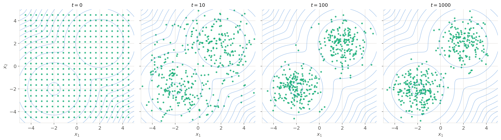
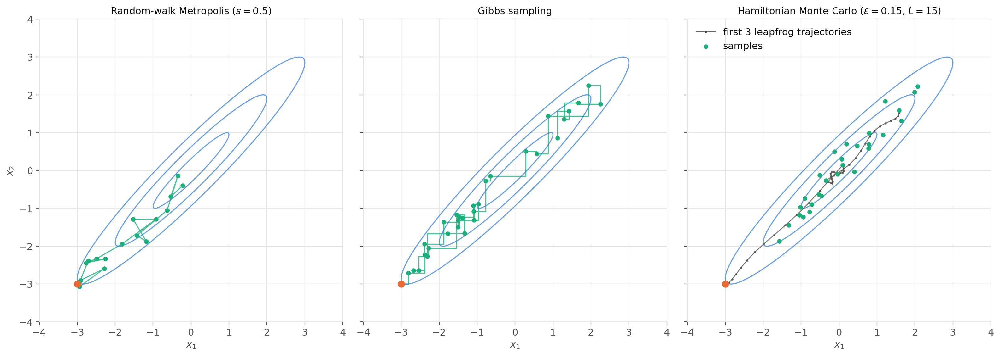
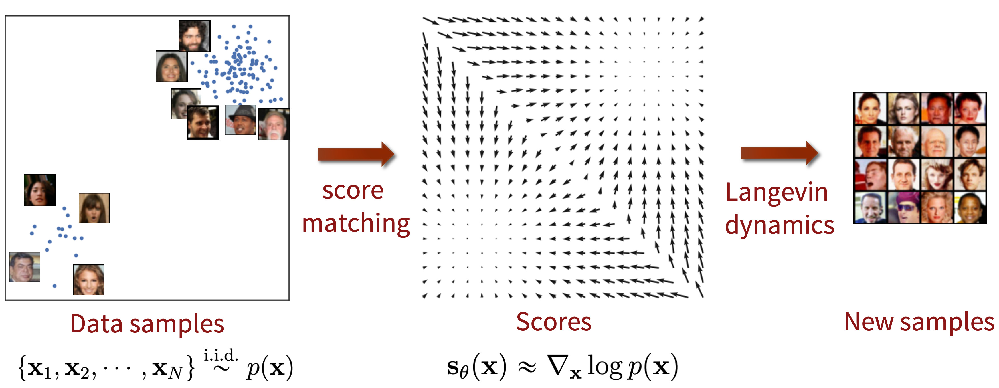
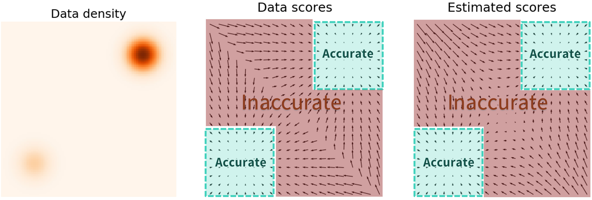

# Langevin dynamics and Hamiltonian Monte Carlo {#sec-hmc}

The previous chapter ended on the main weakness of Metropolis-Hastings: its random-walk proposals are blind, and explore the target more and more slowly when the dimension increases (@sec-mcmclimits). This chapter presents two samplers that use the **gradient** of the log-density to propose moves that follow the shape of the target: Langevin dynamics and Hamiltonian Monte Carlo. The gradient of the log-density will also be the central quantity of score-based diffusion models.

## The score {#sec-score}

The gradient of the log-density with respect to $x$ is called the **score** of the distribution:

$$
    \nabla_x \log p(x)
$$

It is a vector with the same dimension as $x$, which points, at each state, in the direction where the log-density increases the fastest. As seen in @sec-mcmclimits, it does not depend on the normalization constant: $\nabla_x \log p(x) = \nabla_x \log \tilde{p}(x)$, as $\log Z$ is a constant whose gradient is zero. Like the acceptance ratio of Metropolis-Hastings, the score can therefore be computed from the unnormalized target only.

For a normal distribution $\mathcal{N}(\mu, \sigma)$, the log-density is $\log p(x) = - \frac{(x - \mu)^2}{2 \sigma^2} + \text{cst}$, so its score is:

$$
    \nabla_x \log p(x) = - \dfrac{x - \mu}{\sigma^2}
$$

The score acts like a spring pulling $x$ back towards the mean $\mu$: it is zero at the mean, and its strength increases linearly with the distance to the mean. The narrower the distribution (small $\sigma$), the stiffer the spring.

For the bimodal target of the previous chapters (@fig-score, left), the score points towards the nearest mode: it is positive on the left of each mode (go right) and negative on its right (go left). It is zero at the two modes, but also at the bottom of the valley between them: a zero score only means that the density is flat locally, not that it is high. The right part of the figure shows the same behavior in two dimensions, for a mixture of two Gaussians: the score is a **vector field**, whose arrows point towards the modes, and become longer far away from them.

{#fig-score}

Following the arrows of the score from any initial state leads to a mode: this is gradient ascent on the log-density, the method we would use to find the MAP estimate of @sec-map. To sample the distribution instead of finding its modes, we need to add noise to these moves, which is the topic of the next section.

The score of a simple distribution can be derived by hand, as above. For more complex models, for example when the likelihood involves a neural network, it is computed by **automatic differentiation**, exactly like the gradient of a loss function during training. This requires the target to be differentiable with respect to $x$: gradient-based samplers only apply to continuous variables.

## Langevin dynamics {#sec-langevin}

**Langevin dynamics** adds noise to gradient ascent on the log-density. Starting from an initial state $x_0$, each step moves the state a little in the direction of the score, then adds some Gaussian noise:

$$
    x_{t+1} = x_t + \epsilon \, \nabla_x \log \tilde{p}(x_t) + \sqrt{2 \epsilon} \, \xi_t \qquad \text{with } \xi_t \sim \mathcal{N}(0, 1)
$$

where $\epsilon$ is a small step size. The two terms have opposite effects:

* without the noise, this is gradient ascent on $\log p(x)$: the state converges to the nearest mode, i.e. to a MAP estimate (@sec-map);
* without the score, this is a random walk with steps of standard deviation $\sqrt{2 \epsilon}$, which spreads the state everywhere.

The score concentrates the states around the modes, the noise spreads them. The factor $\sqrt{2 \epsilon}$ is exactly the amount of noise for which the two effects balance, so that the stationary distribution of the chain is the target $p(x)$. We admit this result, which comes from physics: the equation describes the motion of a particle in a potential $- \log p(x)$, shaken by thermal noise, whose positions end up distributed according to $p(x)$.

@fig-langevin shows 400 independent Langevin chains on the 2D mixture of @fig-score, starting on a regular grid. Within about ten steps, the score brings the chains to the regions of high probability. They do not collapse onto the modes, though: the noise keeps them spread around each mode, as samples of the target should be. As in @sec-markovchains, the snapshots show the distribution $p_t$ of the chain at different steps, which converges to the target.

{#fig-langevin}

Compared to random-walk Metropolis, every step goes in a sensible direction, and there is no rejection: Langevin dynamics does not waste computations on candidates that would be rejected. The price to pay is a small error. The stationary distribution is exactly $p(x)$ only in the limit of infinitely small steps; with a finite step size $\epsilon$, it is a slightly distorted version of the target. Reducing $\epsilon$ reduces the error, but the chain then needs more steps to explore the target.

The **Metropolis-adjusted Langevin algorithm** (MALA) [@Roberts1996] removes this error by combining the two methods: the Langevin step is used as the **proposal** of Metropolis-Hastings, whose acceptance step corrects the distortion. The proposal is a normal distribution centered on the Langevin update:

$$
    q(x' | x) = \mathcal{N}(x + \epsilon \, \nabla_x \log \tilde{p}(x), \sqrt{2 \epsilon})
$$

Unlike the random-walk proposal of @sec-metropolishastings, this proposal is **not symmetric**: from a state $x$ on the side of a mode, it favors moves towards the mode, and the reverse move is less likely to be proposed. This is precisely the situation for which Hastings introduced the correction $q(x_t | x') / q(x' | x_t)$ in the acceptance probability. With a small step size, nearly all candidates are accepted, and MALA behaves like Langevin dynamics without its error.

Langevin dynamics is also used to sample the posterior over the weights $\theta$ of a neural network (Bayesian deep learning). The score of the posterior $p(\theta | X) \propto p(X | \theta) \, p(\theta)$ with respect to the weights is the gradient of the log-likelihood plus the gradient of the log-prior, i.e. exactly the gradient used to train the network with MAP (@sec-map). A Langevin step is then a gradient step on the training loss plus some noise. **Stochastic gradient Langevin dynamics** (SGLD) [@Welling2011] estimates this gradient on minibatches, as stochastic gradient descent does: with a decreasing step size, training the network with the right amount of noise produces samples of the posterior instead of a single set of weights.

## Hamiltonian Monte Carlo {#sec-hmcalgorithm}

### A ball rolling on the landscape

**Hamiltonian Monte Carlo** (HMC) [@Duane1987; @Neal2012] borrows its idea from physics. Let's define the **potential energy** of a state as minus its log-density:

$$
    U(x) = - \log \tilde{p}(x)
$$

The regions of high probability become the valleys of an energy landscape, the modes being at the bottom of the valleys. Langevin dynamics moves a particle on this landscape as if it was in honey: it slides slowly downhill, shaken by the noise. HMC instead launches a **ball without friction**: given a random push, the ball rolls down into a valley, gaining speed, climbs up the other side, and keeps going. In a single trajectory, it can travel a long way across the region of high probability.

To describe this motion, HMC adds to each state $x$ a **momentum** $v$ (the velocity of the ball), of the same dimension as $x$. The ball has a **kinetic energy** $K(v) = \frac{1}{2} ||v||^2$, and its total energy is the **Hamiltonian**:

$$
    H(x, v) = U(x) + K(v)
$$

The laws of physics (Hamilton's equations) state that the position changes with the momentum, and the momentum with the force, which is minus the gradient of the potential energy, i.e. the score:

$$
    \dfrac{dx}{dt} = v \qquad \dfrac{dv}{dt} = - \nabla_x U(x) = \nabla_x \log \tilde{p}(x)
$$

Without friction, the total energy $H(x, v)$ is **conserved** along the trajectory: the ball converts potential energy into kinetic energy when it goes down, and back when it goes up.

How does this help to sample $p(x)$? HMC samples the pair $(x, v)$ from the joint distribution:

$$
    p(x, v) \propto \exp(- H(x, v)) = \tilde{p}(x) \, \exp(- \frac{1}{2} ||v||^2)
$$

In this distribution, $x$ and $v$ are independent: $x$ follows the target, and $v$ a standard normal distribution. If we can sample pairs $(x, v)$, we simply drop the momentum and keep $x$, which is a sample of the target (the same trick as ancestral sampling in @sec-simplesampling, where we dropped the latent variable). And as $H(x, v)$ is conserved along the trajectory, so is the density $p(x, v)$: moving the ball along its trajectory does not change the probability of the pair, even though the position can change a lot.

### The algorithm

Each iteration of HMC consists of the following steps, starting from the current state $x_t$:

1. sample a new momentum $v \sim \mathcal{N}(0, 1)$: this is the random push, which sets the energy level of the trajectory;
2. simulate the motion of the ball during $L$ small time steps of size $\epsilon$, using the **leapfrog** integrator, which gives a candidate $(x', v')$;
3. accept the candidate with the probability $\min(1, \exp(H(x_t, v) - H(x', v')))$, otherwise stay at $x_{t+1} = x_t$;
4. drop the momentum.

If the motion was simulated exactly, the energy would be conserved and the candidate always accepted. The leapfrog integrator only simulates it approximately, so the energy changes a little: the acceptance step of Metropolis-Hastings corrects this error, as for MALA. With a small step size, the error is small and nearly all candidates are accepted.

:::{.callout-note icon="false" collapse="true"}
## The leapfrog integrator

Each leapfrog step updates the momentum and the position in turn, using the score at the current position:

$$
\begin{aligned}
    v &\leftarrow v + \frac{\epsilon}{2} \, \nabla_x \log \tilde{p}(x) & \text{(half step on the momentum)} \\
    x &\leftarrow x + \epsilon \, v & \text{(full step on the position)} \\
    v &\leftarrow v + \frac{\epsilon}{2} \, \nabla_x \log \tilde{p}(x) & \text{(half step on the momentum, at the new position)} \\
\end{aligned}
$$

Each step requires one evaluation of the score, so an iteration of HMC costs $L$ gradient evaluations. The leapfrog integrator is preferred to simpler methods because it has two properties that make the acceptance probability above correct without any additional Hastings ratio: it is reversible (running it backwards from $(x', -v')$ brings back $(x, -v)$), and it preserves volumes in the $(x, v)$ space. We admit these results; see @Neal2012 for details.
:::

@fig-hmc compares HMC with random-walk Metropolis and Gibbs sampling on the correlated normal distribution of @fig-gibbssampling. The first trajectory of HMC brings the chain from its initial state to the center of the distribution in a single iteration, and the following samples are spread over the whole distribution, almost independently of each other. Random-walk Metropolis and Gibbs sampling are still crawling along the diagonal. The comparison is not entirely fair, as each iteration of HMC costs 15 gradient evaluations. Counted per evaluation, HMC still produces several times more effective samples than the two other methods, and the gap widens quickly in higher dimensions.

{#fig-hmc}

### Tuning HMC

HMC has two parameters:

* The **step size** $\epsilon$ controls the accuracy of the simulation. Too large, and the energy is badly conserved, so that many candidates are rejected; too small, and many steps are needed to travel the same distance.
* The **number of steps** $L$ controls the length of the trajectories. Too short, and HMC loses its advantage: with a single leapfrog step, HMC is actually equivalent to MALA. Too long, and the trajectory makes a U-turn and comes back towards its starting point, wasting computations.

The **No-U-Turn Sampler** (NUTS) [@Hoffman2011] removes the need to choose $L$: it extends each trajectory until it starts to turn back, and adapts the step size during the burn-in period. NUTS is the default sampler of probabilistic programming libraries such as Stan, PyMC or NumPyro, where the user only writes the model, and the gradients are computed by automatic differentiation. @Betancourt2017 gives a very intuitive introduction to the geometry behind HMC.

## Limits and the bridge to diffusion models {#sec-hmclimits}

### Limits of gradient-based samplers

Using the score makes a huge difference in high dimensions. To obtain a new independent sample, the number of steps needed grows roughly like the dimension $d$ for random-walk Metropolis, but only like $d^{1/3}$ for MALA and $d^{1/4}$ for HMC [@Roberts1997; @Neal2012]. This is why HMC (with NUTS) is today the method of choice to sample posterior distributions with thousands of parameters.

Gradient-based samplers keep two limitations, however:

* They are still **local** methods. The score points towards the nearest mode, so the valleys between distant modes remain difficult to cross. In @fig-langevin, the chains starting on the grid first split equally between the two modes, while the target puts 60% of its mass in the lower-left one: the correct proportions are only restored very slowly, by the few chains that manage to cross the valley. Methods such as **tempering**, which run additional chains on flattened versions of the target, help with this problem, but multimodal distributions remain the hardest case for MCMC.
* They require a **differentiable** target: they do not apply to discrete variables, such as the categories of a classifier or the tokens of a language model.

### Learning the score

There is one more observation to make about Langevin dynamics: it only needs the **score** $\nabla_x \log p(x)$, never the density $p(x)$ itself. Until now, we always assumed that the unnormalized target $\tilde{p}(x)$ was known, for example a likelihood times a prior. In generative modeling (@sec-paradigms), the situation is different: we have **data**, samples $x_i$ of an unknown distribution $p(x)$, for example images, and want to generate new samples of the same distribution.

If we could **learn** the score of the data distribution with a neural network $s_\theta(x) \approx \nabla_x \log p(x)$, Langevin dynamics would use this learned score to generate new samples, without ever knowing $p(x)$. This is the idea of **score-based generative models** [@Song2020a] (@fig-scorematchinglangevin). Learning the score from data is possible with methods called **score matching**, which, conveniently, never require the normalization constant either.

{#fig-scorematchinglangevin}

A naive application of this idea does not work well, for two reasons:

* The learned score is only accurate where there is data, i.e. close to the modes (@fig-scorepitfalls). In the low-probability regions between and around the modes, where Langevin chains usually start, the network has seen almost no data, and its score is unreliable.
* The data distribution is extremely multimodal (think of all possible images), and we saw above that Langevin dynamics struggles to distribute the samples correctly between distant modes.

{#fig-scorepitfalls}

The solution is to **add noise** to the data. Perturbing the data with a lot of Gaussian noise spreads it over the whole space: the score of the noisy distribution can be learned everywhere, and its modes are merged into a single smooth bump. Learning the score at several noise levels, and running Langevin dynamics while progressively decreasing the noise, guides the chains from anywhere in the space towards the data, while distributing them correctly between the modes. This is the principle of **diffusion models**, which will be presented in a later part of this book.

### Summary

The methods of this chapter can be summarized as follows, in the same format as at the end of @sec-montecarlo and @sec-mcmc:

| Method | Requires | Produces | Fails when |
|:---|:---|:---|:---|
| Langevin dynamics | score $\nabla_x \log \tilde{p}(x)$ | approximate, correlated samples of $p(x)$ | the step size is too large, the modes are far apart |
| MALA | $\tilde{p}(x)$ and its score | correlated samples of $p(x)$ | the modes are far apart |
| Hamiltonian Monte Carlo | $\tilde{p}(x)$ and its score | nearly independent samples of $p(x)$ | the modes are far apart, the variables are discrete |

This chapter closes the part on sampling methods. Sampling estimates intractable expectations by averaging over samples; the next part presents the other approach to intractable distributions, **variational inference**, which replaces sampling by optimization.
