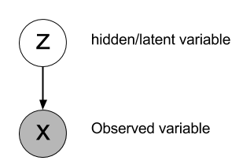

# Latent variable models {#sec-latentvariables}

In generative modeling (@sec-paradigms), the data $X = \{x_i\}_{i=1}^N$ are samples of an unknown distribution $p(x)$, for example the distribution of natural images, and we want to learn a parameterized distribution $p_\theta(x)$ as close as possible to it, in order to generate new samples. As seen in @sec-klml, minimizing the KL divergence between $p(x)$ and $p_\theta(x)$ is the same as maximizing the log-likelihood of the model on the data:

$$
    \max_\theta \, \mathbb{E}_{x \sim p(x)} [\log p_\theta(x)] \approx \max_\theta \, \dfrac{1}{N} \, \sum_{i=1}^N \log p_\theta(x_i)
$$

For images, this is much harder than it looks, because of the dimension of the data. This chapter introduces the main idea used to tame it: describing the data with a few hidden variables.

## Images live on a manifold

A grayscale image of $32 \times 32$ pixels is a point in a space with 1024 dimensions, one per pixel. This space is huge, and almost all of it is noise: if we pick a point at random, i.e. a random value for each pixel, we obtain an image of static, never a face or a digit. Natural images occupy a tiny fraction of the pixel space, which is why their distribution is so hard to model directly (@sec-curse).

These images are not scattered randomly in the pixel space either: they are organized. Let's take a simple example: images of a digit "7", which only differ by their **rotation** and their **size** (@fig-imagemanifold). Each image is a point in the 1024-dimensional pixel space, but as only two factors vary, two numbers are enough to describe it. When the rotation or the size changes a little, the image changes a little: the images form a continuous **2D surface** inside the pixel space. The left part of @fig-imagemanifold shows this surface, projected on the three directions of the pixel space along which the images vary the most: it is curved and folded, but it is a surface, and each of its points is an image.

{#fig-imagemanifold}

Such a surface is called a **manifold**: a space that looks flat when seen up close, but can be curved globally. The surface of the earth is the classical example: it is locally flat and two-dimensional (a map of a city works fine), but globally a sphere in three dimensions. The right part of @fig-imagemanifold shows the same images on a flat 2D map, where each image is described by its two coordinates: its rotation and its size.

Natural images vary along many more factors than our "7": the identity of a person, their pose, their expression, the lighting, the background... But these factors are still far fewer than the number of pixels. The **manifold hypothesis** states that natural data lie close to a manifold of much lower dimension than the space they live in. Learning the distribution of the data then comes down to learning where the data are on this low-dimensional manifold, which is a much easier problem.

## Latent variables

The coordinates of the data on the manifold are called **latent variables**, and noted $z$. They are the actual causes of the observations: in our example, choosing a rotation and a size determines the image. A **latent variable model** describes how the data are generated in two steps:

1. sample the latent variables from a simple distribution, the **prior** $p_\theta(z)$, in the low-dimensional latent space;
2. sample the observation from the **decoder** $p_\theta(x | z)$, typically a neural network, which maps a point of the latent space to a point of the data space.

{#fig-latentvariable width=50%}

Generating new data is therefore easy: this is ancestral sampling (@sec-simplesampling). The decoder plays the role of the map from the right part of @fig-imagemanifold to its left part.

There is one major difference with our toy example: for real data, the latent variables are not given. Nobody labels the images with their pose or their lighting, and the factors of variation are not even known in advance. The latent variables are **hidden**: we only observe $x$, and the latent space has to be learned together with the decoder. The learned latent variables do not need to be interpretable; they just need to explain the data.

## The marginal likelihood is intractable

To train a latent variable model by maximum likelihood, we need the likelihood $p_\theta(x)$ of each observation. The model only defines it indirectly: an image $x$ can be produced by many different latent variables $z$, so its probability is obtained by summing over all of them (**marginalization**):

$$
    p_\theta(x) = \int_z p_\theta(x | z) \, p_\theta(z) \, dz = \mathbb{E}_{z \sim p_\theta(z)} [p_\theta(x | z)]
$$

This integral over the whole latent space has no closed form when the decoder is a neural network. As it is an expectation, we could estimate it with Monte Carlo (@sec-mcestimator): sample latent variables from the prior, and average $p_\theta(x | z)$. But for a given image $x$, almost all the latent variables sampled from the prior generate completely different images, for which $p_\theta(x | z)$ is essentially zero: the estimate is dominated by the rare samples that happen to land in the right region, and its variance is enormous. This is the same problem as importance sampling with a bad proposal (@sec-importance).

To estimate $p_\theta(x)$ efficiently, we would need to sample the latent variables that are likely to have generated $x$, i.e. to sample from the **posterior** $p_\theta(z | x)$. This posterior is exactly what an **encoder** computes: given an image, which latent variables explain it? Unfortunately, Bayes' rule gives:

$$
    p_\theta(z | x) = \dfrac{p_\theta(x | z) \, p_\theta(z)}{p_\theta(x)}
$$

so computing the posterior requires the evidence $p_\theta(x)$, which is the intractable integral we started from. **Variational inference**, presented in the next chapter, breaks this circle by approximating the posterior with a learned encoder.
