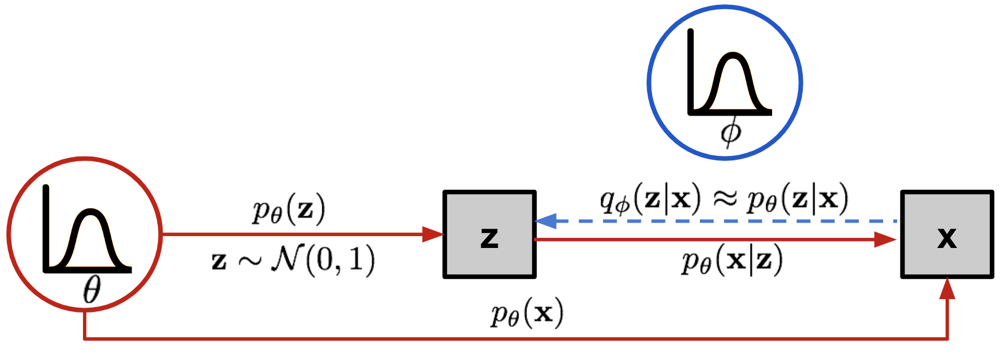

# Variational inference {#sec-variationalinference}

## The intractable posterior

The previous chapter ended on a circular problem. To train a latent variable model (@sec-latentvariables), we need to know which latent variables $z$ explain an observation $x$, i.e. the **posterior** $p_\theta(z | x)$, also called the **encoder**. Bayes' rule tells us:

$$
    p_\theta(z | x) = p_\theta(x |z) \, \dfrac{p_\theta(z)}{p_\theta(x)}
$$

The posterior depends on the **model** (decoder) $p_\theta(x|z)$, the **prior** $p_\theta(z)$ and the **evidence** $p_\theta(x)$. It is **intractable**, as the evidence $p_\theta(x) = \int_z p_\theta(x | z) \, p_\theta(z) \, dz$ would require to integrate over all possible latent representations $z$.

**Variational inference** proposes to approximate the true posterior $p_\theta(z | x)$ by another parameterized distribution $q_\phi(z|x)$, the **approximate posterior**, chosen in a family of distributions that is easy to sample and evaluate, for example normal distributions whose parameters are predicted by a neural network.

{#fig-vaegraphicalmodel width=70%}

The decoder $p_\theta(x |z)$ generates observations $x$ from a latent representation $z$, with parameters $\theta$. The encoder $q_\phi(z|x)$ estimates the latent representation $z$ of an observation $x$, with parameters $\phi$: it should be as close as possible to the true posterior $p_\theta(z | x)$. The decoder and the encoder have to be trained together, but neither the evidence $p_\theta(x)$ we want to maximize for the decoder, nor the true posterior we want to approximate with the encoder, can be computed. Variational inference solves both problems with a single quantity, the evidence lower bound.

## The evidence lower bound

Let's decompose the log-evidence of an observation $x$, using the encoder:

$$
\begin{aligned}
    \log p_\theta(x) & = \log p_\theta(x) \, \int q_\phi(z | x) \, dz& \text{(The integral is one by definition)} \\
     & =  \int q_\phi(z | x) \log p_\theta(x) \, dz& \text{(We can move the evidence inside)} \\
     & =  \mathbb{E}_{z \sim q_\phi(z | x)} [\log p_\theta(x) ] & \text{(It becomes an expectation)} \\
     & =  \mathbb{E}_{z \sim q_\phi(z | x)} [\log \dfrac{p_\theta(x, z)}{p_\theta(z|x)} ] & \text{(Definition of the conditional)} \\
     & =  \mathbb{E}_{z \sim q_\phi(z | x)} [\log \dfrac{p_\theta(x, z) \, q_\phi(z|x)}{p_\theta(z|x) \, q_\phi(z|x)} ] & \text{(Introduce the encoder)} \\
     & =  \mathbb{E}_{z \sim q_\phi(z | x)} [\log \dfrac{p_\theta(x, z)}{q_\phi(z|x)} ] + \mathbb{E}_{z \sim q_\phi(z | x)} [ - \log \dfrac{p_\theta(z|x)}{q_\phi(z|x)} ] & \text{(Split the expectation)} \\
\end{aligned}
$$

The second term is the KL divergence between the approximate and the true posteriors (@sec-kl). The first term is called the **evidence lower bound** (ELBO):

$$
    \text{ELBO}(\theta, \phi) = \mathbb{E}_{z \sim q_\phi(z | x)} [\log \dfrac{p_\theta(x, z)}{q_\phi(z|x)} ]
$$

so that the log-evidence is exactly:

$$
    \log p_\theta(x) = \text{ELBO}(\theta, \phi) + \text{KL}(q_\phi(z|x) || p_\theta(z | x))
$$

This decomposition tells us two things:

* As the KL divergence is always positive or zero, the ELBO is a **lower bound** of the log-evidence, hence its name: $\text{ELBO}(\theta, \phi) \leq \log p_\theta(x)$.
* The **gap** between the log-evidence and its lower bound is exactly the KL divergence between the encoder and the true posterior: the better the encoder approximates the posterior, the tighter the bound. It is zero only when $q_\phi(z|x) = p_\theta(z|x)$.

:::{.callout-note icon="false" collapse="true"}
## Another view: importance sampling of the evidence

The evidence is an expectation over the prior, $p_\theta(x) = \mathbb{E}_{z \sim p_\theta(z)}[p_\theta(x | z)]$, which is very inefficient to estimate with samples of the prior (@sec-latentvariables). Using the encoder as a proposal, importance sampling (@sec-importance) gives:

$$
    p_\theta(x) = \int q_\phi(z|x) \, \dfrac{p_\theta(x, z)}{q_\phi(z|x)} \, dz = \mathbb{E}_{z \sim q_\phi(z|x)} [\dfrac{p_\theta(x, z)}{q_\phi(z|x)}]
$$

where $p_\theta(x, z) / q_\phi(z|x)$ plays the role of the importance weight. Taking the logarithm and using Jensen's inequality ($\log \mathbb{E}[X] \geq \mathbb{E}[\log X]$, as the logarithm is concave) gives the ELBO again:

$$
    \log p_\theta(x) = \log \mathbb{E}_{z \sim q_\phi(z|x)} [\dfrac{p_\theta(x, z)}{q_\phi(z|x)}] \geq \mathbb{E}_{z \sim q_\phi(z|x)} [\log \dfrac{p_\theta(x, z)}{q_\phi(z|x)}] = \text{ELBO}(\theta, \phi)
$$

The best proposal for importance sampling is the posterior $p_\theta(z | x)$, for which all the weights are equal to $p_\theta(x)$ and the inequality becomes an equality. Averaging several importance weights inside the logarithm gives tighter bounds, which is the idea of importance-weighted autoencoders.
:::

## Why maximizing the ELBO works {#sec-elbo}

Variational inference trains the encoder and the decoder together by maximizing the ELBO with respect to both $\phi$ and $\theta$. Many presentations stop at "the ELBO is a lower bound, so maximizing it maximizes the evidence", but a lower bound can increase while the quantity above it stays where it is. The decomposition $\log p_\theta(x) = \text{ELBO}(\theta, \phi) + \text{KL}(q_\phi(z|x) || p_\theta(z | x))$ shows what actually happens [@Luo2022a]. Let's look at the two sets of parameters separately (@fig-elbogap):

**The encoder** ($\phi$). The log-evidence $\log p_\theta(x)$ does not depend on $\phi$, so its gradient with respect to $\phi$ is zero:

$$
    \underbrace{\nabla_\phi \, \log \, p_\theta(x)}_{ = 0} = \underbrace{\nabla_\phi \, \text{ELBO}(\theta, \phi)}_{\text{maximized}} + \underbrace{\nabla_\phi \,  \text{KL}( q_\phi(z|x) || p_\theta(z|x))}_{\text{minimized}}
$$

Whatever increases the ELBO decreases the KL by the same amount: maximizing the ELBO with respect to $\phi$ brings the encoder closer to the true posterior, and closes the gap. This is how the encoder learns to approximate a posterior that it can never compute.

**The decoder** ($\theta$). Maximizing the ELBO with respect to $\theta$ pushes up a lower bound of the log-evidence. As long as the gap is small, the ELBO and the log-evidence move together: improving the ELBO means explaining the data better, which is the goal of maximum likelihood.

{#fig-elbogap}

If the encoder could represent the true posterior exactly, each update of $\phi$ would close the gap completely, and the alternation of the two steps would be the classical **expectation-maximization** (EM) algorithm. With an approximate encoder, the gap never fully closes, and the decoder can also increase the ELBO in a less desirable way: by making its true posterior easier to approximate by the encoder, rather than by explaining the data better. This is the price of the approximation.

## A tractable loss

The ELBO is useful because, unlike the log-evidence, it can be computed. Splitting the joint distribution into the decoder and the prior, $p_\theta(x, z) = p_\theta(x | z) \, p_\theta(z)$:

$$
\begin{aligned}
\text{ELBO}(\theta, \phi) &= \mathbb{E}_{z \sim q_\phi(z|x)} [\log p_\theta(x | z)] + \mathbb{E}_{z \sim q_\phi(z|x)} [\log \dfrac{p_\theta(z)}{q_\phi(z|x)}] \\
&= \mathbb{E}_{z \sim q_\phi(z|x)} [\log p_\theta(x | z)] - \text{KL}(q_\phi(z|x) || p_\theta(z))
\end{aligned}
$$

Neither term involves the evidence nor the true posterior. Training a latent variable model therefore consists in **minimizing** the negative ELBO:

$$
    \mathcal{L}(\theta, \phi) = - \text{ELBO}(\theta, \phi) = \mathbb{E}_{z \sim q_\phi(z|x)} [- \log p_\theta(x | z)] + \text{KL}(q_\phi(z| x) || p_\theta(z))
$$

* $\mathbb{E}_{z \sim q_\phi(z|x)} [- \log p_\theta(x | z)]$ is the **reconstruction loss** of the decoder $p_\theta(x | z)$: given a sample $z$ of the encoder $q_\phi(z|x)$, minimize the negative log-likelihood of the reconstruction $p_\theta(x | z)$.

* $\text{KL}(q_\phi(z| x) || p_\theta(z))$ is the **regularization loss** for the encoder: the latent distribution $q_\phi(z|x)$ should not be too far from the **prior** $p_\theta(z)$.

## Summary

Let's recapitulate the reasoning of this chapter. To train a latent variable model, we need the posterior $p_\theta(z | x)$, which is intractable because of the evidence $p_\theta(x)$. Variational inference replaces it with an approximate posterior $q_\phi(z | x)$, the encoder, and trains the encoder and the decoder together by maximizing the ELBO. Unlike the evidence, the ELBO can be computed: the reconstruction term is an expectation over the encoder, estimated with a few samples $z \sim q_\phi(z | x)$ (@sec-mcestimator), and the regularization term is a KL divergence between the encoder and the prior, often available in closed form (@sec-klnormal).

The resulting loss has an intuitive interpretation, that of an **autoencoder**:

* the encoder compresses each observation $x$ into a distribution over the latent space, and the decoder reconstructs $x$ from samples of this distribution: the reconstruction loss forces the latent variables to keep the information needed to explain the data;
* the regularization loss keeps the latent representations of all observations close to the prior $p_\theta(z)$, so that the latent space is filled without holes: after training, sampling $z$ from the prior and decoding it (ancestral sampling, @sec-simplesampling) generates new, realistic data.

The two terms pull in opposite directions: a perfect reconstruction would give each observation its own isolated region of the latent space, while a perfect regularization would make all latent representations equal to the prior, forgetting the observations.

Variational inference also illustrates the second of the two ways of dealing with intractable distributions in this book. The sampling methods of @sec-montecarlo and @sec-mcmc estimate expectations under the posterior by drawing samples from it, which is exact in the limit but must be repeated for every new observation. Variational inference turns inference into **optimization**: a single network learns to output an approximate posterior for any observation, in one forward pass. The price to pay is that $q_\phi(z | x)$ is only an approximation within a chosen family of distributions (for example normal distributions), and that the ELBO is only a lower bound of the log-likelihood: the gap between the two is exactly the KL divergence between the approximate and the true posteriors. Note also that this KL is taken in the opposite direction to the one of maximum likelihood (@sec-klml): the approximate distribution $q_\phi$ is the first argument, which makes it mode-seeking: it tends to underestimate the uncertainty of the true posterior (@sec-forwardreverse).

One question remains open: how do we compute the gradient of the reconstruction loss with respect to the parameters $\phi$ of the encoder, when this loss is an expectation over samples of the encoder itself? The variational autoencoder (@sec-vae) answers it with the reparameterization trick.
