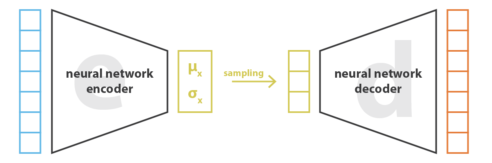
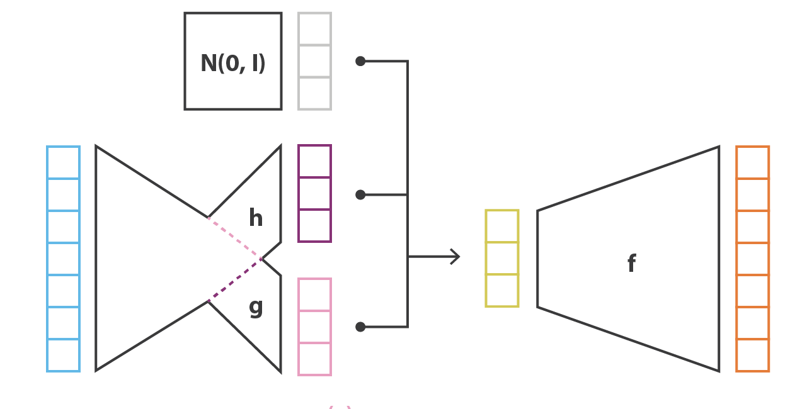
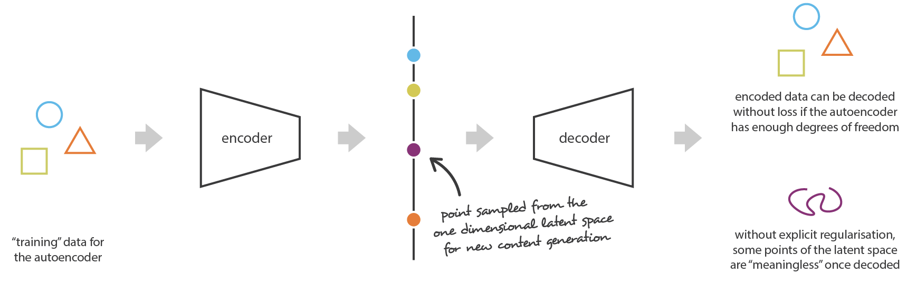
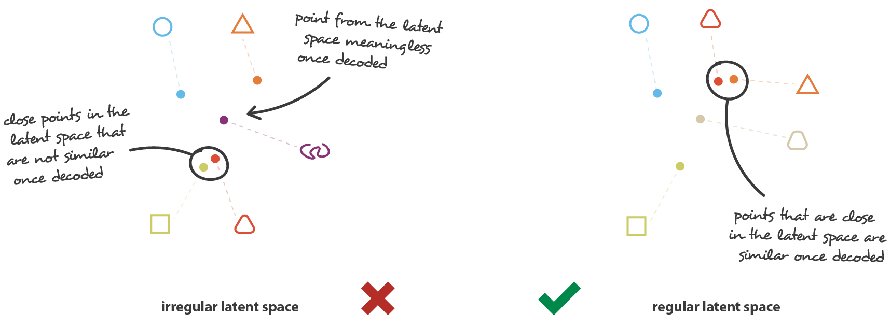
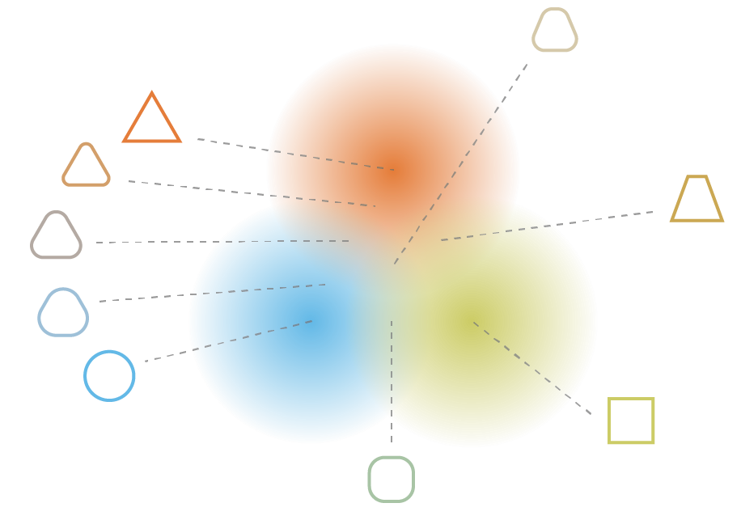
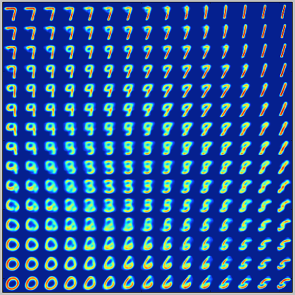

# Variational autoencoders {#sec-vae}

@sec-variationalinference gave the general recipe of variational inference for a latent variable model: an encoder $q_\phi(\mathbf{z} | \mathbf{x})$ approximating the true posterior, a decoder $p_\theta(\mathbf{x} | \mathbf{z})$, and a loss, the negative ELBO, made of a reconstruction loss and a regularization loss towards the prior $p_\theta(\mathbf{z})$. To turn this recipe into an algorithm that can be trained on images, three questions remain:

1. Which distributions should we choose for the prior, the encoder and the decoder?
2. How do we compute the gradient of the reconstruction loss with respect to the encoder, when this loss is an expectation over samples of the encoder itself?
3. What does the regularization loss do to the latent space, and why does it make generation possible?

**Variational autoencoders** (VAE) [@Kingma2013] give the simplest answers to these questions: normal distributions wherever possible, and the reparameterization trick for the gradient. This chapter presents these choices, and then explains why the resulting latent space is smooth enough to generate new data.

## Choosing the distributions

The **prior** over the latent space is the standard normal distribution, $p_\theta(\mathbf{z}) = \mathcal{N}(\mathbf{0}, \mathbf{1})$, which has no parameters to learn.

The **encoder** is a normal distribution with a diagonal covariance matrix, whose parameters are the outputs of a neural network:

$$
    q_\phi(\mathbf{z} | \mathbf{x}) = \mathcal{N}(\mathbf{\mu_x}, \mathbf{\sigma_x})
$$

The encoder network therefore has two output vectors, the mean $\mathbf{\mu_x}$ and the standard deviation $\mathbf{\sigma_x}$, each with one element per dimension of the latent space. During training, a latent vector $\mathbf{z}$ is **sampled** from this distribution and passed to the **decoder** network, which reconstructs the input (@fig-vaestructure).

{#fig-vaestructure width=80%}

With these choices, the loss of the VAE is the negative ELBO averaged over the training data $\mathcal{D}$:

$$
\begin{aligned}
\min_{\theta, \phi} \, \mathcal{L}(\theta, \phi) &= \mathcal{L}_\text{reconstruction}(\theta, \phi) + \mathcal{L}_\text{regularization}(\phi) \\
&= \mathbb{E}_{\mathbf{x} \in \mathcal{D}, \mathbf{z} \sim q_\phi(\mathbf{z}|\mathbf{x})} [ - \log p_\theta(\mathbf{x} | \mathbf{z})] + \mathbb{E}_{\mathbf{x} \in \mathcal{D}} [\text{KL}(q_\phi(\mathbf{z}|\mathbf{x}) || \mathcal{N}(\mathbf{0}, \mathbf{1}))]\\
\end{aligned}
$$

The **reconstruction loss** is the negative log-likelihood of the input under the decoder. Its exact form depends on the distribution chosen for the decoder:

* if the pixels are normalized between 0 and 1 and considered as Bernoulli variables, as in the original paper, the decoder has a logistic output layer and the reconstruction loss is the binary cross-entropy (@sec-crossentropy);
* if the decoder outputs the mean of a normal distribution with a fixed variance, the negative log-likelihood is, up to constants, the mean square error between the input and its reconstruction (@sec-mdn).

The **regularization loss** is the KL divergence between the encoder and the prior. As both are normal distributions, it has a closed form (@sec-klnormal), so there is no need to estimate it with samples. If the latent space has $K$ dimensions:

$$
    \mathcal{L}_\text{regularization}(\phi) = \mathbb{E}_{\mathbf{x} \in \mathcal{D}}[\dfrac{1}{2} \, \sum_{k=1}^K (\sigma_{\mathbf{x}, k}^2 + \mu_{\mathbf{x}, k}^2 -1 - \log \sigma_{\mathbf{x}, k}^2)]
$$

This expression is easy to differentiate with respect to $\mathbf{\mu_x}$ and $\mathbf{\sigma_x}$, i.e. with respect to the parameters $\phi$ of the encoder. Each term is minimal (zero) when $\mu_{\mathbf{x}, k} = 0$ and $\sigma_{\mathbf{x}, k} = 1$. In practice, the encoder predicts the logarithm of the variance $\Sigma_\mathbf{x} = \log \mathbf{\sigma_x^2}$ instead of the standard deviation: a standard deviation must be positive, while the log-variance can take any real value, which is easier for the output layer of a neural network. The regularization loss becomes:

$$
    \mathcal{L}_\text{regularization}(\phi) = \mathbb{E}_{\mathbf{x} \in \mathcal{D}}[\dfrac{1}{2} \, \sum_{k=1}^K (\exp \Sigma_{\mathbf{x}, k} + \mu_{\mathbf{x}, k}^2 -1 - \Sigma_{\mathbf{x}, k})]
$$

## The reparameterization trick {#sec-reparameterization}

### Backpropagation through sampling

The regularization loss is easy to minimize, but the reconstruction loss raises the second question of the introduction. It is an expectation over samples of the encoder, $\mathbf{z} \sim q_\phi(\mathbf{z}|\mathbf{x})$. We can estimate it with Monte Carlo (@sec-mcestimator), in practice with a single sample per input, and backpropagate its gradient through the decoder down to $\mathbf{z}$. But how do we go further, to the outputs $\mathbf{\mu_x}$ and $\mathbf{\sigma_x}$ of the encoder?

Sampling is not a differentiable operation. Let's suppose that backpropagation tells us that the loss would decrease if the sample $\mathbf{z}$ was a bit smaller ($\frac{\partial \mathcal{L}}{\partial \mathbf{z}} > 0$, @fig-samplinggradient). Should we move the mean $\mathbf{\mu_x}$ to the left? Changing $\mathbf{\mu_x}$ changes the distribution of $\mathbf{z}$, but the next sample is drawn independently of the current one: it can land anywhere, smaller or larger than $\mathbf{z}$. Nothing tells us how a particular sample would change when the parameters change: the derivative $\frac{\partial \mathbf{z}}{\partial \mathbf{\mu_x}}$ is not defined, and the gradient cannot be passed on to the encoder.

{#fig-samplinggradient}

Mathematically, the problem is that the parameters $\phi$ appear in the distribution over which the expectation is taken:

$$
    \nabla_\phi \, \mathbb{E}_{\mathbf{z} \sim q_\phi(\mathbf{z}|\mathbf{x})} [- \log p_\theta(\mathbf{x} | \mathbf{z})]
$$

so the gradient cannot simply be moved inside the expectation, as we do when training a network with stochastic gradient descent.

### Moving the randomness out of the network

The **reparameterization trick** uses the affine transformation of normal samples of @sec-simplesampling. Instead of sampling $\mathbf{z}$ directly from $\mathcal{N}(\mathbf{\mu_x}, \mathbf{\sigma_x})$, we sample a noise vector $\xi$ from the standard normal distribution, and transform it with the outputs of the encoder:

$$
    \mathbf{z} = \mathbf{\mu_x} + \mathbf{\sigma_x} \odot \xi \qquad \text{with} \qquad \xi \sim \mathcal{N}(\mathbf{0}, \mathbf{1})
$$

where $\odot$ is the element-wise product. The resulting $\mathbf{z}$ follows exactly the same distribution $\mathcal{N}(\mathbf{\mu_x}, \mathbf{\sigma_x})$ as before. What changes is where the randomness comes from: the noise $\xi$ is now an additional **input** of the network, which does not depend on any parameter, and $\mathbf{z}$ is a deterministic, differentiable function of $\mathbf{\mu_x}$, $\mathbf{\sigma_x}$ and $\xi$ (@fig-reparameterizationtrick):

$$
    \dfrac{\partial \mathbf{z}}{\partial \mathbf{\mu_x}} = 1 \qquad \dfrac{\partial \mathbf{z}}{\partial \mathbf{\sigma_x}} = \xi
$$

For a fixed noise $\xi$, moving the mean moves the sample by the same amount: if the sample should decrease, so should the mean.

{#fig-reparameterizationtrick}

The expectation is now taken over $\xi$, whose distribution does not depend on $\phi$, so the gradient can be moved inside it:

$$
    \nabla_\phi \, \mathbb{E}_{\xi \sim \mathcal{N}(\mathbf{0}, \mathbf{1})} [- \log p_\theta(\mathbf{x} | \mathbf{\mu_x} + \mathbf{\sigma_x} \odot \xi)] = \mathbb{E}_{\xi \sim \mathcal{N}(\mathbf{0}, \mathbf{1})} [- \nabla_\phi \log p_\theta(\mathbf{x} | \mathbf{\mu_x} + \mathbf{\sigma_x} \odot \xi)]
$$

The right-hand side is estimated by sampling $\xi$ and backpropagating through the decoder and the encoder, exactly like any other loss. The whole VAE becomes differentiable end-to-end (@fig-vaereparameterization), and its complete loss is:

$$
    \mathcal{L}(\theta, \phi) = \mathbb{E}_{\mathbf{x} \in \mathcal{D}, \xi \sim \mathcal{N}(\mathbf{0}, \mathbf{1})} [ - \log p_\theta(\mathbf{x} | \mathbf{\mu_x} + \mathbf{\sigma_x} \odot \xi) + \dfrac{1}{2} \, \sum_{k=1}^K (\sigma_{\mathbf{x}, k}^2 + \mu_{\mathbf{x}, k}^2 -1 - \log \sigma_{\mathbf{x}, k}^2)]
$$

{#fig-vaereparameterization width=70%}

The trick works because a normal sample can be written as a differentiable transformation of a parameter-free noise. It applies to other distributions with the same property, but not, for example, to discrete latent variables. The other general method to compute gradients of expectations, the score-function (or REINFORCE) estimator, works for any distribution but has a much higher variance.

## A smooth latent space

### Why autoencoders cannot generate

As noted at the end of @sec-variationalinference, the loss of a latent variable model reads like the loss of an autoencoder. A classical **autoencoder** is a neural network trained to reproduce its input: an encoder compresses the input $\mathbf{x}$ into a low-dimensional code $\mathbf{z}$, the bottleneck, and a decoder reconstructs the input from this code. Both are trained together by minimizing a reconstruction loss only. The bottleneck forces the network to keep only the most important information about the data, which makes autoencoders very good at compressing data.

They are, however, bad at generating new data. The encoder and the decoder are **deterministic**: each training example is mapped to a single point of the latent space, and the decoder only learns to reconstruct these points. Nothing constrains what the decoder does between them. If we pick a new point of the latent space, for example between the codes of two training examples, the decoder generally produces a meaningless output (@fig-autoencoderlimits).

{#fig-autoencoderlimits}

The VAE differs from a classical autoencoder by two ingredients: its encoder outputs a distribution, which is sampled, and its loss contains the regularization towards the prior. Together, they solve this problem.

### Regularity of the latent space

To generate new data with the decoder, its latent space must be **regular**: close points of the latent space should be decoded into similar data, and every point sampled from the prior should be decoded into something meaningful (@fig-vaelatentregularity). The latent space of a classical autoencoder has none of these properties. The variational autoencoder obtains them thanks to its two ingredients, which act together.

{#fig-vaelatentregularity}

**The noise makes the latent space locally smooth.** Each input is encoded into a whole region of the latent space, the distribution $\mathcal{N}(\mathbf{\mu_x}, \mathbf{\sigma_x})$, and the decoder must reconstruct the input from any sample of this region. Neighboring latent points are therefore decoded into similar outputs. Without regularization, however, the encoder could escape this constraint: by making the standard deviations very small, or the means very far apart, the regions would become isolated points again, and the VAE would behave like a classical autoencoder (@fig-vaeregularization, left).

**The KL divergence fills the holes.** The regularization loss prevents this escape. Its $- \log \sigma_{\mathbf{x}, k}^2$ term grows without bound when a standard deviation goes to zero, so the encoded regions keep a minimal size. Its $\mu_{\mathbf{x}, k}^2$ term pulls all the means towards the origin, so the regions of different inputs are packed together around the center of the latent space and overlap (@fig-vaeregularization, right). In the overlapping areas, the decoder must produce outputs that are compatible with several inputs: a point between the codes of a triangle and a circle is decoded into something in between (@fig-vaeinterpolation). The latent space is continuous, and filled without holes: sampling the prior and decoding generates plausible data.

{#fig-vaeregularization}

{#fig-vaeinterpolation width=60%}

### A map of the data manifold

@fig-vaemnistmanifold shows the result for a VAE with a two-dimensional latent space, trained on images of handwritten digits (MNIST). Each image is the output of the decoder for one point of a regular grid of the latent space. The digits change gradually from one to the other when moving in the latent space: a "7" slowly becomes a "9" when going down the left side, a "1" turns into an "8" and then a "5" on the right side, and a "0" into a "6" along the bottom. The latent space has become a flat **map of the data manifold**, exactly like the right part of @fig-imagemanifold, except that the latent variables were not given but learned from the data, and do not need to correspond to simple factors such as rotation or size.

{#fig-vaemnistmanifold width=50%}

This smoothness comes at a price. The two terms of the loss pull in opposite directions (@sec-variationalinference): the reconstruction loss wants well-separated codes to reconstruct each input precisely, while the regularization loss wants all codes to look like the prior. Images that end up in overlapping regions are reconstructed as an average of the compatible images, which is why the outputs of VAEs are often blurry. Weighting the regularization loss with a factor $\beta$ ($\beta$-VAE) explicitly controls this trade-off between the quality of the reconstructions and the regularity of the latent space.
