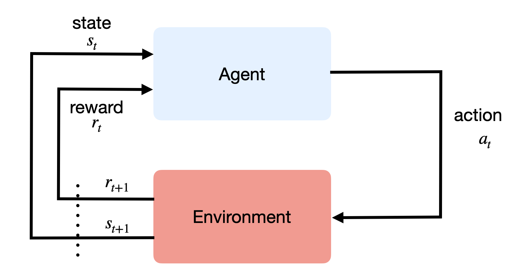

# Gradient estimators {#sec-gradientestimators}

Training a variational autoencoder required a trick: the reconstruction loss is an expectation over samples of the encoder, and its gradient with respect to the parameters of the encoder could only be computed after reparameterizing the samples (@sec-reparameterization). This problem is much more general than VAEs, and the reparameterization trick is only one of the two main ways to solve it. This chapter presents both, and applies the second one to a problem that looks very different at first sight: reinforcement learning.

## The gradient of an expectation

Let's consider a distribution $q_\phi(z)$ with parameters $\phi$, and a function $f(z)$ whose expected value under this distribution we want to minimize (or maximize):

$$
    \mathcal{L}(\phi) = \mathbb{E}_{z \sim q_\phi(z)} [f(z)] = \int q_\phi(z) \, f(z) \, dz
$$

Gradient descent needs the gradient $\nabla_\phi \mathcal{L}(\phi)$. In supervised learning, the parameters appear in the function $f$, while the distribution of the data does not depend on them: the gradient can be moved inside the expectation, and estimated by averaging the gradients of individual samples. Here, it is the opposite: the parameters $\phi$ appear in the **distribution** over which the expectation is taken, not in the function. Changing $\phi$ does not change the value of $f$ for a given $z$; it changes which samples $z$ are likely to be drawn. The gradient cannot simply be moved inside the expectation:

$$
    \nabla_\phi \, \mathbb{E}_{z \sim q_\phi(z)} [f(z)] \neq \mathbb{E}_{z \sim q_\phi(z)} [\nabla_\phi f(z)] = 0
$$

and, as seen in @sec-reparameterization, we cannot backpropagate through the sampling operation either.

This situation appears in many places:

* in **variational autoencoders**, the reconstruction loss is an expectation over the encoder $q_\phi(z | x)$ (@sec-vae);
* in **variational inference** in general, when the ELBO of an arbitrary model has no closed form and must be estimated with samples of the approximate posterior;
* when the latent variables are **discrete**, for example categories or tokens, which cannot be reparameterized as a differentiable function of a noise;
* in **reinforcement learning**, where an agent controls the distribution of its own experiences through its behavior, and wants to change this behavior to obtain better outcomes.

As the expectation itself is usually estimated with samples, so is its gradient: we look for an **estimator** of the gradient, i.e. a quantity that can be computed from samples of $q_\phi(z)$ and whose expected value is the true gradient. There are two main families of such estimators, which make very different assumptions about $f$ and $q_\phi$.

## The reparameterization estimator

The first family generalizes the reparameterization trick of @sec-reparameterization. The idea is to write a sample of $q_\phi(z)$ as a deterministic function of the parameters and of a noise $\xi$ whose distribution $p(\xi)$ does not depend on the parameters:

$$
    z = g_\phi(\xi) \qquad \text{with} \qquad \xi \sim p(\xi)
$$

For a normal distribution, $g_\phi(\xi) = \mu + \sigma \, \xi$ with $\xi \sim \mathcal{N}(0, 1)$, as in the VAE. The expectation over $z$ then becomes an expectation over $\xi$, whose distribution does not depend on $\phi$, so that the gradient can be moved inside:

$$
    \nabla_\phi \, \mathbb{E}_{z \sim q_\phi(z)} [f(z)] = \nabla_\phi \, \mathbb{E}_{\xi \sim p(\xi)} [f(g_\phi(\xi))] = \mathbb{E}_{\xi \sim p(\xi)} [\nabla_\phi f(g_\phi(\xi))]
$$

The gradient inside the expectation is computed with the chain rule, i.e. by backpropagation through $f$ and $g_\phi$: $\nabla_\phi f(g_\phi(\xi)) = \nabla_z f(z) \, \nabla_\phi g_\phi(\xi)$. The **reparameterization estimator** (also called the pathwise gradient) samples a few noise values $\xi_i$, often a single one, and averages these gradients:

$$
    \nabla_\phi \, \mathbb{E}_{z \sim q_\phi(z)} [f(z)] \approx \dfrac{1}{N} \sum_{i=1}^N \nabla_z f(z_i) \, \nabla_\phi g_\phi(\xi_i) \qquad \text{with} \qquad z_i = g_\phi(\xi_i)
$$

This estimator is unbiased, and it usually has a **low variance**. The reason is that it uses the gradient $\nabla_z f(z)$ of the function: for each sample, it knows in which direction the sample should move to decrease $f$, and how a change of the parameters would move the sample. A single sample is often enough to obtain a useful gradient, which is why VAEs are trained with one sample of the encoder per input.

This efficiency comes with two requirements:

* The function $f$ must be **differentiable** with respect to $z$, and we must be able to compute its gradient. This excludes black-box functions, such as a simulator or a physical system, whose output we can observe but not differentiate.
* The distribution $q_\phi(z)$ must be **reparameterizable**: there must be a differentiable function $g_\phi$ transforming a fixed noise into its samples. This is the case for location-scale families such as the normal distribution, and more generally for any distribution that can be sampled with a differentiable transformation, for example by inverse transform sampling (@sec-simplesampling). It is not the case for **discrete** distributions: the sample of a categorical distribution jumps from one class to another when the parameters change, and the derivative of the class with respect to the probabilities is zero almost everywhere.

When one of these requirements is not met, we need a different estimator, which only uses the values of $f$.

## The score-function estimator

### The log-derivative trick

The second family starts from the integral form of the expectation. The function $f(z)$ does not depend on the parameters, so the gradient only applies to the density $q_\phi(z)$:

$$
    \nabla_\phi \, \mathbb{E}_{z \sim q_\phi(z)} [f(z)] = \nabla_\phi \int q_\phi(z) \, f(z) \, dz = \int \nabla_\phi q_\phi(z) \, f(z) \, dz
$$

This integral is not an expectation anymore, as $\nabla_\phi q_\phi(z)$ is not a probability distribution. The **log-derivative trick** turns it back into one. As the derivative of the logarithm is $\nabla \log q = \nabla q / q$, we have:

$$
    \nabla_\phi q_\phi(z) = q_\phi(z) \, \nabla_\phi \log q_\phi(z)
$$

and therefore:

$$
    \nabla_\phi \, \mathbb{E}_{z \sim q_\phi(z)} [f(z)] = \int q_\phi(z) \, f(z) \, \nabla_\phi \log q_\phi(z) \, dz = \mathbb{E}_{z \sim q_\phi(z)} [f(z) \, \nabla_\phi \log q_\phi(z)]
$$

The gradient of the expectation is itself an expectation over $q_\phi(z)$, which can be estimated with samples. The **score-function estimator** (also called the log-derivative or REINFORCE estimator) is:

$$
    \nabla_\phi \, \mathbb{E}_{z \sim q_\phi(z)} [f(z)] \approx \dfrac{1}{N} \sum_{i=1}^N f(z_i) \, \nabla_\phi \log q_\phi(z_i) \qquad \text{with} \qquad z_i \sim q_\phi(z)
$$

:::{.callout-warning icon="false"}
## Two different scores

In statistics, the gradient of the log-likelihood with respect to the **parameters**, $\nabla_\phi \log q_\phi(z)$, is called the **score function**, hence the name of the estimator. It should not be confused with the score $\nabla_x \log p(x)$ of @sec-score, which is the gradient with respect to the **variable**, and which is used by Langevin dynamics and diffusion models. Both are called "score" in the literature.
:::

### Interpretation

The term $\nabla_\phi \log q_\phi(z_i)$ is the direction in which the parameters should change to make the sample $z_i$ more likely. The estimator moves the parameters in this direction, weighted by the value $f(z_i)$ of the sample. When maximizing $f$, samples with a high value become more likely and samples with a low value less likely; when minimizing, it is the opposite. The distribution $q_\phi$ is progressively reshaped to put its mass on the good samples, without ever knowing *why* they are good.

This is the strength of the estimator: it only needs to **sample** $q_\phi(z)$ and to **differentiate its log-density**, but it never needs the gradient of $f$, only its values. The function $f$ can be a black box, a simulator or a physical system; the samples $z$ can be **discrete**, as the log-probability of a category is perfectly differentiable with respect to the parameters of a categorical distribution, even if the category itself is not.

### Variance and baselines

The price to pay is a much higher variance. @fig-gradientestimators compares the single-sample estimates of the two estimators on a simple example, the gradient of $\mathbb{E}_{z \sim \mathcal{N}(\mu, 1)}[(z - 2)^2 + 10]$ with respect to $\mu$. Both estimators are unbiased, but the estimates of the score-function estimator are spread over a very wide range: about half of them even point in the wrong direction. The reparameterization estimator uses the slope of $f$ at each sample, while the score-function estimator only uses its value, and must infer the direction of improvement from the comparison of many samples.

![Distribution of single-sample estimates of the gradient of $\mathbb{E}_{z \sim \mathcal{N}(\mu, 1)}[(z - 2)^2 + 10]$ with respect to $\mu$, at $\mu = 0$, for the three estimators. All are unbiased (their mean is the true gradient), but their variances are very different.](../img/gradient-estimators.png){#fig-gradientestimators}

A large part of this variance comes from the value of $f$ itself. In the example, the constant 10 added to $f$ does not change the gradient, but it multiplies every term $\nabla_\phi \log q_\phi(z_i)$ by a large number: each sample pushes the parameters strongly towards itself, and only the average over many samples cancels these pushes out. Fortunately, the expected score is always zero:

$$
    \mathbb{E}_{z \sim q_\phi(z)} [\nabla_\phi \log q_\phi(z)] = \int \nabla_\phi q_\phi(z) \, dz = \nabla_\phi \int q_\phi(z) \, dz = \nabla_\phi 1 = 0
$$

Subtracting any constant $b$ from $f$ therefore does not change the expected value of the estimator:

$$
    \nabla_\phi \, \mathbb{E}_{z \sim q_\phi(z)} [f(z)] = \mathbb{E}_{z \sim q_\phi(z)} [(f(z) - b) \, \nabla_\phi \log q_\phi(z)]
$$

but a well-chosen **baseline** $b$ can reduce its variance a lot. A natural choice is the average value of $f$, $b \approx \mathbb{E}_{z \sim q_\phi}[f(z)]$, estimated for example with a running average: each sample is then only reinforced if it is **better than average**, and penalized otherwise. In @fig-gradientestimators, the baseline removes the effect of the offset and reduces the spread of the estimates a lot, although the reparameterization estimator remains much more precise. Baselines, and more elaborate control variates, are essential to make the score-function estimator usable in practice.

## Application: reinforcement learning {#sec-reinforcementlearning}

### The reinforcement learning problem

In supervised learning, a teacher provides the correct answer for each input. In **reinforcement learning** (RL), there is no teacher: an **agent** learns by trial and error, by interacting with an **environment** and observing the consequences of its actions [@Sutton1998]. At each time step $t$ (@fig-rlagent):

1. the agent observes the **state** $s_t$ of the environment (the position of the pieces in a game, the joint angles of a robot, the beginning of a conversation...);
2. it chooses an **action** $a_t$ (a move, a motor command, the next word...);
3. the environment changes to a new state $s_{t+1}$, and sends the agent a scalar **reward** $r_{t+1}$, which tells how good the outcome is (winning or losing the game, completing a task, being rated positively by a human...).

{#fig-rlagent width=60%}

The goal of the agent is not to obtain a high immediate reward, but to maximize the sum of the rewards over a whole episode, called the **return**. Rewards can be delayed: a move in a game of chess is only rewarded at the end of the game, many moves later. The sequence of states and actions of an episode is called a **trajectory**:

$$
    \tau = (s_0, a_0, s_1, a_1, \ldots, s_T, a_T) \qquad R(\tau) = \sum_{t=0}^{T} r_{t+1}
$$

The difficulty is that the agent does not know how the environment works. The next state may be random, the rules may be unknown, and in any case the environment is not a differentiable function: the agent can only act, and observe what happens.

### Policies as probability distributions

The behavior of the agent is described by its **policy**: the probability $\pi_\theta(a | s)$ of choosing the action $a$ in the state $s$. The policy is typically a neural network with parameters $\theta$ taking the state as input, and outputting a probability distribution over the actions: a softmax over the possible actions when they are discrete (@sec-softmax), or the mean and standard deviation of a normal distribution when they are continuous.

Running the policy in the environment generates trajectories: an initial state is sampled, the policy samples an action, the environment samples the next state and the reward, and so on. This is ancestral sampling (@sec-simplesampling), and the probability of a whole trajectory is the product of all these steps:

$$
    \rho_\theta(\tau) = p(s_0) \, \prod_{t=0}^{T} \pi_\theta(a_t | s_t) \, p(s_{t+1} | s_t, a_t)
$$

where $p(s_0)$ is the distribution of the initial states and $p(s_{t+1} | s_t, a_t)$ the unknown dynamics of the environment. Only the policy depends on the parameters $\theta$. The objective of the agent is to find the parameters whose trajectories have the highest return on average (@fig-policysearch):

$$
    \mathcal{J}(\theta) = \mathbb{E}_{\tau \sim \rho_\theta(\tau)} [R(\tau)]
$$

{#fig-policysearch width=60%}

This is exactly the problem of the beginning of this chapter: the expectation of a function, the return, under a distribution whose parameters we want to optimize, the distribution of trajectories. The agent controls the distribution of its own experiences through its behavior. The reparameterization estimator cannot be used: the return depends on the actions through an unknown, non-differentiable environment, and the actions are often discrete. The score-function estimator, which only needs the values of the return, is the natural choice.

### The REINFORCE algorithm

Applying the score-function estimator to the objective gives:

$$
    \nabla_\theta \mathcal{J}(\theta) = \mathbb{E}_{\tau \sim \rho_\theta(\tau)} [R(\tau) \, \nabla_\theta \log \rho_\theta(\tau)]
$$

It seems that we need the gradient of the log-probability of a trajectory, which involves the unknown environment. But the logarithm turns the product into a sum:

$$
    \log \rho_\theta(\tau) = \log p(s_0) + \sum_{t=0}^{T} \log \pi_\theta(a_t | s_t) + \sum_{t=0}^{T} \log p(s_{t+1} | s_t, a_t)
$$

and only the policy depends on $\theta$: the terms of the environment disappear when taking the gradient. The **policy gradient** is therefore:

$$
    \nabla_\theta \mathcal{J}(\theta) = \mathbb{E}_{\tau \sim \rho_\theta(\tau)} [R(\tau) \, \sum_{t=0}^{T} \nabla_\theta \log \pi_\theta(a_t | s_t)]
$$

This is a remarkable result: the gradient can be estimated without knowing anything about the environment, by simply running the policy and observing the returns. It is the basis of the **REINFORCE** algorithm [@Williams1992]:

1. run the current policy in the environment to collect a few trajectories;
2. compute the return $R(\tau)$ of each trajectory;
3. update the parameters with the estimate of the policy gradient: $\theta \leftarrow \theta + \eta \, R(\tau) \, \sum_t \nabla_\theta \log \pi_\theta(a_t | s_t)$, averaged over the trajectories.

The interpretation is the one of the score-function estimator: all the actions taken during a trajectory with a high return become more likely, all the actions of a trajectory with a low return less likely. This is learning by trial and error, written as gradient ascent.

As expected from @fig-gradientestimators, the variance of this estimator is very high: the return of a trajectory depends on many random actions and transitions, and a single good or bad outcome is attributed to all the actions of the trajectory. The tools of the previous section apply directly. A **baseline**, typically the average return, ensures that only the trajectories that are better than average are reinforced; actor-critic methods learn this baseline with a second neural network. Each action can also be credited only with the rewards that come **after** it, as it cannot have influenced the past ones.

These ideas, called **policy gradient** methods, are at the heart of modern reinforcement learning. PPO [@Schulman2017a] reuses the trajectories of previous versions of the policy with importance sampling, the importance weights being clipped to keep the updates stable (@sec-importance). The same algorithm is used to fine-tune large language models from human feedback [@Ouyang2022]: the language model is the policy, the tokens it generates are discrete actions, and the reward is given by a model trained to predict human preferences. As tokens are discrete, the score-function estimator is the only option.

## Summary

The gradient of an expectation with respect to the parameters of its distribution appears whenever a model has to learn from its own samples: the encoder of a VAE, the approximate posterior of variational inference, a model with discrete latent variables, or the policy of a reinforcement learning agent. The two families of estimators make opposite trade-offs:

| Estimator | Requires | Variance | Typical uses |
|:---|:---|:---|:---|
| Reparameterization (pathwise) | differentiable $f$, reparameterizable $q_\phi$ (continuous $z$) | low, often one sample is enough | VAEs (@sec-vae), variational inference with continuous latent variables |
| Score function (REINFORCE) | samples of $q_\phi$ and the gradient of $\log q_\phi$; only the values of $f$ | high, needs baselines | discrete variables, black-box functions, reinforcement learning, fine-tuning of language models |

When both are applicable, the reparameterization estimator is usually preferred, as it exploits the gradient of the function. The score-function estimator is the fallback that works almost everywhere, at the price of more samples and careful variance reduction.
