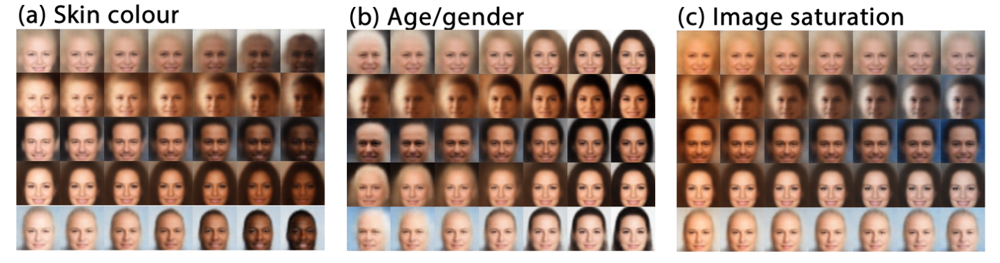

# Tighter and weighted bounds {#sec-tighterbounds}

The ELBO of @sec-variationalinference is the standard objective of latent variable models, but it is not the only possible one. This chapter presents two simple modifications, which answer two different problems. The importance-weighted bound makes the ELBO **tighter**, so that a model trained with an imperfect encoder gets closer to maximum likelihood. The $\beta$-VAE changes the **weight** of the regularization term, trading the likelihood of the data for a better structured latent space.

## Importance-weighted autoencoders {#sec-iwae}

The ELBO has a simple interpretation in terms of importance sampling (@sec-variationalinference): the evidence is the expected importance weight $w(z) = p_\theta(x, z) / q_\phi(z|x)$ of samples of the encoder, and the ELBO is obtained by moving the logarithm inside the expectation:

$$
    \log p_\theta(x) = \log \mathbb{E}_{z \sim q_\phi(z|x)} [w(z)] \geq \mathbb{E}_{z \sim q_\phi(z|x)} [\log w(z)] = \text{ELBO}(\theta, \phi)
$$

The ELBO takes the logarithm of **a single** importance weight. The **importance-weighted autoencoder** (IWAE) [@Burda2016] samples $K$ latent variables from the encoder, and averages their weights **before** taking the logarithm:

$$
    \mathcal{L}_K(\theta, \phi) = \mathbb{E}_{z_1, \ldots, z_K \sim q_\phi(z|x)} [\log \dfrac{1}{K} \sum_{k=1}^K w(z_k)]
$$

The average of the weights is the importance sampling estimate of the evidence (@sec-importance), which becomes more accurate when $K$ increases. For $K = 1$, $\mathcal{L}_1$ is the ELBO; $\mathcal{L}_K$ increases with $K$, and tends to $\log p_\theta(x)$ when $K \rightarrow \infty$ (we admit these results).

A tighter bound only helps when the ELBO cannot be made tight by training the encoder, i.e. when the true posterior lies **outside** the family of the encoder, for example a multimodal posterior approximated by a normal distribution. With the ELBO, the encoder fits the posterior with the reverse KL and settles on one mode (@sec-forwardreverse); with $\mathcal{L}_K$, a broader encoder covering all the modes becomes preferable, as the importance weights correct for its mismatch. The decoder is then less constrained to have posteriors that the encoder can represent.

In practice, the improvements brought by IWAE for training are modest, while the cost of each update is multiplied by $K$. Its main use today is the **evaluation** of latent variable models: the log-likelihood of test data, which cannot be computed exactly, is estimated with $\mathcal{L}_K$ for a large number of samples, for example $K = 5000$.

## $\beta$-VAE {#sec-betavae}

### Weighting the regularization

The loss of a VAE balances two terms that pull in opposite directions: the reconstruction loss, which wants the latent representations to keep all the information about the input, and the regularization loss, which wants them to stay close to the prior (@sec-vae). The **$\beta$-VAE** [@Higgins2016] makes this balance explicit with a single hyperparameter $\beta \geq 0$ weighting the regularization:

$$
    \mathcal{L}_\beta(\theta, \phi) = \mathbb{E}_{z \sim q_\phi(z|x)} [- \log p_\theta(x | z)] + \beta \, \text{KL}(q_\phi(z|x) || p_\theta(z))
$$

For $\beta = 1$, this is the negative ELBO of a standard VAE. For any other value, the loss is no longer a bound on the log-evidence: the $\beta$-VAE deliberately gives up some likelihood of the data in exchange for a different structure of the latent space.

* With $\beta > 1$, the encoder is pushed harder towards the prior $\mathcal{N}(\mathbf{0}, \mathbf{1})$, whose dimensions are **independent**. The latent space is more regular, and its dimensions tend to capture distinct, independent factors of variation of the data: this is called a **disentangled** representation. In @fig-betavae, moving along a single latent dimension changes only one property of a face, such as its skin colour, its apparent age or gender, or the saturation of the image, while the others stay the same. The price is a lower quality of the reconstructions, which become blurrier, as less information about each input is allowed in the latent space.
* With $\beta < 1$, the reconstructions are sharper, but the latent space is less regular, and the model gets closer to a classical autoencoder, which cannot generate new data (@sec-vae).

{#fig-betavae}

Disentanglement is not guaranteed: which factors end up in which dimensions depends on the data, the architecture and the training, and is difficult to control without supervision. But the $\beta$-VAE shows clearly that the regularization term is not only a technical by-product of the ELBO: it shapes the latent space.

### Posterior collapse

The opposite failure happens when the regularization wins completely. If the decoder is powerful enough to model the data on its own, for example an autoregressive decoder that generates an image pixel by pixel, or text word by word, it does not need the latent variables to reconstruct the input. The cheapest way to minimize the loss is then to make the encoder **equal to the prior** for every input, $q_\phi(z|x) = p_\theta(z)$: the regularization loss is zero, and the decoder ignores $z$ completely. This is called **posterior collapse**: the model may generate good data, but its latent variables carry no information about the inputs, and the encoder is useless.

Posterior collapse often happens early in training, when the decoder learns faster than the encoder: at that point, the latent variables are not informative yet, and the regularization loss pushes them towards the prior before they become useful. A simple remedy is **KL annealing**: training starts with $\beta = 0$, i.e. a plain autoencoder, so that the latent variables first learn to carry information about the inputs, and $\beta$ is progressively increased to 1 during training. Other remedies limit the capacity of the decoder, or only penalize the KL divergence above a minimal amount of information per latent dimension.

## Summary of the part

This part introduced the second way of dealing with intractable distributions in this book, after the sampling methods of the previous part: **variational inference**, which replaces the computation of a posterior by an optimization problem.

* Latent variable models describe high-dimensional data, such as images, with a few hidden variables living on a low-dimensional manifold (@sec-latentvariables). Generating data is easy, but inferring the latent variables of an observation, an inverse problem, requires the posterior, which is intractable.
* Variational inference approximates this posterior with an encoder, trained together with the decoder by maximizing the evidence lower bound (@sec-variationalinference): the encoder closes the gap of the bound, while the decoder raises the evidence.
* Variational autoencoders implement this idea with neural networks and normal distributions (@sec-vae); the regularization of the latent space makes it smooth enough to generate new data.
* The gradient of an expectation over the encoder is obtained either by reparameterization, or with the score-function estimator, which also trains reinforcement learning agents (@sec-gradientestimators).
* The ELBO can be made tighter with several importance samples, or reweighted to trade the likelihood of the data for a more structured latent space (this chapter).

VAEs have a well-known weakness: their samples are often blurry, as a single decoder has to map a simple latent distribution onto the whole data distribution in one step. The deep generative models of the next part relax this constraint in different ways. In particular, diffusion models can be seen as hierarchical VAEs with many latent layers, whose encoder is not learned but fixed to the progressive addition of noise, and which are trained with exactly the ELBO of this part.
